这次陷入了一段朦胧的感情之中，以下作分析。

 

自上大学以来我就是活在一个小环境里，这里有才之人很少，四年里自己心目中的理想女孩子没见到一个，最近再加上自己前途未卜，梦想也不知道会不会实现，心中总是很焦虑，所以当她出现的时候,我就有一种想要得到的欲望，即便是她说了她会以貌取人之后我还是无法放下她，对她很依赖，以为她是最好的, 其实“天涯何处无芳草”，最重要的是和她的聊天之中都可以感受到她没用“心”。

在一个不太好的学校里呆了四年，四年里周围有思想的女孩子寥寥无几，所以当我接触到一个这个小环境之外的有思想的女孩子后，我便会想去得到她，这是一种不理智的行为，还是应该多见识一些这样的女孩子之后综合比较后再做决定吧。老在小环境里生存着也是害人不浅啊，最要命的是限制了自己的视野，这不利于自己的决策，以后应当尽可能低扩大自己的视野。

 只有站得高，才能看得远。观千剑而后识器，操千曲而后晓声。

她喜欢读书，比我早踏入社会，感觉很有思想，追求独立，个性好强。

她刚经历完相亲失败的痛苦，所以她对我的感觉应该都是在“境遇性爱情”下产生的吧，结果等她恢复过来的时候她发说说

那天早上，她在我一上线的时候就给我发照片，可见如果她真的在乎，怎么会对你的信息半天不回或者是忽视呢？

在我发照片给她看的时候她只顾看照片（在乎相貌），忽视我对自己座右铭及其价值观的阐述。（这种人太自我，）

叫她去看人性的弱点，她说看过了，就不会想想自己有没有熟读精思吗？

容易发脾气，说改不了！！！

我发的0.9999……=1的创作，7个人，连南科大的老师（很多平时没什么联系的QQ好友）都评论了，她没评论

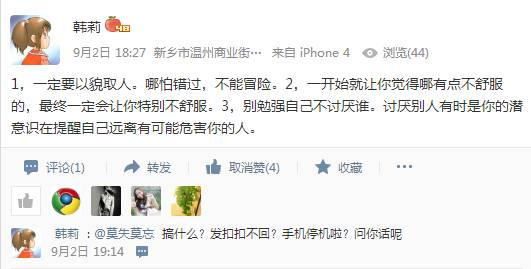

（标点错误：数字后面的“，”号，合适吗？）

她并不是我心目中理想的那种文静的女孩，她上很浓的妆，画眉+口红，一点都不符合自己心目中那种清新淡雅的要求。

她发太多说说，大事小事都发，有点随意（用APP做了个口红效果，好夸张，看了就像风尘女子一样，竟然还发出来！！！一点都不讲究美！），从说说内容上可以看出来她很感性，同样可以看出来她不怎么追求完美。

 她看练霓裳（近两年来拍的烂片），我却是个甘愿落伍之人。

她透露了我给她产生过不好的感觉，也许我的行为确实给她造成了这样的感觉，但是我从不是故意的，每次和她聊天我都是用心的。我感觉她好像是不会设身处地为别人着想，QQ聊天的时候有时一句话好几分钟才回复，对于我问的有些问题干脆不回答，我认为这是一种不礼貌的作法，她没对我付出“真心”，这也显得她做事不注重细节，她并不是很重视我。

第一次加QQ的时候，她叫我加她，但实际上她设了密码问题（问她的名字是什么），根本加不了，粗心！！！

（我的用户调研，她的朋友回了，她不回！！！）

很看重金钱基础上的好的物质生活（过不了清贫的生活），要是你穷一点，落魄一点，她可能就走掉了。From：发现老公外遇之后，“拿走钱”离开，可以感到安慰；找不到喜欢的人就找个有钱点的，这样子不会受苦。

她找到喜欢的人又怎么样，如果没有好的物质基础（她受不了清贫的苦），她最终还是可能离去。

她的择偶观是矛盾的。

有一定的哲思，但还是性情中人，感情用事。

她喜欢旅游，所以物质基础对她而言是必须看重的。

我回复了她的很多说说和日志，但是她只在我们刚认识的第二早回复了我的一条说说，仅仅如此。

性情中人（发太多说说），做事情之前考虑得不够清楚，之后疑虑重重（From：之后回来删自己发过的说说）

看书之类 + 去她想去的地方（她的爱好）

爱人，永远无法确定是否会属于自己，哪怕是婚后都可能散去。

一个南科大的女生两周内看了我的QQ空间两次啊（之前一直没聊过），她，一个多月了，貌似才勉强看了一次（而且我们还聊了那么多次）。可见我对她的“重要性”！！！

很多时候，她经常忽略我的观点，就像没看到一样；只按照她的想法转而说别的事（只会考虑自己，自我自私表现），ke！！！！！

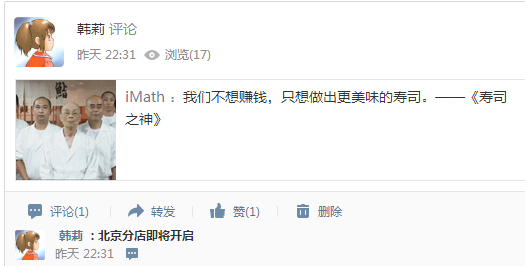

旅行，吃，乐

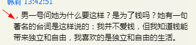

开森   桑心~~~

竟然会把爱情几乎作为生活的唯一目标。

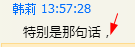

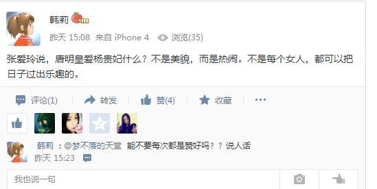

这次给她看我画的画，她看后只字不提；我再把之前她没记录的文章重发给她的时候也是一个“谢”字不提。

她的空间日志里有好多错别字，通常几个意思融合在一个段落里，可以看出来她不是一个追求完美的人。

她以貌取人，这是人之常情，不愿意接受我，所以我们不适合在一起。

她过惯了经常出差住酒店的生活，所以难以回到简朴的生活中来。

我“爱屋及乌”，她喜欢发说说，于是我就疯狂地每天看两三次QQ空间，只要她发说说，我就尽可能去评论，完全违背了自己平素理智的常态，后来想自己的那些评论确实有些被感情冲昏头脑后“危于多言”的迹象。最后这两天她没怎么发说说了，我呢看了几次不见，然后心中的这种渴望越来越强烈，结果致使我只要一有空就马上看空间，然后还是看不到她发的说说，心里边很失望、失落，我太依赖她了！！！人一反常态的时候是不可能保有多少理智的，万物只能在静中求得！

我发的说说她很少关注，基本上也不怎么给评论，她对我的评论的回复也没花多少心思。她也没有把我设为特别关注的人，她好像也没有认真地看过我的QQ空间。QQ空间里我在意她91分，她在意我85分。

（工作最重要，其他不重要的人都不会及时回复，但如果是自己真心在意的人呢？这下子会及时回复了吧？？？）

我推荐她看的电影，不知道看了没有，理想中看了之后必须和我交流感想。不知道她是否看了我发给她看的文章，反正之后也没给我反馈。

 （我给她发了那么多文章，她给我发了什么东西了吗？）

 

我，相貌不佳，还没有独立的经济能力，又是大学退学，所以这个女孩子没有选择我，我很理解，然后再加上我的梦想还没有实现，我还想要作很多折腾，所以我也不能和一个女孩子在这个时候好，因为好上以后脑子里很多时候都是和她有关的思想，这就使我不能集中精力在自己所要做的事情了，也许还会失去自由。

 

切莫爱屋及乌。“乌”点恰能反映两个人的差异，两个人性格不合之处由此而生，婚后一切吵闹可能由此而生。

作此篇，希望铭记教训。不忘初心，不爱屋及乌，方得始终！

要找的人:与我息息相通者（最重要的是要与吾交心，息息相通，心有灵犀一点通，注重细节，体悟他人，有思想，追求美，可以乐在农村，朴素，清新淡雅，平淡之美，不淡妆浓抹。（起风了：菜穗子   一样的女子      棒球大联盟 ： 吾朗继母）  清水出芙蓉，天然去雕饰。

看得起农村人，不骂农村人脏，入乡随俗（三哥那些个媳妇）

 

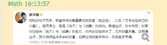

no feedback（所以，至此可以不必再纠结了！！！）

文艺女~~~~

她脾气暴躁（QQ空间日志里都会有“我吃你的还是喝你的了”），不到一分钟就和人吵架

比较自我，追求独立，好动，爱旅行，文艺女，性情中人，感情用事。

似乎不懂得奉献，也不会轻言道谢，不懂得奉献。

开始的时候还以为是知音人，后来渐渐地发现不能与吾合奏。（我发给她的富有哲理的句子，她没有任何回应，而是说别的）

发文章这件事情的起因：她的朋友看了我发过去的文章觉得好（她自己或许根本没有认真看那篇文章），她觉得不容错过，所以才叫我之后看到的话也都发过去。

我问她在沙漠里脚上套的是什么东西，根本不做回答！！！（忽略我的 问题！！！！！！

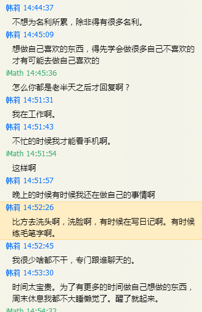

 

 

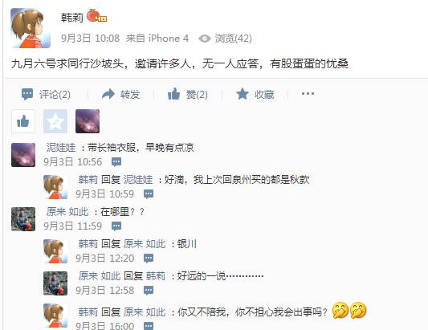

 

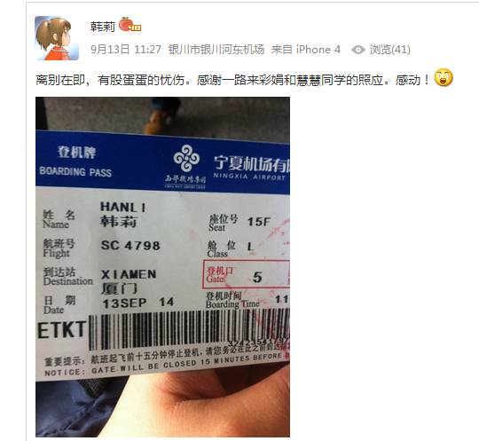

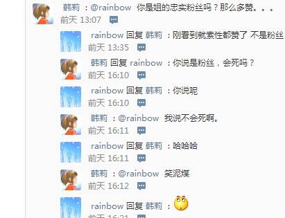

 

 

 

 

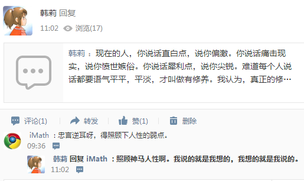

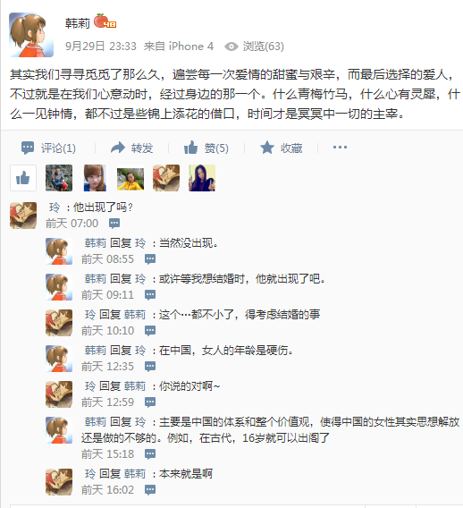

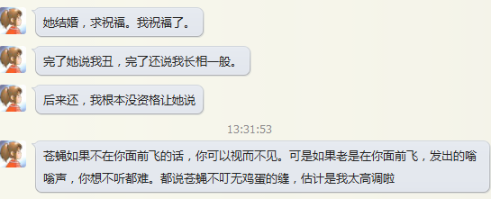

她很在乎物质，外向，好动，文艺（和文艺的人相处要注意），脾气暴躁，会为一件小事而纠结半天。

交流到后面，发现她在思想上也不能及我之高度。而且脾气还那么不好。任性。

妻子会影响丈夫成为怎样的人——行动决定命运

| 韩莉 14:35:59   我认为这文章就是表达这个意思。所谓知足常乐不外是对自己的无能为力找的一个很美丽的外衣罢了 |
| - |
| 韩莉 14:44:17   自主，其实是需要很强大的物质支撑的 |
| iMath 14:44:31   就是这个意思 |
| 韩莉 14:44:37   不想为名利所累，除非得有很多名利。 |
| 韩莉 14:45:09   想做自己喜欢的东西，得先学会做很多自己不喜欢的才有可能去做自己喜欢的 |
| iMath 14:45:36     |

| 怎么你都是老半天之后才回复啊？ |
| - |
| 韩莉 14:51:31   我在工作啊。 |
| 韩莉 14:51:43   不忙的时候我才能看手机啊。 |
| iMath 14:51:54   这样啊 |
| 韩莉 14:51:57   晚上的时候有时候我还在做自己的事情啊 |
| 韩莉 14:52:26   比方去洗头啊，洗脸啊，有时候在写日记啊。有时候练毛笔字啊。 |
| 韩莉 14:52:45   我很少啥都不干，专门跟谁聊天的。 |
| 韩莉 14:53:30   时间太宝贵。为了有更多的时间做自己想做的东西，周末休息我都不大睡懒觉了。醒了就起来。  |
