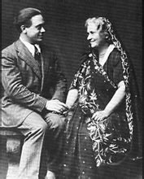
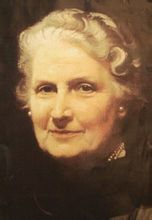

[编辑本段](http://baike.baidu.com/view/1682945.htm#)简介
--------------------------------------------------

　　玛利亚·蒙台梭利博士是教育史上一位杰出的幼儿教育思想家和改革家、意大利历史上第一位学医的女性和第一位女医学博士。 1870 年 8 月31日玛利亚 · 蒙台梭利出生在意大利[安科纳](http://baike.baidu.com/view/786753.htm)( Ancona )地区的基亚拉瓦莱( Chiaravalle )小镇。父亲亚历山德鲁 · 蒙台梭利是贵族后裔和性格平和保守的军人，母亲瑞尼尔·斯托帕尼是虔诚的天主教徒博学多识、虔诚、善良、严谨、开明。作为独生女的蒙台梭利深得父母的宠爱，受到良好的家庭教育。因此从小便养成自律、自爱的独立个性，以及热忱助人的博爱胸怀。 　　玛丽亚·蒙特梭利是二十世纪享誉全球的幼儿教育家，她所创立的、独特的幼儿教育法，风靡了整个西方世界，深刻地影响着世界各国，特别是欧美先进国家的教育水平和社会发展。蒙特梭利教育法的特点在于十分重视儿童的早期教育，她为此从事了半个多世纪的教育实验与研究；她的教学方法从智力训练、感觉训练到运动训练，从尊重自由到建立意志，从平民教育到贵族教育，为西方工业化社会的持续发展，提供了几代优秀的人才基础。《西方教育史》称她是二十世纪赢得欧洲和世界承认的最伟大的科学与进步的教育家。 　　1952 年 5 月 6 日逝世于[阿姆斯特丹](http://baike.baidu.com/view/31504.htm)，享年82 岁。[编辑本段](http://baike.baidu.com/view/1682945.htm#)求学历程
----------------------------------------------------

　　蒙台梭利五岁时，因父亲调职而举家迁居罗马，开始了她的求学生涯。蒙台梭利虽是独生女，但父母并不溺爱她，而是注意对她的教育，如要求她守纪律,同情和帮助穷苦和残疾的儿童。因此她幼年时就特别关心那些不幸的儿童，尽可能地帮助他们。玛丽亚从孩提时代起，她的自尊心就非常强烈。有个老师对学生很严格，很权威，不尊重,不关心。有一次这位老师曾用略带侮辱的口吻提及她的眼睛，为了抗议，玛丽亚从此不在这老师面前抬起“这对眼睛”，她认为孩子也是一个人，也需要受到尊重。在安科纳上小学时，蒙台梭利也表现出关心、帮助其他儿童的倾向,对教师轻视儿童和侵犯儿童人格尊严的态度和行为极为反感。 　　十三岁时，她选择了多数女孩不感兴趣的数学，进入米开朗基罗工科学校就读。且于 1886 年时以最优秀的成绩毕业，奠定了数学基础。 中学毕业后，在进入国立达文奇工业技术学院，学习现代语言与自然科学。 　　十六岁（ 1886 年）进入工科大学，专攻数学。因后来发现对生物有兴趣，于1890年进入罗马大学读生物。读了生物，蒙特梭利觉得对医学有了浓厚的兴趣，她做了一个前所未有的决定 -- 学医。“女孩子学医”在当时保守的欧洲社会里，可谓荒谬与决不可能。但蒙台梭利不顾父亲的反对（中断经济上的资助）以及教育制度的限制,凭着她不屈不挠的努力，终于获准进入医学院研读。由于她是班上唯一的女生，时常单独留在解剖室做实验，与死尸独处：再加上家人的反对，沉重的压力，无人可倾诉。不过蒙台梭利却能愈挫愈勇，因而培养出异于常人的毅力，为她日后献身儿童教育，奠定了成功的基石。 　　26岁获罗马大学医学博士学位，成为罗马大学和意大利的第一位女医学博士。随即在罗马大学附属医院任精神病临床助理医生，诊断和治疗身心缺陷儿童，开始对低能儿童的研究发生了兴趣。她深入研究和检验了伊他（ Jean itard ）和塞贡（ Edward Seguln ）的教育低能儿童的方法，在此期间，曾去巴黎和伦敦参观和访问有关低能儿童的教育机构。[编辑本段](http://baike.baidu.com/view/1682945.htm#)贡献
--------------------------------------------------

玛利亚·蒙台梭利

　　蒙特梭利在担任助理医生期间（ 1896-1898），主要是治疗[智障](http://baike.baidu.com/view/51979.htm)儿童。当时意大利把智障儿童与精神病患者一起关押在疯人院里。室内没有玩具，甚至没有任何可供儿童抓握和操作的东西；管理人员态度恶劣，根本不组织任何活动。蒙特梭利对这些儿童的处境深表同情。通过观察和研究，她深深感到，这种医疗方法只能加速儿童智力下降。从此，她对智障儿童的治疗和教育问题产生了兴趣，决心用自己的智慧去帮助他们。为了找到一种适合智障儿童的教育方法，蒙特梭利认真研究了法国心理学家伊塔和塞根的教育思想和方法。她亲自翻译他们的著作，亲手抄写，以加深理解，伊塔和塞根是19世纪训练心理缺陷儿童的著名人物。伊塔曾在1800年对一个早年被丢弃后在森林中长大的“野孩”进行治疗，并发表了实验报告。塞根继承了伊塔的事业，提出“生理教育法”，主张对身体有残缺和智力落后的儿童进行感官训练，充分发挥他们的生理功能，促进其智力和个性的发展，他著有《痴呆的精神治疗、保健与教育》和《痴呆及其生理治疗方法》。伊塔和塞根的教育思想和方法深深地影响了蒙特梭利。她认为这就是“科学的教育学”的先导。 　　1898年，在都灵召开的教育会议上，蒙特梭利发表了以《精神教育》为题的演讲，阐述了对智障儿童教育的思想和方法。她指出：“儿童的智力缺陷主要是教育问题，而不是医学问题”并向社会呼吁，智障儿童应当与正常儿童一样享有同等受教育的权利。蒙特梭利发现，智力缺陷儿童的心理水平一般比同龄的正常儿童差，但与年龄更小的正常儿童有很多共同的特点，如感官发育不完善，动作不协调，走路不稳定，不能从事脱衣服之类的活动，没有掌握语言，注意力不集中等。因此她确信，自己为智力缺陷儿童设计的教育方法也适用于正常儿童，而且会获得更显著的效果。于是，她决心献身于正常儿童的教育工作。 　　在这种思想支配下，1901年，蒙特梭利离开精神治疗学院，再次回到罗马大学，进修哲学、普通教育学、实验心理学和教育人类学，以扩大和加深自己的理论基础，进一步研究教育正常儿童的方法，为以后从事正常儿童的教育打下了坚实的基础。 　　1904-1907年，她担任罗马大学人类学教授，并在讲义的基础上整理成《教育人类学》一书，于1908年出版。 　　1907 年蒙台梭利在罗马贫民区建立“儿童之家”。招收 3 — 6 岁的儿童加以教育，她运用自己独创的方法进行教学,结果出现了惊人的效果；那些“普通的、贫寒的”儿童，几年后，心智发生了巨大的转变，被培养成了一个个聪明自信、有教养的、生机勃勃的少年英才蒙台梭利崭新的、具有巨大教育魅力的教学方法，轰动了整个欧洲，“关于这些奇妙儿童的报道，像野火一样迅速蔓延”。人们仿照蒙台梭利的模式建立了许多新的“儿童之家”。1909年，蒙台梭利写成了《运用于儿童之家的科学教育方法》一书，1912 年这部著作在美国出版，同时很快被译成 20 多种文字在世界各地流传；100 多个国家引进了蒙台梭利的方法，欧洲、美国还出现了蒙台梭利运动，1913 年 --1915 年，蒙台梭利学校已遍布世界各大洲。到四十年代，仅仅美国就有2000多所。蒙台梭利在世界范围内引起了一场幼儿教育的革命。 　　1929年，“国际蒙特梭利协会”在丹麦成立，蒙特梭利任会长。此后，10多个国家相继成立了“蒙特梭利学会”。从1929年至1951年蒙特梭利逝世前，“国际蒙特梭利协会”召开了9次大会，蒙特梭利连任9届大会主席。到1952年蒙特梭利逝世时，欧美和印度等地都建立了蒙特梭利学会，“儿童之家”则遍及世界各地。 第一次于1929年在丹麦的艾尔斯诸举行； 第二次于1932年在法国的尼斯； 第三次于1933年在荷兰的阿姆斯特丹； 第四次于1934年在意大利的罗马； 第五次于1936年在英国的牛津； 第六次于1937年在丹麦的哥本哈根； 第七次于1938年在苏格兰爱丁堡； 第八次于1949年在意大利的山瑞穆； 第九次于1951年在英国的伦敦。 蒙特梭利为促进儿童智力发展和实现世界和平奋斗了一生。她生前曾经获得许多荣誉和奖励，反映了世界各国人民对她的热爱与尊敬。例如，法国授予她 “荣誉社团会员勋章”；她的故乡安科纳和米兰等地授予“荣誉公民”的称号；荷兰阿姆斯特丹大学授予她“荣誉哲学博士”学位；苏格兰教育研究院授予她“荣誉院士”职位。 　　1949、1950、1951年连续3年获得“诺贝尔和平奖”候选人的资格。[编辑本段](http://baike.baidu.com/view/1682945.htm#)教育理念
----------------------------------------------------

### 概述

　　蒙台梭利认为干涉儿童自由行动的教育家太多了，一切都是强制性的，惩罚成了教育的同义词。她强调教育者必须信任儿童内在的、潜在的力量，为儿童提供一个适当的环境，让儿童自由活动。她特制了很多教具，如小型的家具、玻璃、陶瓷等小物件，供儿童进行感官练习。### 儿童发展观

　　蒙台梭利对于儿童心理发展的看法，是她全部教育学说的基础。过去许多人批评她在这个问题上纯属遗传决定论，其实并不尽然。纵观蒙台梭利的全部学说，她认为儿童的心理发展既不是单纯的内部成熟，也不是环境、教育的直接产物，而是机体和环境交互作用的结果，是“通过对环境的经验而实现的”（蒙台梭利：《有吸收力的心灵》，1949年英文版，第97页）。蒙台梭利肯定，创造良好的环境，采取正确的教育措施，及早进行教育，丰富儿童的经验，可以消除和防止智力落后的现象。? 　　具体地说，蒙台梭利首先强调的是人和遗传素质和内在的生命力。她说：儿童的“生长是由于内在的生命潜力的发展，使生命力显现出来，他的生命就是根据遗传确定的生物学规律发展起来的”。对儿童来讲，生命力表现为自发冲动，因此她把对儿童的自发冲动是压制还是引发作为区分好坏教育的分水岭，对旧学校压抑学生自发冲动的做法予以猛烈抨击。她说：“在这样的学校里，儿童像被钉子固定的蝴蝶标本，每人被束缚在一个地方——桌子边”，这对儿童的发展是不利的。在身体方面，导致骨骼畸形；在心理方面，教师为了把零碎干瘪的知识塞进儿童的头脑，用奖励和惩罚诱逼儿童集中注意和缄默不动。蒙台梭利否定奖励、惩罚等强化的作用，强调儿童的内在力量、主观能动性；要求环境(刺激)要适合儿童的内在需要和兴趣，认为儿童不是消极被动地接受外界刺激，他们每个人都有自己的内部结构、变化和发展。 　　蒙台梭利又认为，生命力的冲动是通过儿童的自发活动表现出来的，“生命是活动的，只有通过活动才能发展”，为了使儿童的生命力和个性通过活动得到表现、满足和发展，就必须创造适宜的环境。蒙台梭利为“儿童之家”设置了一个良好的环境：有一个较大的花园，学生可自由进出；轻巧的桌椅，4岁儿童便能随意搬动；教室里放有长排矮柜，儿童可任意取用放在里面的各种教具。这样的环境设置明显地是服务于儿童的自由活动的。 　　从个体心理发展过程来看，蒙台梭利强调通过自发活动表现出来的生命力发展呈现一种节律(阶段)：童年是个性形成最重要的时期，“没有比这个时期更需要智力方面的帮助”了（蒙台梭利：《有吸收力的心灵》，第27页）。而在童年期，儿童的各种心理机能也存在不同的发展关键期，例如，2～6岁是对良好的行为规范的敏感期，2～4岁是对色、声、触摸等感觉的敏感期。某种感觉能力在相应时期内出现、消失，当它们出现时，能最有效地学习；忽视了敏感期的训练，就会造成难以弥补的损失，这正是很多低能儿童之所以低能的主要原因。因此，环境和教育在儿童心理发展中又是举足轻重的。蒙台梭利说，环境问题在她的教育方法体系中占有举足轻重的地位。 　　蒙台梭利还认为，不同的个体有不同的发展节律，教育要与儿童发展的敏感期吻合，就必须用不同的教育来适应不同的成熟节律，因此她十分强调个别教学，让儿童各按自己的需要自由活动，使个性得到充分发展。 　　应该如何看待蒙台梭利的儿童发展观?我们认为，蒙台梭利由于缺乏科学的世界观和方法论为指导，未能正确阐明遗传、环境和教育三者之间辩证统一的关系，她的全部学说的基点是儿童内在生命力的自发冲动，把教育看作仅仅是儿童潜能(本能)的展现，虽然她也注意到环境和教育的重要性，但总的说来只把它们放在从属于遗传的地位，因而夸大了儿童的自发冲动和自由活动在教育中的重要性。尽管如此，蒙台梭利多少看到了心理发展是遗传与环境、教育协同作用的结果，证明了教育可以纠正智力落后，更能使正常儿童智力发展，提倡早期教育，这比当时那种认为“智力固定不变”，否认儿童早期认识发展必要性的流行看法要接近真理。她尊重幼儿自身发展的特点，反对用成人的思想不适当地妨碍幼儿的心理发展，注意到儿童活动的智力价值和内部动机在学习上的意义，这些都有合理之外。至于蒙台梭利关于敏感期和儿童心理发展阶段论的思想更已被心理学家广泛承认。蒙台梭利的教育工作之所以取得一定的成功，是与她对儿童心理有一定的正确理解分不开的。[编辑本段](http://baike.baidu.com/view/1682945.htm#)初级教学法
-----------------------------------------------------

### 适用范围

　　蒙特梭利的初级教学法适用于3～6岁的儿童，分为以下四个方面### 体育(筋肉练习)

　　为了促使幼儿生理的正常发展，使他们的日常生活动作熟练化，蒙台梭利十分重视幼儿的肌肉练习，她除了顺其自然，让幼儿通过坐、起、走、穿衣、脱衣、取物、照料动植物等行为得到良好的体育练习外，还发明了种种器具，如螺旋梯、摇椅等等，帮助幼儿进行训练，还编制了体操乃至于呼吸、唇、舌、牙等方面的特别练习。?### 感官教育

　　这是蒙台梭利方法中的中心环节，下文将予重点述评。蒙台梭利认为，感官训练既为儿童将来的实际生活作准备，又是儿童接受知识和发展智力的基础。### 知识教育

　　结合感官训练，提早让儿童接受读、写、算、音乐等方面的教育。同时，通过谈话发展儿童的语言能力。?### 实际生活练习

　　如穿衣、个人卫生、室内整理等，使儿童不需别人帮助而能自己处理日常生活上的事项，培养其独立性。不难看出，蒙台梭利上述做法对于幼儿教育来说有许多可取之处。至于蒙台梭利的感官教育，还须作进一步的分析。[编辑本段](http://baike.baidu.com/view/1682945.htm#)感官教育
----------------------------------------------------

### 概述

　　感官教育(感觉训练)在蒙台梭利的教育体系中占最重要的地位，也是她的教育实验的主要部分，《蒙台梭利方法》一书用1/4的篇幅来论述感官教育。### 感官教育的重要性

　　蒙台梭利认为，对于幼儿来说，是“刺激，而不是对事物的思维，吸引着他的注意”，因此感官教育符合幼儿心理发展的需要，是重要的；蒙台梭利还认为，“智能的培养首先依靠感觉……感觉练习是初步的基本的智力活动。通过感觉的练习使儿童能辨认、分类、排列顺序，这就是智能和文化学习”（蒙台梭利：《高级蒙台梭利教学法》，第1卷“教育上的自发活动”，1917年英文版，第198～205页）。算术、书写、言语，甚至实际生活能力、良好秩序的规范都由感官教育引出。还有，通过感官教育可以在早期发现某儿童在感觉机能的某方面所存在的欠缺，以便及时治疗和纠正。### 感官教育的实施

　　首先，蒙台梭利根据儿童对不同的感官刺激存在不同敏感期的原理，将感官训练细分为触觉、视觉、听觉等的训练，每种训练单独进行，并创制了一套教具，共26种，供除嗅觉外的感官练习之用。例如，供视觉练习用的一种教具是：三组圆柱，第一组高相等而直径不同，第二组直径相同而高不等，第三组高与直径均不同，要求儿童分别将其嵌入钻在木盘上的相应孔中。 　　其次，蒙台梭利认为，感官教育要给儿童以活动的自由，成人尽量不予干涉，让儿童各人根据自己的意愿和进度选择(按等级顺序排列的)教材、教具，并自行操作，只有这样，才能激发儿童的内在动机，同时使教具与儿童的敏感期相配合，达到最好的学习效果。蒙台梭利创制的教具能控制错误，她主要是通过这套教具让儿童进行自我教育。例如，上面讲到的视觉教具，如果儿童把一个圆柱体放进一个比它小的孔，则放不进；若放进一个比它大的孔，则到最后，终将至少有一个圆柱体放不进孔中，整个过程只要有一个错误，就需重新调整。所以说：“这套教具控制了每一个错误，要求儿童能进行自我纠正”。 　　再次，根据生命力活动服从一定节律的原理设计的整套感官训练教具，试图按儿童的水平和兴趣，根据物体的外形特征(形状、颜色、大小、声音……)提供有等级的顺序的系统刺激(由浅入深，由易到难、由少到多……)以引起儿童的自由反应和自导学习。### 对感官教育的评价

　　近年来有不少实验证明认识能力的培养应从感觉训练开始，感觉发展得越好，带来的外界信息越多，认知能力就越能得到发展，因此不少心理学家和教育家认为蒙台梭利强调儿童的感觉训练是符合人的认识发展规律的。有些实验研究还证明蒙台梭利学校的儿童经过“斯坦福—比奈智力测验”，智力一般有所提高，在知觉方面尤佳。从教育史角度讲，蒙台梭利方法确有创见。例如，卢梭的自然教育论以自然后果作为道德自我教育的方法，蒙台梭利将其从德育扩大到智育，主张让儿童在自我操作和摸索中，通过“教具的控制错误”，达到智慧的自我教育，这对以后的个体化教学是一个启发。又如文字书写的学习，裴斯塔洛齐主张通过绘画对形的掌握过渡到文字的书写，蒙台梭利则让幼儿从进入“儿童之家”的第一天起，就通过有计划的感官训练，在不知不觉之中“爆发式”地学会书写，效果比常规的要好得多。 　　当然，蒙台梭利的感官训练也存在着明显的缺陷，这主要是“感官的单独刺激，对特定材料的有关刺激果然敏锐了。但由于强调单一的器官的孤立训练，必然使个体与丰富的社会生活和现实世界相脱离，影响儿童全面地认识世界，从而也就影响儿童的认识发展，因为知觉的整体并不是色、形、声等感觉的简单总合。其次，蒙台梭利进行感觉训练所用的教材、教具过于死板划一，都是按严格的分类、等级的排列、固定的方法进行的，每种教具只有一个目的，不能变化，不能用来做游戏、发展语言或进行其他创造性的独立活动，这必然不利于发展儿童的想象力、创造力、情感和语言等。此外，单纯掌握物体的外形特征以及大小、长短高低等的顺序，并不一定能促进概念的形成，因而未能有效地培养儿童的思维。[编辑本段](http://baike.baidu.com/view/1682945.htm#)论儿童的自我教育与教师作用
-------------------------------------------------------------

　　蒙台梭利崇拜儿童的自发冲动，要求给儿童以极大的自由活动权。因此，她试图让儿童通过作业的方式达到自我教育。所谓作业，就是儿童根据个体发展的内在需要，按照自己的兴趣自由选择的一些活动，或者是感官练习，或者是算术练习，或者摆弄字母卡片，或者练习穿衣和脱衣动作等等。 　　蒙台梭利认为：通过作业，儿童自然就“学会谨慎，学会自觉，学会指挥身体的行动”；通过作业这种自由选择的个体活动方式，学会依靠自己、学会尊重他人，使“儿童之间没有妒忌，没有争吵”，从而培养“绝对平静”的气氛，良好的秩序由此而来；通过作业，让儿童学会自我约束，为意志力形成作准备，推动儿童服从。可见，蒙台梭利所主张的是从自由经过作业到自觉秩序和服从，从而实现让儿童自我教育的目的。 　　既然在蒙台梭利教育体系中儿童的自我教育是主要教育方式，那么教师起什么作用呢?蒙台梭利认为，教师的首要任务是用科学的态度、科学的方式去观察、研究“自然的儿童”，真正了解儿童的本来面目，从而揭开生命发展的“秘密面纱”，探讨生命的“深刻真理”。其次，在真正了解和认识儿童的前提下，教师应成为儿童自我发展的“援助者”、优异环境的“创造者”。也就是说，教师的工作除了消极的观察，还应该积极地引导儿童，但这种引导并不是那种直接教给儿童方法和观念的传统做法，而是给儿童提供活动的环境和作业的教具，使儿童通过自己的作业达到自我发现和发展，同时，教师应该阻止儿童的不良行为，免得危及儿童本人和其他儿童的发展。再次，教师应无限热爱儿童，献身教育事业，不断完善自己，以自己的完美形象作为儿童自我教育的榜样。 　　蒙台梭利通过作业把自由与纪律、活动与教育协调起来的做法是一个有意义的尝试，她要求教师以身作则、研究儿童、引导儿童，这对于提高教师素质也有积极意义。但是，由于蒙台梭利把儿童的天性理想化，夸大了儿童的自发冲动和自由活动在教育中的重要性，因而也就夸大了儿童自我教育的作用和意义。这就决定了在蒙台梭利的教育体系中，教师的主要职能是被动、消极的，教师的主导作用，尤其是直接传授知识和说理方面的作用就不能充分发挥。[编辑本段](http://baike.baidu.com/view/1682945.htm#)生平
--------------------------------------------------

### 成长阶段（1870～1886）

　　1870 意大利独立，八月三十一日，玛利亚·蒙特梭利出生于意大利安科纳省的希亚拉瓦莱镇。父亲为亚力山卓·蒙特梭利，母亲为雷奈德·史托普尼。 　　1875 玛利亚·蒙特梭利五岁，举家迁居罗马。 　　1876 玛利亚·蒙特梭利进入公立小学一年级就读。 　　1883～86 进入米开朗基罗技术学校（高中） 。 　　1886～90 进入达文奇工业技术学院，最喜欢的学科为数学。 　　1890～92 以杰出成绩就读于罗马大学。 　　1892～96 进入罗马大学医学院就读。1896年毕业，成为意大利第一位女性医学博士。### 准备阶段（1896～1906）

　　1896 担任罗马大学附设医院―San Giovani Hospital之助理医师。在柏林举行的国际妇女会议上，以意大利代表身份出席会议。 　　1897 义务担任罗马大学精神医学科临床教学之助理医生。 　　1898 在社林举行之教育会议上演说，并于罗马出版此演讲文《社会的不幸与科学上的新发现》。儿子马里欧·蒙特梭利诞生。 　　1899 在意大利开始为期二星期的演讲旅行，演说《新女性》与《现代慈善事业：儿童与和平》，获杰出医疗服务奖。 　　1900 担任罗马国立启智学校校长。 　　1901 辞卸校长一职，重回罗马大学修读哲学。 　　1902 受邀于拿坡里教育学术会议上演讲。 　　1904～1908 任罗马大学教育学院之自然科学与医学课程教授。### 启蒙阶段（1907～1909）

　　1907 在罗马的圣罗伦斯区设立第一所儿童之家。不久，第二所儿童之家相继成立。 　　1908 第三所儿童之家——米兰儿童之家成立。（依据史坦丁的说法：出版意大利版《教育人类学》） 　　1909 重要著作<蒙特梭利教学法>意文版。（意文版名称为《应用于儿童之家的幼儿教育之科学的教育方法》）。首次师资训练课程在罗马开课。### 拓展阶段（1910～1952）

　　1910 与墨西哥的修道院为地震受灾儿童成立学校。蒙特梭利协会于罗马成立。 　　1911 意大利与瑞士的公立学校经政府当局认可正式采用蒙氏教学法。巴黎成立蒙特梭利示范学校，英国也成立学校与蒙特梭利协会。 　　美国第一所蒙特梭利学校设立，为安妮乔治所创办。 　　辞去医师工作与大学教职而全力投入其教学方法的扩展。 　　1912 美国麦克劳杂志以《在美国出发为题》长篇介绍蒙特梭利。 　　《蒙特梭利教学法》英译本出版。 　　（依据史坦丁之说法《高级蒙特梭利教学法》两册出版） 　　1913 第一届国际训练课程在罗马开课。应麦克劳杂志之邀到美国演说，与卡内基大厅发表专题演讲。受邀至发明家爱迪生家中做客。 　　1914 荷兰儿童之家成立。著作《蒙特梭利手册》出版。克伯屈出版《检视蒙特梭利系统》严厉抨击蒙特梭利教育。 　　1915 于洛山机与圣地亚哥开设训练课程。 　　第三届国际训练课程在美国旧金山开课。 　　由美国教育协会赞助于旧金山的巴拿马太平洋世界博览会上演讲。 　　巴塞罗纳成立第一所蒙特梭利学校。 　　1916 在西班牙巴塞罗纳开训练课程。 　　1917 两册《高级蒙特梭利教学法》出版。访问荷兰，荷兰蒙特梭利协会成立。最后一次访问美国。 　　1919 首次在英国开始训练课程，为期两月。之后，每隔一年前往伦敦开课一次。 　　1922 受意大利政府任命为学校督导。 　　维也纳成立儿童之家。 　　1923 获英国达拉莫大学颁赠荣誉博士学位。 　　1924 于荷兰阿姆斯特丹开设四个月的训练课程。莫索里尼走访各国调查蒙特梭利学校蒙氏与其相遇。 　　1925 获意大利政府支持，蒙特梭利教育于意大利复生。 　　1926 前往南美洲阿根廷演讲。 阿姆斯特丹成立蒙特梭利中学。 在瑞士日内瓦的国家联盟演讲《教育与和平》。 　　1929 发表《宗教教育》专文。罗马成立师资训练学院。 　　国际蒙特梭利协会在柏林成立，第一届国际蒙特梭利会议于丹麦举行，会议主题为《新教育》。 　　1930 罗马开始为期六个月的训练课程。 　　1933 莫索里尼领导之法西斯党统治意大利，下令关闭所有蒙特梭利学校。致使蒙氏离开意大利，转而定居西班牙。 　　国际训练课程也于巴塞罗纳开课。（依据史坦丁说法：《童年的秘密》出版） 　　1936 西班牙内战，蒙氏转往荷兰。《童年的秘密》出版。 　　模范学校与训练中心于荷兰的拉兰成立。 　　国际蒙特梭利协会总部由柏林迁至阿姆斯特丹。 　　1939 在印度开设训练课程。《大地的儿童》、《青春期及青春期之后教育的改革》、《大学的功能》等出版。 　　于甘地、泰戈尔会见。 　　1939～1946 在印度有千名以上教师接受训练。蒙氏对婴幼儿发展产生浓厚兴趣。 　　1944 以《生命的前三年》为题演讲。于锡兰举办训练班。 　　1946 出版《新世界的教育》一书。 　　1947 应意大利政府之请回罗马重组蒙特梭利协会。 　　返回印度策划蒙特梭利大学，但因政治混乱而中止。 　　伦敦蒙特梭利中心成立。 　　1948 《吸收性心智》、《了解你的小孩》、《发现儿童》等著作出版。 　　1949 （依据史坦丁说法：《吸收性心智》出版） 　　首次在巴基斯坦开课任教讲授。于巴黎获颁荣誉社团会员奖章。 　　1949～1951 连续三年被提名为诺贝尔和平奖候选人。 　　1950 到北欧的挪威、瑞典演讲，获阿姆斯特丹大学颁赠荣誉哲学博士。被委任在意大利佛罗伦斯召开联合国教科文组织总部演讲。 　　1951 第九次也是蒙氏最后一次亲自主持的国际蒙特梭利会议在伦敦举行。在奥地利的因斯布鲁克市开设训练课程。 　　1952 五月六日病逝于荷兰，享年八十二岁。[编辑本段](http://baike.baidu.com/view/1682945.htm#)重要著作
----------------------------------------------------

　　教育人类学（Pedagogical Anthropology） 　　蒙特梭利教学法（The Montessori Method） 　　蒙特梭利手册（Dr.Montessori's Own Handbook） 　　高级蒙特梭利教学法（The Advanced Montessori Method） 　　童年的秘密（The Secret Of Childhood） 　　新世界的教育（Education For A New Wold） 　　发现儿童（The Discovery Of Child） 　　吸收性心智（The Absorent Mind） 　　教育之重建（Reconstruction In Education） 　　家庭中的儿童（The Child In Family）[编辑本段](http://baike.baidu.com/view/1682945.htm#)经典语录
----------------------------------------------------

玛利亚·蒙台梭利年迈之时

　　1、母亲和幼教老师所产生的爱，近乎于神。 　　2、人类的高贵来自于你就是你，你不是别人的复制品。 　　3、反复练习是儿童的智力体操。 　　4、儿童不会自己判断自己，他是以别人对他的态度来判断自己的。 　　5、儿童通过自立获得身体的独立；通过自由的使用其选择能力获得意志上的独立；通过没有干扰的独立工作获得思想上的独立。 　　6、生命的纪律是秩序；智力的纪律是专注；行为的纪律是顺从。 　　7、成人应该敬畏儿童。 　　8、只要准备一个自由的环境来配合儿童生命的发展阶段，孩子们的精神与秘密便会自发的显现出来了。 　　9、我们现在看到的最错误的想法便是以为身体活动就只是身体活动而已，以为它不具有更高层次的功能，。。。。。。其实，心智的发展必然和身体动作相配合，而且是相互依赖存在的。 　　10、成人无法直接帮助儿童形成自己，因为那是自然而成的工作；但是成人必须懂得细心地尊重这个目标的实现，也就是提供儿童形成自己所必要的而他自己却无法取得的材料。 [1]