甘地
==

#### [求助编辑](http://baike.baidu.com/view/18595.htm#)百科名片

[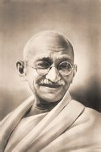](http://baike.baidu.com/albums/18595/18595/0/0.html#0$fd039245d688d43fa6c30a7b7d1ed21b0ff43bd4)
莫罕达斯·卡拉姆昌德·甘地

莫罕达斯·卡拉姆昌德·甘地（[古吉拉特语](http://baike.baidu.com/view/533709.htm)；Mahatma 
Gandhi，印地语；Mohandas Karamchand Gandhi，1869年10月02日－1948年01月30日），尊称[圣雄甘地](http://baike.baidu.com/view/138856.htm)（Mahatma Gandhi），是[印度民族解放运动](http://baike.baidu.com/view/2182044.htm)的领导人和印度国家大会党领袖。他是现代印度的[国父](http://baike.baidu.com/view/65205.htm)，是印度最伟大的政治领袖，也是现代[民族资产阶级](http://baike.baidu.com/view/88755.htm)政治学说——[甘地主义](http://baike.baidu.com/view/711011.htm)的创始人。他的精神思想带领国家迈向独立，脱离英国的[殖民统治](http://baike.baidu.com/view/990403.htm)。他的“非暴力”(ahimsa)的哲学思想，影响了全世界的民族主义者和争取能以和平变革的国际运动。 

* [查看词条图册](http://baike.baidu.com/albums/18595/18595/0/0.html#.)

|  |  |  |  |  |  |  |  |  |  |  |  |  |  |  |  |  |  |  |  |  |  |  |  |  |  |  |  |  |  |  |  |  |  |
| --- | --- | --- | --- | --- | --- | --- | --- | --- | --- | --- | --- | --- | --- | --- | --- | --- | --- | --- | --- | --- | --- | --- | --- | --- | --- | --- | --- | --- | --- | --- | --- | --- | --- |
| 

|  |  |
| --- | --- |
| 中文名： | 莫罕达斯·卡拉姆昌德·甘地  |
| 外文名： | Mohandas Karamchand Gandhi（英文）  |
| 别名： | 圣雄甘地（Mahatma Gandhi）  |
| 国籍： | 印度  |
| 出生地： | 波尔班达尔，一译[博尔本德尔](http://baike.baidu.com/view/905178.htm) |
| 出生日期： | 1869年10月02日  |
| 逝世日期： | 1948年01月30日  |
| 职业： | 民族解放运动领导人，国大党领袖  |

 | 

|  |  |
| --- | --- |
| 毕业院校： | [伦敦大学学院](http://baike.baidu.com/view/16434.htm) |
| 信仰： | 非暴力不合作运动，印度教  |
| 主要成就： | 印度“国父”、最伟大的政治领袖  |
| 代表作品： | 《印度自治》，《甘地自传——我体验真理的故事》  |
| 政党： | 印度国民大会党  |
| 配偶： | Kasturba Gandhi  |
| 子女： | Harilal、Manilal、Ramdas  |
| 血型： | O 
 |

 |

目录

[人物简介](http://baike.baidu.com/view/18595.htm#1)
[成就荣誉](http://baike.baidu.com/view/18595.htm#2)
[传奇经历](http://baike.baidu.com/view/18595.htm#3)
[生活信条](http://baike.baidu.com/view/18595.htm#4)
[荣誉头衔](http://baike.baidu.com/view/18595.htm#5)
[可敬事迹](http://baike.baidu.com/view/18595.htm#6)
[甘地语录](http://baike.baidu.com/view/18595.htm#7)
[历史评价](http://baike.baidu.com/view/18595.htm#8)
[社会评论](http://baike.baidu.com/view/18595.htm#9)
[艺术作品](http://baike.baidu.com/view/18595.htm#10)
[其他信息](http://baike.baidu.com/view/18595.htm#11)
展开

[人物简介](http://baike.baidu.com/view/18595.htm#1)
[成就荣誉](http://baike.baidu.com/view/18595.htm#2)
[传奇经历](http://baike.baidu.com/view/18595.htm#3)
[生活信条](http://baike.baidu.com/view/18595.htm#4)
[荣誉头衔](http://baike.baidu.com/view/18595.htm#5)
[可敬事迹](http://baike.baidu.com/view/18595.htm#6)
[甘地语录](http://baike.baidu.com/view/18595.htm#7)
[历史评价](http://baike.baidu.com/view/18595.htm#8)
[社会评论](http://baike.baidu.com/view/18595.htm#9)
[艺术作品](http://baike.baidu.com/view/18595.htm#10)
[其他信息](http://baike.baidu.com/view/18595.htm#11)
展开

[编辑本段](http://baike.baidu.com/view/18595.htm#)人物简介
--------------------------------------------------

　　**版本一**
　　莫罕达斯·卡拉姆昌德·甘地，1869年出生于[西印度](http://baike.baidu.com/view/771410.htm)[波尔](http://baike.baidu.com/view/91396.htm)班达尔贵族家庭，后来为了黑人的平等与解放放弃了贵族的生活。年轻时留学英国，攻读法律，

[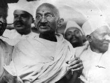](http://baike.baidu.com/albums/18595/18595/1/2687774.html#2687774$)

莫罕达斯·卡拉姆昌德·甘地组图(17张)1891年取得律师资格回国，后应聘前往[南非](http://baike.baidu.com/view/2535.htm)任一家公司的[法律顾问](http://baike.baidu.com/view/185056.htm)。1894年在南非[纳塔尔省](http://baike.baidu.com/view/2129557.htm)组织印度侨民投入反对南非当局[种族歧视](http://baike.baidu.com/view/55981.htm)的斗争，首次提出[非暴力](http://baike.baidu.com/view/1253464.htm)口号。[第一次世界大战](http://baike.baidu.com/view/26747.htm)爆发后，甘地再次回到印度，在印度各地周游了解，组织“坚持真理运动”。[第二次世界大战](http://baike.baidu.com/view/5338.htm)期间，甘地发动要求“撤离印度”的运动，运动遭到残酷镇压。印度独立后，甘地呼吁人民团结一致结束教派流血冲突。 
　　1948年1月30日，[印度国大党](http://baike.baidu.com/view/70244.htm)领袖、民族解放运动著名领导人、非暴力不合作运动者，享有“[圣雄](http://baike.baidu.com/view/748546.htm)”称号的甘地在[德里](http://baike.baidu.com/view/118127.htm)作[晚祷](http://baike.baidu.com/view/343885.htm)时，被印度教极右分子开枪暗杀，终年79岁。杀害甘地的刺客[纳特](http://baike.baidu.com/view/2856943.htm)胡拉姆-戈德塞是印度教的一个极端派别的成员，该派别完全拒绝甘地发出的善意、和平与爱的呼声。 
　　他一生曾创办和主编过四种刊物，主要著述有《印度自治》、《[甘地自传](http://baike.baidu.com/view/1705638.htm)——我体验真理的故事》等。 
　　甘地是印度人民反抗英国统治的[精神领袖](http://baike.baidu.com/view/292181.htm)，他发起和领导了声势浩大的[非暴力不合作运动](http://baike.baidu.com/view/34158.htm)，以非暴力方式抵制英国统治和英国商品，手纺车运动便是其中的一项内容，是指在杜绝对英国纺织物的需求。 
　　甘地赢得了许许多多男女老少对他的爱戴和忠诚，包括各种[宗教信仰](http://baike.baidu.com/view/1327059.htm)的欧洲人以及几乎不同政治倾向的所有印度人。　 
　　**版本二**
　　莫汉达斯·甘地于1869年生于[印度](http://baike.baidu.com/view/2174.htm)，按照当地习俗，他在13岁时就结婚了。1888年9月，他19岁的时候乘船去了英国，学习三年后，当了一名律师。他一回到印度，就得到一个去南非的机会，到那里去处理一个案子。这个经历后来改变了他的生活道路。
[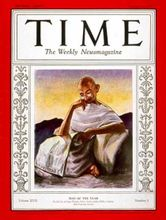](http://baike.baidu.com/albums/18595/18595/0/0.html#0$7ac880511ad1b34343a75b6e)
甘地荣登1930年《时代》年度风云人

在这个时期，居住在南非的印度人受到南非白人的虐待，只有极少数人有[选举权](http://baike.baidu.com/view/168425.htm)。甘地在旅行时，由于坚持要坐在白人座位区，曾经先后两次被人从一列火车和一辆邮车上扔了下去。这件不平等、不公正的事情使他大为震惊，于是他成立了一个组织，领导印度人为争取平等权利而进行斗争。很快地，他就成了这个组织的领袖者。 

　　20年里，在为印度人争取[平等权利](http://baike.baidu.com/view/1204301.htm)的斗争中，甘地起了非常重要的作用。他为报纸写文章介绍[社会主义](http://baike.baidu.com/view/8059.htm)，还创办了一个叫《印度舆论》的杂志。他回到印度时，曾就南非局势发表公开演说。后来南非又通过了一些法律，企图给非白种人的生活造成困难。8岁以上的印度人，不管什么时候全都必需携带通行证。印度人宣称，这项“通行证法”是不公正的。有的人还当众烧掉他们的通行证，许多人因此被捕入狱。另外一些人在警官残暴地袭击政治游行时被杀害。最后，由于印度居民的骚乱，南非首领才不得不作出让步。于是甘地赢得了第一次反对种族歧视的非暴力斗争的胜利。 

　　甘地于1915年返回印度，被誉为英雄。在随后的32年中，他为人权而斗争，为受雇主虐待的工人们的权利而斗争。最后，他要求结束英国对印度的统治，要求国家的独立。由于他的革命的观点，他在监狱里度过了许多岁月。他有一种才能，能够想方设法来阐述政治观点。他鼓励印度人自己生产棉布，拒绝购买英国布匹。他领导过一次去海滨的进军，成千上万的人参加了他的队伍，目的是为了到海边去生产一点食盐。在那个时候，只有英国政府有权销售食盐，而食盐要征税。于是甘地就鼓励全国人民自己生产食盐。在这个事件之后，有6万印度人，包括甘地在内，被投入监狱。这次政治斗争终于取得了胜利，印度人被允许生产和销售食盐了。 

　　以后又进行了许多次别的斗争。最后，1947年8月15日印度赢得了独立，但是五个月后甘地却被一个反对他的观点的印度教极端分子刺杀，于1948年1月30日逝世。

[编辑本段](http://baike.baidu.com/view/18595.htm#)成就荣誉
--------------------------------------------------

　　**变化**
　　
[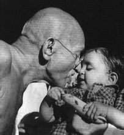](http://baike.baidu.com/albums/18595/18595/0/0.html#0$245e8bca39b01be1c8176845)
莫罕达斯·卡拉姆昌德·甘地

通过“非暴力”的公民不合作，甘地使印度摆脱了英国的统治。这也激发了其他[殖民地](http://baike.baidu.com/view/34807.htm)的人们起来为他们的独立而奋斗。最终[大英帝国](http://baike.baidu.com/view/97492.htm)分崩离析了，取而代之的是[英联邦](http://baike.baidu.com/view/58647.htm)，或者更准确一点是[联邦](http://baike.baidu.com/view/171967.htm)（因为“英”这个前缀于[1946年](http://baike.baidu.com/view/931243.htm)没有了，变成了Commonwealth of Nations）。 
甘地的主要信念是“satyagraha”，意为“精神的力量”、“[真理](http://baike.baidu.com/view/15305.htm)之路”、“追求真理”等。这鼓舞了其他国家的[民主](http://baike.baidu.com/view/14448.htm)运动人士，如[马丁·路德·金](http://baike.baidu.com/view/81787.htm)，[曼德拉](http://baike.baidu.com/view/40753.htm)等人。 
　　他经常说他的[价值观](http://baike.baidu.com/view/135672.htm)（是从传统的印度教信仰演化来的）很简单，那就是：真理（*satya*）、非暴力（ahimsa）。 
　　他在印度被给予“国家的父亲”之荣誉。　 
　　**纪念日**
　　甘地的生日，10月2日，被定为甘地纪念日（Jayanti），是印度的[国家法定假日](http://baike.baidu.com/view/60272.htm)，也是国际非暴力不合作运动的纪念日。

[编辑本段](http://baike.baidu.com/view/18595.htm#)传奇经历
--------------------------------------------------

　　**成长**
　　
[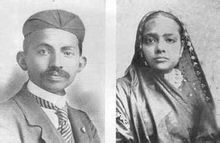")](http://baike.baidu.com/albums/18595/18595/0/0.html#0$ac0acf136e953e655baf5369)
甘地和他的妻子Kasturba 
Gandhi(1902年摄)

虽受当时革新之风的感染，曾经尝试打破素食以强身健体、振兴民族国家，终因摆脱不了从小所受的教育，半途而废。19岁时，不惜被开除种姓身份，远涉重洋，赴伦敦求学。异域的文明曾令甘地产生过深刻的自卑而拜倒在它的脚下，宗教陈规的约束使他在一个全新环境里无所适从。短时的迷惘与摸索之后，他终于放弃了对西方文明的盲目模仿，坚持了原有的宗教信仰并兼收并蓄其他宗教教义，接受了英国法制思想的教育，取得了[伦敦大学](http://baike.baidu.com/view/37207.htm)的律师资格。学成归国后，他开始在[孟买](http://baike.baidu.com/view/17247.htm)从事律师业务，却历遭挫折。第一次替人打官司就因临阵怯场而砸锅。半年后打道回府，在家乡拉奇科特靠兄长和亲友的资助维持律师业务，律师业务的毫无起色及令人窒息的环境，使他倍感苦闷压抑。当有个来自南非印度人的案子要他处理时，他便义无反顾地踏上了前往南非的历程。 

　　**反抗**
　　在[南非](http://baike.baidu.com/view/2535.htm)这个种族歧视根深蒂固、无所不及的英国[殖民地](http://baike.baidu.com/view/34807.htm)，甘地作为有色人种先后遭遇到了一连串的歧视与侮辱。民族自尊心和同胞在此所受的苦难驱使他走上了领导南非印度人反种族歧视的斗争，成为引人注目的人物。正是在南非这块充满种族歧视的土地上，甘地对他曾经倾慕过的西方文明产生了否定，培养和锻炼了自己从事公众工作的能力，掌握了作一个成功律师的秘诀，基本形成了他的宗教、人生观、社会政治观。他在南非领导的艰苦卓绝的反种族歧视斗争，为南非印度人争取到了基本平等的权利，他从中也试验成功了一种有效的武器——真理与非暴力学说及其实践。不过，在这种反歧视过程中，甘地对英帝国仍充满幻想。 

　　1915年，甘地回到印度。回国初年，他坐三等车游历印度各地，以深入了解他久别的祖国。一年以后，他开始发表演讲，宣传自己的主张，从事非暴力斗争，试验并发展了非暴力学说。他对当时正在进行的战争予以支持，希望以此换取英国的开恩，给予印度自治。“一战”后殖民当局的种种作为使甘地由一个英帝国的忠实追随者变成了不合作者。1919年3～4月间，为抗议反动的“[罗拉特法](http://baike.baidu.com/view/163031.htm)”，他发起全国性的非暴力抵抗运动，由于殖民当局的血腥镇压和群众的暴力反抗，甘地一度宣布暂缓非暴力抵抗运动，试图与政府合作，但英国政府继续在[哈里发](http://baike.baidu.com/view/25748.htm)与[旁遮普](http://baike.baidu.com/view/359974.htm)问题上倒行逆施，打破了甘地的幻想。在印度全民反英斗争高涨的形势下，甘地的不合作思想趋于成熟，并率先在哈里发运动中发起群众性的抵制殖民政府的立法机构、法院、学校、封号与洋货的非暴力不合作运动，进而推广为全民反帝斗争形式。 

　　1920年9月，国大党[加尔各答](http://baike.baidu.com/view/34737.htm)特别会议和12月的那[普尔](http://baike.baidu.com/view/35517.htm)年会正式通过了甘地的非暴力不合作计划及甘地起草的党纲，使非暴力不合作成为国大党的指导思想；争取“印度自治”成为国大党的现实斗争目标；国大党也因此由一个少数上层分子主要依靠宪政手段从事活动的团体变成一个有广泛群众基础、依靠群众性直接斗争进行全面反帝斗争的现代资产阶级政党。甘地在国大党内的领导地位也因此确立。此后，不论甘地是否在国大党内任职，他始终是国大党的“灵魂”，左右着印度民族解放运动发展的方向。1922年2月，因运动中出现暴力事件，甘地宣布停止第一次非暴力不合作运动，挫伤了士气，引起国大党内的思想混乱。甘地也身陷囹圄。出狱后甘地致力于重振民心士气。 

　　1929年12月31日，国大党[拉合尔](http://baike.baidu.com/view/91962.htm)年会通过争取印度独立的决议，并授权甘地领导新的不合作运动。1930年3月他率领78位志愿队员开始“食盐长征”，揭开了第二次非暴力不合作运动的序幕，给英殖民主义者以巨大打击。运动进行中甘地又与总督谈判，并出席圆桌会议，群众运动因此而松懈，被英国残酷镇压下去。1934年10月，甘地因与国大党领导层再次出现严重分歧而宣布退党，但仍在关键问题上指导国大党的工作。1939年9月3日，英国代表印度宣战后，甘地的极端非暴力立场与国大党领导机构的有条件支持战争的主张发生尖锐冲突，以致他两次被免职，又因英国政府顽固不肯满足国大党的要求，国大党两次请甘地复出。这期间，甘地的反帝立场进一步发生变化。 

　　1942年4月，在印度国内广大群众反英情绪高涨和[日本](http://baike.baidu.com/view/1554.htm)侵略者迫近印度的形势下，甘地提出了英国“退出印度”的口号，并先后发起了1940～1941年第三次不合作运动和准备发动第四次不合作运动，均被英国镇压下去。甘地入狱直到1944年5月。战争结束后，处于内外交困的英国政府慑于印度民族解放运动再起的压力，答应印度独立的要求。但因印、穆两教的分岐对立由来已久，加之英国分而治之政策的影响，印、巴分治已成定局。甘地为维护印度统一不懈努力，终无回天之力，只好接受分治。 

　　独立后甘地获得了印度人民和国大党的崇高敬意，但他却大权旁落，其终身为之奋斗的非暴力理想也被束之高阁。而对分治以后的宗教仇杀与混乱，甘地殚精竭虑，利用自己的威望与绝食帮助平息了大规模教派仇杀，自己却成了教派冲突的牺牲品，死在了一位狂热的印度教徒的枪口之下。[1]

[编辑本段](http://baike.baidu.com/view/18595.htm#)生活信条
--------------------------------------------------

　　**放弃**
　　甘地奉行的苦行僧式的个人克己生活制度包括素食，独身，默想，禁欲，一周有一天不说话，放弃西方式衣服而穿了印度土布做的印度传统服装，用纺车纺纱，参与劳动。 

　　
[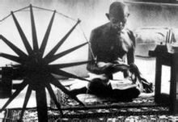](http://baike.baidu.com/albums/18595/18595/0/0.html#0$6a63f6246b600c33d4d51d521a4c510fd8f9a1f8)
坐在纺车旁的甘地

甘地的哲学和非暴力不合作（satya, 
ahimsa）的思想深受薄伽梵歌，印度教信仰以及[耆那教](http://baike.baidu.com/view/163377.htm)的影响。非暴力（ahimsa)的概念在印度的宗教中长久以来就有。印度教，佛教，耆那教中对于此都有重述。甘地在他的自传“我的对于真理的实践经历”（The 
Story of my Experiments with Truth）揭示了他的哲学和生活方式。 
　　尽管他去伦敦时，尝试吃肉，但是他后来变成一个严格的素食主义者。他在伦敦求学时对此写过几本书。在印度教和耆那教中素食主义是根深蒂固的。他的家乡就有很多印度教徒是素食主义者。他尝试不同的饮食，最终相信素食足以满足人体的最小要求。他也曾很长时间不进食，并以此作为政治武器。　 

　　**讨论**
　　在他三十六岁时，他禁欲，变成了一个彻底的[禁欲主义者](http://baike.baidu.com/view/3394387.htm)。禁欲是受印度教的影响。但是他没有离婚。据说他的这个决定没有同他的妻子讨论，而是直接向她宣布的。 
　　甘地每周一天不说话。他相信沉默带给他内心的平静。这来自于印度教中的力量来自于“沉默”（mouna）和“平静”（“shanti”，梵语音译。）。他在沉默靠在纸上写字来交流。从他三十七岁开始的三年半里，甘地拒绝读报纸。他认为尘世的喧嚣比他的内心的不安更加不堪。 

　　在从南非的成功法律工作回到印度后，他放弃了代表富有和成功的西方式衣服。他的意思是要穿的能够被印度最贫穷的人接受。他宣扬使用家庭纺织的土布（khadi）。甘地和他的跟从者使用纺车自己纺的布做衣服。这对英国的权力集团是一个威胁。如果印度人因为没有工作而空闲时，他们从英国那里买衣服。如果印度人自己做衣服，英国的工业就空闲了。后来国大党的党旗中就有纺车图案。[2]

[编辑本段](http://baike.baidu.com/view/18595.htm#)荣誉头衔
--------------------------------------------------

　　“*Mahatma*”（一般汉译为“圣雄”）来源于[梵语](http://baike.baidu.com/view/73651.htm)的敬语mahatman，原
[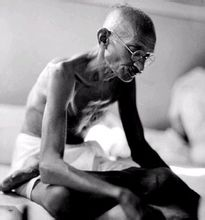](http://baike.baidu.com/albums/18595/18595/0/0.html#0$d68b65cb78cc4e78bf09e657)
莫罕达斯·卡拉姆昌德·甘地

意“Great Souled”，伟大的灵魂。这是在他授予印度诗人[拉宾德拉纳特·泰戈尔](http://baike.baidu.com/view/6247024.htm)"Gurudev"（意即“伟大的导师”）的称号后，1915年泰戈尔赠予他的尊称，意为合[圣人](http://baike.baidu.com/view/42051.htm)与英雄于一身。 
　　这个头衔的使用也在印度以外国家和地区被广泛地接受，部分的反映出在他的时代印度和英国的复杂关系。无论如何，这个头衔的广泛使用，是同世界上对甘地这样一个对于非暴力和自己的宗教信仰的极其执著的人的广泛接受相一致的。

[编辑本段](http://baike.baidu.com/view/18595.htm#)可敬事迹
--------------------------------------------------

　　甘地的贡献不会被人们遗忘。他的孙子，Arun Gandhi和Rajmohan 
Gandhi，甚至他的重孙，Tushar Gandhi也是社会政治活动家，为了世界上的非暴力而努力。　 
　　**绝食运动**
　　时至1947年8月底，印度独立刚满半月，旁遮普省的12个县已在血泊与火海中挣扎了2周，倒是加尔各答这个火药库因为甘地的坐镇一直没有爆炸。参加甘地祈祷会的人以空前规模在扩大，1万、10万、继而50万，甚至高达100万，在一个宗教狂热的国度里，当亿万信徒聆听一种声音的时候，它所创造的奇迹与神话可想而知。甘地在加尔各答创造的奇迹，曾引起举世瞩目。当时《伦敦时报》这样评说：“这座城市是印度的奇观。”蒙巴顿从新德里致函甘地，盛赞他的功德无量：“在旁遮普，我们有一支55000名士兵组成的别动队，他们被大规模的暴乱弄得一筹莫展，在孟加拉，我们的干预部队只有1个，那里却没有发生任何暴乱。” 

　　1947年8月31日早晨，奇迹出现16天之后，宗教仇恨之火终于还是点燃了加尔各答这个火药库。当晚10点，一群狂热的印度教青年突然闯进海达利公馆院内，要求与甘地谈话。当时甘地正躺在草垫上，身边是他的侄孙女摩奴和阿巴。甘地被吵声惊醒，站起身来，说：“嚷什么，我在这儿，你们杀我吧？”说话间，两位浑身是血的穆斯林挣脱人群，躲藏到甘地身后，但一根根棍子向他们飞去，好在甘地个子不高，才没被击中，直到增援的警察赶来才解了围。随后，对[穆斯林](http://baike.baidu.com/view/32146.htm)贫民窟一系列的袭击行为达到丧心病狂的程度。这些都是国民公仆团极端分子策划的。 
　　加尔各答事变给甘地以致命的打击，这位终生致力于非暴力理想的老人似已有一种幻灭感。为了使加尔各答恢复理智，拯救千百万无辜者免于死亡，甘地只有拿生命孤注一掷了。 

　　他对外发表声明，决定从9月1日起开始绝食，一直到动乱结束，不成功便成仁。 
　　这次绝食无论对他本人和他的同志们来说都是一次冒险。此时甘地已78岁高龄，最近长时间的焦虑与奔波又使他精疲力竭，绝食开始后他的体力很快衰竭，几小时后便出现心律不齐，时至午夜，他说话的声音就含糊不清了。 

　　甘地绝食的消息几小时就传遍了加尔各答城。多少年来，甘地的绝食斗争已成为激发人们斗争的信号。整个印度虽然85%的居民不识字，没有收音机，但人们总能了解他绝食的各个阶段的详细情况，每当甘地受到死亡威胁时，人们都一致本能地为他担忧，一批又一批焦虑不安的群众纷纷来到海达利公馆看望他。但疯狂的暴力行为似脱缰的野马一时难以遏制，纵火、杀人、抢劫仍在进行。 

　　从第2天早晨起，前来海达利公馆询问甘地健康状况的人越来越多，印度教徒和穆斯林知名人士纷纷来到甘地卧榻前，请求甘地停止绝食。 

　　第3天凌晨，甘地健康恶化的消息一经传出，整个加尔各答沉浸在焦虑与悔恨之中，一股友善的浪潮突然席卷了这座难以驾驭的大都市。印度教徒和穆斯林一起在暴行肆虐的贫民区游行，呼吁恢复秩序与平静。中午时分，27名市区的极端分子来到海达利寓所门前，承认了自己的罪恶活动，当晚，全城恢复平静。印度教徒、锡克教徒和穆斯林显要人物起草了一项共同声明，庄严保证阻止宗教仇恨再起。 

　　1947年9月4日晚，甘地喝了几口桔子汁，宣告结束了73小时的绝食斗争。甘地不惜牺牲生命以捍卫和平的举动终于制止了加尔各答暴乱的蔓延，他因此获得了极高的声誉。甘地的老友，独立印度的首任孟加拉省督拉贾戈帕拉戛查理说：“甘地建树过许多丰功伟绩，然而最为神奇的乃是他在加尔各答战胜了邪恶，其意义甚至超过了印度独立。” 

　　在确信加尔各答不会再有问题时，甘地决定前往被血与火吞噬的旁遮普省。然而，还没来得及到那里，首都新德里又发生了新的暴力事件。由于周围的农村极不安全，成千上万的穆斯林都涌到这里避难。9月3日早晨，印度教徒从杀害中央车站的穆斯林苦力开始，接着大规模洗劫穆斯林的商店，打死商店老板。新德里的暴乱将对整个印度半岛产生不可估量的影响，由于警察多半开小差，仅有的部队人心涣散，公共秩序严重瘫痪，新总理尼赫鲁甚至不得不亲自挥舞棍棒，驱散暴乱分子。 

　　新政府对于局势几乎一筹莫展。这些人执政前大部分时间都在英国人的监狱中度过，而且一直从事不合作斗争，从没有机会深入了解和治理这个国家。现在英国人丢下一个烂摊子让他们收拾，他们哪里应付得过来。9月6日，总理尼赫鲁和内政部长帕迭尔急电招回当时正在西姆拉休假的蒙巴顿，由他出面组织应急委员会。 

　　9月9日，甘地前往旁遮普时路过新德里。一下火车，帕迭尔便一脸沮丧地告诉他德里的情形，甘地于是决定留下来。由于原先甘地住过的“贱民”区已挤满难民，他只好住到了国大党的支持者、甘地的忠实拥护者比尔拉的寓所。甘地当即发表声明，一定要尽力使德里的空气恢复平静。 

　　9月10日，甘地来的第一天就作了40公里旅行，视察了许多难民区。当天的祈祷会中，他发表了一篇动人心弦的演讲（全文向全国转播），追述了他初到新德里的印象。他感到这里就像一座死城，没有欢笑，没有希望，只有恐怖、混乱与仇恨。他感到不理解，在独立自由的印度为什么会出现如此现象，不理解人们为什么要被赶出家园，在自己的国家内还会出现难民问题。他认为“政府应负责，人民也有责任”。甘地每天都去视察难民营，试图打动那些因仇恨而咬牙切齿、面容扭曲的人们，然而收效甚微，一次，在一座难民营出口处，一位男子把他小孩的尸体扔到甘地怀里，再有一次，甘地在无人护卫的情况下进入难民营，一群被仇恨激怒的人围住他的汽车狂喊乱叫。一天晚上，当甘地一如既往地在祈祷会上把《[雅歌](http://baike.baidu.com/view/598069.htm)》、《[可兰经](http://baike.baidu.com/view/419387.htm)》、《[新约](http://baike.baidu.com/view/22586.htm)》、《[旧约](http://baike.baidu.com/view/22593.htm)》与《薄伽梵歌》一起诵读时，人群中有人大叫：“以你赞美真主的名义，我们的妻子和姐妹遭到强奸，我们的兄弟被屠杀！”“打死甘地！”甘地不得不停止祈祷。尽管如此，甘地并不灰心，他每天照例去乱区视察，安抚民心，排忧解难，并照例每天举行晚祷，发表他的观点与见解，抨击人们的失去理智，谴责政府的办事不力，建议人们该如何遵纪守法，勿施暴力；同时，他还得应付外界的各种问题与来访者，并替《哈里真报》撰稿。 

　　1947年10月2日，甘地78岁诞辰。数千封来自世界各国和独立印度的电报和信件向他表示祝贺。各界领导人、难民、印度教徒、锡克教徒和穆斯林相继来到比尔拉官邸，向他敬献水果、糖果和鲜花。尼赫鲁总理及其他各部部长、新闻记者、外国使节和蒙巴顿夫妇亲临甘地卧室向他表示祝贺。然而甘地的状况令来访者无比震惊，他一反惯常的生动表情与狡黠神色，一脸的忧郁与沉闷。他决定以祈祷、斋戒与手摇纺车来过生日。在这天的晚祷上，他语气低沉：“你们要祈祷神灵，以结束目前的敌对状态；或者为我早日离开人间祷告上苍，我不想在烈日纷争的印度过生日。” 

　　11月末的一天晚上，新德里东北90公里的小城帕尼帕特又发生锡克教徒屠杀穆斯林事件，甘地只身驱车前往那里，平息动乱。在市政当局临时搭起的一座小平台上，甘地对潮水般涌来的群众进行演讲，并与各种各样的反对意见争论。他不厌其烦、深入浅出地讲述信仰自由、宗教平等的理论，用整个心灵设身处地地安抚受苦受难的难民，恳请他们摒弃暴力和仇恨，发扬理智和宽容。他的逻辑那样不可辩驳，他的言辞那样恳切真诚，他的意志那样坚韧不拔，人们的狂怒与伤痛渐渐平息。仅仅几小时后，帕尼帕特的居民倾城而出，拥戴他们的圣人离去。 

　　1947年岁末的日子，甘地始终沉浸在莫大的悲伤之中，印度的分治给他的心灵以致命的创伤，终生宣扬非暴力却无法改变印度内乱四起的现状，旧日印度的一切落后的东西并未在新生的印度中消逝，这一系列现实令甘地无限感伤；而现在他又发现那些追随他革命的同志登上政权宝座后丝毫无意执行他的理想。他与他们之间的鸿沟越来越大。甘地指责印度政府日益腐败，谴责各部部长举行盛大豪华的酒宴而不顾数百万难民的饿死，指责印度的新生知识分子打算使国家工业化，而不关心农民利益，他建议这些知识分子应到农村去，与农民同吃同住同劳动，以了解农民的真实需要。 

　　由于他的尖锐言论，令新政府领导大为不悦，他们渐渐不愿再征询甘地的意见。 
　　除了这些烦恼外，当时困扰甘地的还有两大问题，一是首都新德里的局势。政府借助于武力而不是甘地所倡导的人民心灵的力量暂时维持平静，但是各种隐患大量存在，一些人骨子里暗藏杀机，暴乱随时可能再度发生。二是政府对巴基斯坦的态度。国大党拒不偿还分给[巴基斯坦](http://baike.baidu.com/view/6853.htm)的55000万卢比的款项，想从经济上扼杀它；甘地认为这是一件极不体面的事，有损印度的精神传统。 
　　为使以上这两个问题得到较好的解决，甘地决定再次进行无限期绝食，直至新德里恢复平静和政府答应偿还巴基斯坦的款项。 
　　1948年1月13日，甘地开始了一生中最后一次绝食。这天早上，甘地在比尔拉寓所的花园内举行了简短的宗教仪式，出席这一仪式的有尼赫鲁、摩奴、阿巴、秘书普雅雷拉尔·纳耶尔等，还有印度新闻界和其他国家驻印度首都的数10名记者。11点55分，绝食开始了，甘地在草褥上躺下，慢慢进入梦乡。 

　　甘地宣布进行绝食和停止绝食条件，使很多人感到震惊和沮丧，甚至反感。当时新德里的局势与加尔各答有所不同，这里到处挤满难民，不少难民为逃避难民营内寒冷和恶劣的生活条件，纷纷占领清真寺和穆斯林的住宅，现在甘地要他们归还栖身之地，再回到难民营去，他们极不情愿。而且，甘地要求偿还巴基斯坦巨额款项，也令一些人愤恨不平。不少印度教徒认为甘地绝食自毁是有偏见的阴谋诡计。甘地停止绝食的条件也激怒了大多数部长，他们认为拒偿这笔款项理所当然。 

　　由印度教极端分子组成的国民公仆团获悉甘地进行绝食的原因，增加了他们的仇恨心理，他们认为甘地此举无异于政治讹诈，他们准备立即铲除甘地。 

　　绝食当晚，甘地例行晚祷，他用发自内心的微弱声音祈祷诸神纯洁大家的心灵，清除所有人间的纷争，让印度教徒、锡克教徒和穆斯林兄弟般和睦相处。他说：“我要使德里经受一场考验，无论印度和巴基斯坦发生多么严重的屠杀事件，我恳请首都人民不要放弃自己的义务……各个教派，全体印度人必须以人道主义取代野蛮行径，必须使自己成为名符其实的印度人，如果你们不能如此，我也无需继续活在尘世。” 

　　这一次甘地的体力消耗更快。自上次加尔各答城的绝食后，甘地的肾功能已开始减弱；加上一连串不幸事件的打击，他的血压急剧上升，一直靠一种特制的镇静剂维持。因为绝食之故，镇静剂的使用也受到严格限制。 

　　14日上午，甘地体重仅有49．5公斤，这意味着绝食一天后体重即下降了1公斤，用不了多久，甘地瘦弱体内的营养储备将消耗殆尽。而对绝食的人来说，当机体已开始消耗蕴藏在肌肉内的蛋白质时，危险即已来临，其结果必然导致死亡。 

　　1月15日，可能危及甘地生命的危险征兆出现。这天的小便化验结果中发现了含有丙酮和酸性成分的毒性物质及其他危险症状，证明导致死亡的过程业已开始。医生力劝甘地停止绝食，但甘地置若罔闻。 

　　这一次人们对甘地的绝食反应迟缓，直到绝食的第3天，新德里街头才开始出现小规模游行，呼吁教派和睦、亲善，以拯救甘地生命。这天下午，印度政府经过长期的争论和犹豫，终于决定立即偿付巴基斯坦的55000万卢比。尼赫鲁在红堡广场向德里市民发表演讲，希望人们以实际行动拯救甘地生命，“因为丧失圣雄的生命，也就是丧失印度的灵魂”。 

　　1月15日的晚祷会，甘地因极为虚弱，无力行走，甚至无法支撑起来，没有出现在比尔拉寓所外的草坪上。他竭尽全力，用麦克风向聚在草坪外的数百名群众说了几句话，他的声音细如游丝，人们预感到圣雄的生命已危在旦夕。这一不祥之兆唤醒了人们沉睡的良知和麻木的神经，群众排成长阵，人人双手合十，在一片肃穆的气氛中依次从甘地的阳台前走过。 

　　1月16日的清晨，第一号有关甘地的健康公报发布，告之印度人民甘地健康状况已严重恶化，这一不幸消息使印度全国的气氛发生巨大变化。各个城市内，人们纷纷涌向广场，高呼“亲善”、“团结”和“拯救甘地”的口号。各教派与各界领袖代表在全国各地相继成立了“拯救甘地生命委员会”，数十万人举行聚会，为甘地祈祷。 

　　尼赫鲁率领由政治和宗教领导人组成的代表团来到甘地草垫前，安慰甘地，希望他停止绝食。 
　　现在无动于衷的却是甘地。不管人民多么激动，也不管尼赫鲁如何劝导，他依然不肯停止绝食。他期待的是“人民心灵深处的反应，是真心诚意的幡然悔悟，是实实在在的具体行动”。 

　　1月17日上午，新的健康公报表明急性尿毒症即将夺去甘地的生命，这时甘地已进入绝食的第3个阶段，即最后一个阶段，他的精神突然好了起来，整个地沉浸在安静之中，除了关节痛外，没有其他不适。他向秘书口授了停止绝食的7项条件，这些条件几乎涉及到新德里城生活的各个方面，包括：印度教和锡克教难民必须把改成住房的117座清真寺归还给穆斯林，取消对新德里穆斯林商人的抵制，保证乘坐印度火车旅行的穆斯林的人身安全等。甘地要求新德里各政治组织的领导人，包括他的敌手印度教大会的极端分子必须在他的声明上签字。 

　　当晚，整个京城的注意力都集中在如何尽快让甘地终止绝食上。商业活动停止了，机关、商店、作坊、工厂、咖啡馆关闭了，在大清真寺广场上，来自各种族和各教派的数10万群众举行盛大集会，强烈呼吁他们的领导人接受甘地声明的条款。 

　　比尔拉寓所内，甘地的健康状况急剧恶化，短暂的清醒后是长时间的虚脱，同时伴有谵妄现象，医生与身边工作人员焦虑万分，却又无可奈何。 

　　尼赫鲁再次来到甘地卧榻前，见到他敬爱的“巴布”（“巴布”即父亲）奄奄一息，禁不住百感交集，热泪盈眶。蒙巴顿也来到甘地身旁，此情此景，也令这位戎马一生的异域军人倍觉酸楚。 

　　1月17日晚，甘地大部分时间陷入昏厥与谵妄状态，脉搏微弱而不规则，身体各重要器官的功能已经开始崩溃。秘书拿来各派领袖在他的口授声明上的签字，这上面除了没有印度教大会地方代表和国民公仆团的代表签字外，新德里几乎所有派别组织的领导都签字保证恢复平静，和睦相处。医生劝甘地喝点东西，甘地轻轻叹息了一下，而后摆摆头说：“不，任何事情不能操之过急。在我中断绝食前，任何铁石心肠的人也会动心的。” 

　　1月18日上午，甘地处境危急，很快将进入长时间的人事不省。国大党主席紧急动员，他派出一帮人前去寻找甘地所要的签字，自己带了一帮人亲自前往比尔拉寓所。不一会，各派代表终于聚齐，其中包括印度教极端分子及国民公仆团的神秘代表，他们都已在7项声明上庄严签字，并依次走到甘地卧榻前，亲自确认自己的庄严保证。 

　　甘地获得了这场绝食的全部胜利，但执著的老人仍不肯中止绝食，他在死亡的边缘，用尽浑身力气，口授了一项声明。他希望各派代表不仅要保证新德里的平静局面，而且应使全印度都能从根本上消除不安定因素。他说：最大的错误观点，莫过于认为印度只属于印度教徒，或认为巴基斯坦只属于穆斯林。虽然要改变全印度和巴基斯坦人民的意识是件艰苦的事，但只要我们齐心合力，任何事情都是可以办成的。甘地讲话后，在场的所有人一一俯身表示了他们的庄严承诺，当最后一个人立下誓言后，甘地宣布停止绝食。一场令世界人民惊心动魄的绝食斗争终于圆满结束。 

　　绝食胜利似乎给垂暮之年的甘地注入了新的活力。来自世界各国舆论的赞誉是一个重要原因。伦敦《新闻纪事报》报道：“一位78岁的瘦弱老人竟以神奇力量震撼了整个世界，赋予世界新的希望；它所显示的力量，可以胜过原子弹的威力。”始终敌视甘地的《[泰晤士报](http://baike.baidu.com/view/218624.htm)》也不得不承认“甘地先生推崇的勇敢的唯心主义，这一次比以往任何时候都得到更加充分的肯定”。法国《世界报》发表评论，“善良的甘地再次证实，他自己乃是我们这个时代最伟大的叛逆者”。美国《[华盛顿邮报](http://baike.baidu.com/view/229325.htm)》写道，“获悉甘地安然脱险的消息后，慰藉的浪潮席卷全球。这足以说明甘地的圣洁之心受到人们普遍颂扬”。埃及报纸颂扬甘地是“东方世界一位品德高尚的儿子，将其毕生精力献给和平、宽仁与博爱事业”。印尼报纸认为甘地的功德“为把亚洲人从苦难中救出来带来了曙光”。“巴基斯坦之父”真纳也在甘地绝食停止的当日宣布欢迎昔日的政敌前来访问他的新国家。面对这些铺天盖地的美誉，甘地感到由衷的欣慰，他认为这意味着他毕生为之奋斗的理想终为世人瞩目和接受，此时他又萌生一个宏伟的计划，准备以步当车，穿越刚被冲突弄得伤痕累累的旁遮普大地，沿着难民逃亡的大道一步一步走向巴基斯坦。这样他既可以体察民情，安抚民心，又可以广泛传播非暴力和博爱思想。为了这一计划，他必须养精蓄锐。　 

　　**故事六则**
　　**1、老师的暗示**
　　甘地小时候并不聪明，从小学到中学，他的成绩都不是很好。可是他一点儿也不顽皮，是个诚实害羞的孩子。 
有一天，一位督学到甘地的学校检测学生的英文水平。他让学生们听写了五个英语单词，甘地写对了四个，就是“茶壶”这个词不会拼。正当甘地皱着眉头冥思苦想的时候，老师刚好走到他旁边。老师用脚尖轻轻地碰了一下他的椅脚，暗示他去偷看旁边同学的卷子，可甘地继续低着头想，不愿看别人的答案。 

　　结果，大家都考了满分，只有甘地一个人考了八十分。督学走后，老师把甘地叫到面前，说：“傻孩子，偶尔作弊一次又有什么关系呢？如果你也能拿满分的话，我们就可以受到表扬了。”可甘地坚持认为自己那样做是正确的，抄袭就是不对，倒是老师让他作弊，让他感到非常难过。 

　　**2、凑双完好的鞋子**
　　一天，甘地坐火车，不小心把自己穿着的一只鞋子掉在铁轨上了。此时，火车已经轰隆隆地启动了，他已不可能下车去捡那只鞋子。 
旁边的人看到甘地没了一只鞋子，都为他可惜。忽然，甘地弯下身子，把另一只鞋子脱下来，扔出了窗外。身边的一位乘客看到他这个奇怪的举动，就问：“先生，你为什么要这样做呢？” 
甘地笑了笑，慈祥地说：“这样的话，捡到鞋子的穷人，就有一双完好的鞋子穿了。” 
　　**3、非暴力的课程**
　　15岁时，甘地偷了哥哥手镯上的一小块金子，良心受到谴责。由于不敢当面认错，他写了一封悔过信交给父亲。他原以为会受到重罚没想到病榻上的父亲读后泪流满面，竟原谅了他，甘地感动得哭了。这是甘地人生中第一堂“非暴力”课。他认为，父亲信任与慈爱的力量远远胜过责骂和棒打。后来他在自传中写道：“这些爱的眼泪洗涤了我的心灵，抹拭了我的罪污。只有亲自经历这种爱的人，才能认识它的价值……” 

　　**4、被赶出头等舱**
　　甘地在英国学成以后到南非做了一名律师。有一次，因公事远行，他得到了一张头等舱的火车票。当甘地拖着行李准备上车时，一名白人工作人员看见他是有色人种，竟把他的行李扔在站台上。原来，在英国殖民地——南非，种族歧视非常严重，有色人种是不能坐头等舱的。 
那一晚，甘地在站台上冻了一夜。他想不明白，每个人地位都应该是平等的，为什么自己会受到歧视呢？于是，他到南非的各个政府部门申诉，同时也得到了舆论的支持。最终他赢得了这场斗争的胜利。 

　　**5、做一个有出息的人**
　　甘地小时候经常做一些偷偷摸摸的事：偷偷地抽烟，偷父母的钱，到餐馆偷吃羊肉……有一次，他向哥哥借钱去外面大吃大喝，为了还钱又偷刮哥哥金镯子上的金子去卖。父亲知道了这事后非常难过，加上工作劳累过度，就病倒了。 
父亲躺在床上，天天盼着甘地来认错，但他始终没来。甘地打算把犯下的罪过都写在一张纸上，准备接受父亲的惩罚。可是，一切都迟了。父亲的病越来越重，很快就去世了，只留下一张纸给甘地，上面写着：一个诚实、自力更生的人，才是一个有出息的人。看了这张字条，甘地泪如泉涌，他心中响起了一个有力的声音：父亲，我一定不会再让您失望了！ 

　　**6、四亿件毛衣**
　　寒冬里的一天，妻子看见甘地穿得很单薄，就非常痛心地说：“天气那么冷，你为什么不穿件毛衣呀？”甘地笑笑说：“我没有毛衣，也没有钱买毛衣！” 
妻子有点摸不着头脑：“给你织的毛衣呢？你的钱呢？”甘地不好意思地说：“今天早上在街上看见一个老人在乞讨，就把毛衣脱给他了，钱也给他买吃的了！” 
妻子有点无奈地说：“又是这样呀！那我再给你织一件！”“我们家可不只我一个人没得穿，一件怎么够呀？”甘地急忙说道。 
“那你要多少件呀？”妻子疑惑地问。甘地一本正经地说：“我们家有四亿兄弟姐妹，只有他们都有毛衣穿了，我才会穿。你能不能多给他们织几件呀？” 
妻子听到这话后乐了，她知道他说的“四亿兄弟姐妹”是指印度全国劳动人民。妻子幽默地说：“好！好！好！我尽量多织几件！”　 
　　**动人故事**
　　**亲手制皮凉鞋呼吁社会平等**

遗物：金属边眼镜、皮凉鞋、怀表和两件餐具

　　皮质凉鞋系甘地1931年访问英国[伦敦](http://baike.baidu.com/view/27242.htm)时赠送给一名英国军官的礼物，可能由他亲手制作。《[印度时报](http://baike.baidu.com/view/801356.htm)》说，甘地为呼吁印度社会改变对制鞋匠等“贱民”的歧视，亲自学习制鞋技艺，曾在狱中为同伴制作鞋子。 
　　**怀表完璧归赵　找回“信仰”**
　　“Zenith”牌银怀表为甘地使用大约20年的心爱之物，由印度首任总理[贾瓦哈拉尔·尼赫鲁](http://baike.baidu.com/view/147094.htm)之女、后来也曾担任总理的英迪拉·甘地赠送。这块怀表在甘地1947年会见时任总督蒙巴顿勋爵途中遭窃，但6个月后由于偷表者悔悟失而复得。[3]

[编辑本段](http://baike.baidu.com/view/18595.htm#)甘地语录
--------------------------------------------------

　　1、以眼还眼，世界只会更盲目。 
　　原文：An eye for an eye ends up only making the whole 
world blind. 
　　
[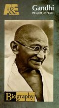](http://baike.baidu.com/albums/18595/18595/0/0.html#0$a1ad16fa31b09af058ee9052)
甘地

2、要活就要像明天你就会死去一般活着。要学习就要好像你会永远活着一般学习。（11月5日名言） 
　　原文：Live as if you were to die tomorrow. Learn as if 
you were to live forever. 
　　3、生由死而来。麦子为了萌芽，它的种子必须要死了才行。 
　　4、国家都是由苦难中产生的。 
　　5、不使用暴力，是谦逊的极限。 
　　6、如果我们能发展意志力，我们就会发现我们不再需要[武装](http://baike.baidu.com/view/391255.htm)力量了。 
　　7、无数的例子让我深信，上帝终将拯救那些动机纯正的人。 
　　8、祈祷不是要求，而是灵魂上的渴望。 
　　9、懦夫是不会有爱的，爱是勇者的特性。 
　　10、就是因为自己非常怕死，所以才会对别人的死亡流下眼泪。 
　　11、有信心，即不知道有失望。 
　　12、当我绝望时，我会想起：在历史上，只有真理和爱能得胜，历史上有很多暴君和凶手，在短期内或许是所向无敌的，但是终究总是会失败。好好想一想，永远都是这样。 

　　13、[贫穷](http://baike.baidu.com/view/88575.htm)才是最糟糕的暴力。 
　　14、手段的不纯洁，必然导致目的的不纯洁。 
　　15、我的人生就是我想要传达的信息。 
　　16、地球所提供的足以满足每个人的需要，但不足以填满每个人的欲望。 
　　17、欲变世界先变其身。 
　　18、嗨，[罗摩](http://baike.baidu.com/view/919987.htm)！（甘地遗言，意即“哦，天哪！”）

[编辑本段](http://baike.baidu.com/view/18595.htm#)历史评价
--------------------------------------------------

　　甘地的思想极为庞杂。他留下了卷帙浩繁的言论记录，其内容涉及哲学、政治、经济和社会各个方面，不仅宗教的与政治的混为一谈，而且资产阶级思想与小生产者思想兼而有之，可以说是无所不包，无奇不有。然而甘地主义的核心却是其为印度民族解放斗争提出的真理与非暴力学说。而对强大的武装到牙齿的敌人，他提出的唯一斗争武器就是坚持真理与非暴力。用甘地的话说，真理是神，非暴力则是追求真理、即认识神的手段，甘地认为这是强者的武器。这种抽象而富有神秘色彩的学说看起来令人费解，
[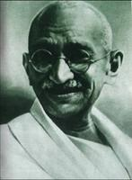](http://baike.baidu.com/albums/18595/18595/0/0.html#0$0b14ad19c04b0b2242a9ad5c)
微笑的甘地

难以让人信服，但它却包含着重要的政治内容，具有较大的应用价值。因为在印度这样一个种族混杂、宗教信仰多样、种姓隔离和英国实行分而治之政策的殖民地国家，“真理是神”实际上是把印度各种各样的宗教信仰“众神归一”，把宗教的神与现实中的理想揉和在一起，用人民大众熟悉、了解的语言和形式，唤起人们在真理的旗帜下不分种族、宗教、教派、种姓团结起来，勇敢无畏地追求真理。这无疑是印度资产阶级借以宣传群众、组织群众、吸引群众参加反英斗争的有效武器。同时因为它提倡非暴力，不仅适应了英国殖民统治下人民被剥夺了武装的权利，一直受宗教成见麻痹的现实，也能在一定程度上被披着议会民主制外衣、富于统治经验的殖民者接受；不仅能发动群众，又能始终把群众运动限制在一定的范围内，因而很适合印度[民族资产阶级](http://baike.baidu.com/view/88755.htm)在“一战”和十月革命后印度民族独立运动蓬勃兴起，无产阶级[世界革命](http://baike.baidu.com/view/918472.htm)高潮来临的时代条件下，既希望利用群众的反帝斗争以实现自身的政治经济目标，又要防止工农运动的深入发展危及其自身利益的需要。印度现代民族解放运动几度汹涌澎湃，虽历遭挫折，却历久不绝，并最终在世界人民反法西斯战争胜利后，民族独立和解放运动大势所趋的形势下，迫使英国殖民者撤出印度，应该说，甘地主义在这一过程中起了重要的作用。 

　　当然，甘地把非暴力作为宗教信仰和不可更改的[原则](http://baike.baidu.com/view/616305.htm)，明显地具有种种弊病和[缺陷](http://baike.baidu.com/view/1122313.htm)，对印度民族解放运动产生了一些消极影响。如绝对的非暴力不可能实现；贬斥一切暴力，给群众运动制定清规戒律，不准越雷池一步，必然束缚群众的积极性和创造性；如果只要发生暴力就停止运动，必然挫伤士气，丧失革命时机，延长革命过程；群众性自苦和自我牺牲，总有时间和环境的局限性；在反革命暴力的镇压下，徒手的抵抗只能是无谓的牺牲；注重小处着眼，认为注重手段目的自明，往往导致轻重倒置，目标模糊；非暴力的宗教色彩迎合了群众的蒙昧落后意识，不利于群众的真正觉醒；等等。尽管如此，甘地的真理与非暴力学说仍在理论和实践上值得我们进一步研究。 

　　甘地的一生复杂多变，极富争议。无论对于他的敌手，还是他的亲密同事抑或一般群众来说，他始终是个谜。人们对他的评价也是众说纷纭，毁誉不一。在一些人看来，他简直是“神的化身”、“真理的代言人”，而在另一些人看来，他是“欺世盗名的救世主”、“矫揉造作的阴谋家”。曾几何时，他被斥责为“印度封建主义不折不扣的辩护士”、“帝国主义的帮凶”、“群众性民族解放运动的主要叛卖者”，但时至今日，人们一般都承认，甘地是印度民族资产阶级的代表，印度现代民族解放运动的[领袖](http://baike.baidu.com/view/51151.htm)，他对印度的民族独立和解放事业功不可没。 
　　甘地的伟大人格几乎是举世公认。他具有赤诚的爱国热诚，崇高的牺牲精神，追求真理的执著信念；坚强的意志，坚韧的耐心，随机应变的本领；他待人谦恭、诚实、光明磊落，不分贵贱善恶一视同仁，没有种族歧视和宗教偏见；他注重实际，反对空谈；他关心下层人民疾苦，善于体察民情并始终与人民群众打成一片；他生活清苦，安贫乐道；他尊重女性，提倡人的精神完善和社会和谐；他的道德修养堪称楷模。正因为如此，甘地这位身材矮小、其貌不扬的东方人博得了不同民族、信仰和阶级的人的景仰和爱戴。 

　　他被人们称作“巴普”，意思是父亲，因为他是20世纪印度的[国父](http://baike.baidu.com/view/65205.htm)。即使在印度从英国统治者手里争得独立之前，很明显甘地就已经是3亿8千万印度人争取自治斗争中的关键人物和领袖。

[编辑本段](http://baike.baidu.com/view/18595.htm#)社会评论
--------------------------------------------------

　　甘地远不只是一个聪明的律师、优秀的[演说家](http://baike.baidu.com/view/425634.htm)、坚定的人权战士和政治领袖。
[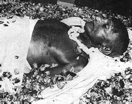](http://baike.baidu.com/albums/18595/18595/0/0.html#0$2e6fa73828c0f3a5d462255d)
洒满花瓣的圣雄遗体在火化前一刻供人瞻仰

他还是一种与众不同的政治领袖的典范。他写过一本有关他早年生活的书，书的标题是“我体验真理的故事”。奥秘就体现在这个标题中。他可以无拘束地谈论他的失败和他的困难。他犯了错误时，就自动承认错误。 

　　首要的是，他拒绝从他的政治活动中获取任何[利益](http://baike.baidu.com/view/508359.htm)。在他回[印度](http://baike.baidu.com/view/2174.htm)之前，他就决定要像穷人那样生活，决不占有财富。他在印度旅行时，坐的是硬座，从不预订座位，而是跟农民和其它普通百姓在一起。在城市里，他拒绝乘坐人力车——一种由赤脚男人拉着的两轮车。他吃得很简单，从不吃肉。他早晨起得很早，然后坐在纺车旁纺棉线。他认为从领袖到最穷的农民人人都应该准备干[重活](http://baike.baidu.com/view/1754239.htm)。 
　　他对所有宗教问题都感兴趣，而不只是对印度的神。他读过很多的书。每天傍晚六点钟，他都暂停工作进行祈祷，甚至当他跟其它的世界领袖在一起的时候也是这样。每周总有一整天，他是在沉默之中度过的。在他的一生中，他总是设法获得神灵的真谛。 

　　甘地认为人们都应该能够“像爱自己一样爱世上最平凡的人”。甘地憎恨几千年来使印度社会分裂成不同种姓的那种习俗，而他的目标就是要废除这种习俗。他支持那些干收入最低的活的、属于社会最贫困阶层的人们。由于他的身体力行，所有印度人终于能够自由地在村子里同一口井中打水喝，到同一个寺庙去祈祷，甚至可以相互通婚。 

　　甘地对于妇女平等的问题给予极大的重视。他最大的信念也许就在他所说的“真理的力量”这个印度习语中。如果存在一条不公正的法律，——在印度和南非的英国统治者曾经通过了许多这种法律——那么，每个人都有责任拒绝服从这条法律，但不采取暴力手段。人们应该为了他们的信念而随时准备进监狱，而不应该拿起武器去战斗。 

　　莫·甘地是以个人之力抗拒专制、拯救民权和个人自由的象征。尽管甘地在[1937年](http://baike.baidu.com/view/673049.htm)到[1948年](http://baike.baidu.com/view/286269.htm)之间获得过五次[提名](http://baike.baidu.com/view/1304958.htm)，但他始终没有获得过[诺贝尔和平奖](http://baike.baidu.com/view/138850.htm)。多年以后，[诺贝尔委员会](http://baike.baidu.com/view/4358614.htm)对此公开表达过他们的遗憾。 
　　甘地去世后，他的事迹一直受到广泛的评论。例如英国首相[丘吉尔](http://baike.baidu.com/view/11240.htm)不禁感慨说：“见到甘地先生，……是令人作呕，他曾是一个妨害治安的Middle 
Temple出来的律师。现在在东方作出苦行僧的样子，半裸的在总督府前游行，却出名了”。 
　　[爱因斯坦](http://baike.baidu.com/view/2218.htm)这样评论甘地：“后世的子孙也许很难相信，世上竟然真地活生生出现过这样的人。”（Generations to come 
will scarcely believe that such a one as this walked the earth in flesh and 
blood.）他又说：“我认为甘地的观点是我们这个时期所有政治家中最高明的。我们应该朝着他的精神方向努力：不是通过暴力达到我们的目的，而是不同你认为邪恶的势力结盟。” 

　　1999年《时代》杂志将甘地评选为20世纪风云人物。第一名是爱因斯坦，第二位是[罗斯福](http://baike.baidu.com/view/20972.htm)总统，印度的甘地则名列第三位。

[编辑本段](http://baike.baidu.com/view/18595.htm#)艺术作品
--------------------------------------------------

　　**电影**
　　关于甘地最出名的艺术作品应该是电影《甘地》。该片的导演是[理查德·阿滕伯勒](http://baike.baidu.com/view/280500.htm)（Richard Attenborough）；主演是[本·金斯利](http://baike.baidu.com/view/280495.htm)（Ben Kingsley），他的一半
[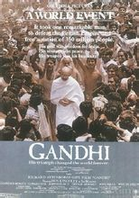](http://baike.baidu.com/albums/18595/18595/0/0.html#0$cebd0017bb2505664b90a734)
电影《甘地》

血统也是来自[古吉拉特邦](http://baike.baidu.com/view/359972.htm)。 
　　其次是电影“The Making of the Mahatma”展示的是他在南非的二十一年，主演是Rajat 
Kapur。　 
　　**雕塑**
　　在英国，有几座甘地的塑像，最著名的是在他学习法律的伦敦大学学院的附近的Tavistock Gardens。 
在美国，[旧金山](http://baike.baidu.com/view/7407.htm)的Ferry楼旁， 
　　[休斯敦](http://baike.baidu.com/view/36093.htm)的Herman公园， 
　　纽约的Union Square， 
　　[亚特兰大](http://baike.baidu.com/view/60489.htm)的马丁·路德·金纪念处，
[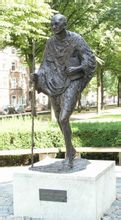](http://baike.baidu.com/albums/18595/18595/0/0.html#0$7aad4ae786799349b8382035)
甘地纪念碑，美国纽约中央公园

　　[华盛顿特区](http://baike.baidu.com/view/449140.htm)Dupont Circle的印度使馆附近， 
　　都可以看到甘地的塑像。 
　　在[巴黎](http://baike.baidu.com/view/11269.htm)， 
　　[阿姆斯特丹](http://baike.baidu.com/view/31504.htm)， 
　　[巴塞罗那](http://baike.baidu.com/view/2222.htm)和[里斯本](http://baike.baidu.com/view/55446.htm)， 
　　也有甘地的雕塑。 
　　印度政府赠给[加拿大](http://baike.baidu.com/view/3647.htm)温尼伯市一座雕塑，以表达他们对安家于此的加拿大人权博物馆的支持。
[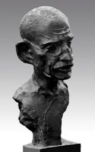](http://baike.baidu.com/albums/18595/18595/0/0.html#0$242dd42a2834349b5dacad1fc9ea15ce37d3be86)
薛林纳的青铜雕塑《圣雄甘地》

　　**传记**
　　**图书信息**
　　书 名：甘地 
　　作　者：（美国）凯瑟琳·布什 阿瑟·施莱辛格 
　　出版社：中国工人出版社 
　　出版时间：2010年01月 
　　ISBN：9 787 500 845 867 
　　开本：16开 
　　定价：22.00 元
[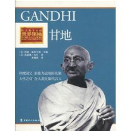](http://baike.baidu.com/albums/18595/18595/0/0.html#0$14ce36d3d539b6005f64cc2de950352ac75cb786)
《甘地》传记

　　**内容简介**
　　圣雄甘地被尊称为印度国父，他倡导“非暴力不抵抗”运动，带领印度人民脱离英国殖民统治。实现国家独立。他对道德完善、心灵宁静以及人格完美的不懈追求。为世人惊叹并永远铭记。他是人类良知的代言人。《甘地》生动再现了他饱经忧患，历尽坎坷，追求真理的一生。 

　　**作者简介**
　　凯瑟琳·布什（Catherine 
Bush）美国专业作家，写作领域包括小说、艺术评论及书评。在本丛书中还撰写有《[伊丽莎白一世](http://baike.baidu.com/view/14059.htm)》。 
　　阿瑟·施莱辛格(ArthurM．Schlesinger，)(1917-2007)美国著名历史学家。因其父也为著名历史学家，为有所区别，人称小施莱辛格。毕业于[哈佛](http://baike.baidu.com/view/30410.htm)、[剑桥大学](http://baike.baidu.com/view/13714.htm)。1945年29岁时因《杰克逊时代》获[普利策](http://baike.baidu.com/view/42056.htm)历史奖；1966年因《一千天：[肯尼迪](http://baike.baidu.com/view/100413.htm)在白宫》第二次获普利策奖。曾先后担任过肯尼迪和[约翰逊](http://baike.baidu.com/view/54148.htm)总统的特别顾问。 
　　**图书目录**
　　一套开拓视野、有助[历史](http://baike.baidu.com/view/8081.htm)反思的书(推荐序一) 
　　传达进步的历史观(推荐序二) 
　　左图右史，图文两证(推荐序三) 
　　不论是福是祸，领袖能改变历史(原文版序) 
　　1、甘地的印度 
　　2、少年甘地 
　　3、伦敦的学生 
　　4、从律师变成领导者 
　　5、进一步的转变 
　　6、南非的萨提亚格拉哈运动 
　　7、混乱的印度 
　　8、不合作主义 
　　9、一把海盐 
　　10、自由的痛苦滋味 
　　11、甘地死后 
　　大事年表 
　　延伸阅读 
　　索引 
　　图片索引 
　　印度历史大事年表

[编辑本段](http://baike.baidu.com/view/18595.htm#)其他信息
--------------------------------------------------

　　**与尼赫鲁-甘地家族的关系**　 
　　印度的政治家族尼赫鲁-[甘地家族](http://baike.baidu.com/view/3899910.htm)与圣雄甘地无血缘关系。当年圣雄甘地的追随者尼赫鲁和他的女儿英迪拉以及外孙拉吉夫（英迪拉的长子）相继成为[印度总理](http://baike.baidu.com/view/4500306.htm)。巧合的是，英迪拉嫁给了一位也姓“甘地”的记者[费罗兹·甘地](http://baike.baidu.com/view/4922322.htm)（Feroze 
Gandhi，生于一个区别于印度教的异教家庭），所以她的姓跟西欧一样，随夫姓由“尼赫鲁”变成了“甘地”，她的姓名便成了[英迪拉·甘地](http://baike.baidu.com/view/143991.htm)（Indira 
Gandhi），这个政治家族才采用甘地这个姓氏，从而有了影响印度政坛的[尼赫鲁](http://baike.baidu.com/view/86860.htm)-甘地家族一说，人们简称为甘地家族。新近宣布弃任总理的[索尼娅·甘地](http://baike.baidu.com/view/157843.htm)是[拉吉夫·甘地](http://baike.baidu.com/view/546775.htm)的[遗孀](http://baike.baidu.com/view/710.htm)。[4]
　　**简析“非暴力不合作运动”**
　　**积极性**：甘地领导的[非暴力不合作运动](http://baike.baidu.com/view/34158.htm)，是从宗教的角度团结人民凝聚起民族解放的精神，增强了印度人民的自尊心和自信心，从精神领域沉重打击了英国的殖民统治。实际上，甘地在以“[大爱](http://baike.baidu.com/view/1003393.htm)”的方式回击猛烈的暴力。 
　　**局限性**：另一方面，如果以“非暴力”限制人民的革命运动，就必然挫伤士气，丧失革命时机，延长革命过程。群众性自苦和自我牺牲，总有时间和环境的局限性