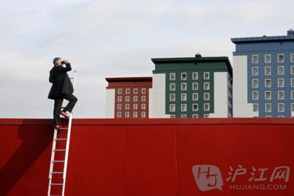

　　

你会取代我的地位吗　　Q: Will you be out to take my job?

　　提问：你会取代我的地位吗？

　　A: Maybe in about twenty years, but by then, I suspect you'll be running the entire company and will need a good, loyal lieutenant to help you manage this department!

　　回答：也许20年后会。不过到那个时候，您将会掌管整个公司，并且需要一个优秀的、忠诚的员工来协助您管理这个部门。

如果你在这里工作了5年还没有得到升职　　Q: What if you work here for five years and don't get promoted? Many of our employees don't. Won't you find it frustrating?

　　提问：如果你在这里工作了5年还没有得到升职，我们这里很多员工都遇到过这种情况。到时，你会不会觉得很受挫？

　　A: I consider myself ambitious, but I'm also practical. As long as I am continuing to learn and grow within my position, I'll be a happy camper. Different companies promote people at different rates, and I'm pretty confident that working for you will keep my motivated and mentally stimulated for several years to come。

　　回答：我觉得自己是个很有抱负的人，同时我也很实际。只要我能够在所从事的岗位上不断地学习和成长，我就很高兴了。不同公司的晋升速度是不一样的。我自信在贵公司工作可以在未来的几年里一直激励我进步。

你最大的缺点是什么？　　Q: What is your biggest weakness that's really a weakness, and not a secret strength?

　　提问：你最大的缺点是什么？我指的是真的缺点，而不是披了缺点外衣的优点。

　　A: I am extremely impatient. I expect my employees to prove themselves on the very first assignment. If they fail, my tendency is to stop delegating to them and start doing everything myself. To compensate for my own weakness, however, I have started to really prep my people on exactly what will be expected of them。

　　回答：我很没有耐心。我希望我的下属能在接到任务的第一时间就证明自己的实力。如果他们失败了，我就不会再把任务交给他们去做，而是自己亲力亲为。不过，为了弥补这个缺点，我会在一开始把工作交代给他们的时候，就说清楚我希望得到的是什么样的结果。

我要怎么确定你以前的工作经历对我这一行有用呢？　　Q: You have changed careers before. Why should I let you experiment on my nickel?

　　提问：你之前从事过不同的行业，我要怎么确定你以前的工作经历对我这一行有用呢？

　　A. As a career-changer, I believe that I'm a better employee because I've gained a lot of diverse skills from moving around. These skills help me solve problems creatively。

　　回答：作为一个在不同行业工作过的人来说，我觉得自己更能胜任成为好员工，因为我在不同的行业里积累了各种工作经验和技能，这些技能可以帮助我在思考问题时更有想法、更具创造力。

如果你知道你之前所在的公司正在面临困境，那你为什么不早点离开那里呢？　　Q: If you knew that things at your company were rocky, why didn't you get out of the company sooner?

　　提问：如果你知道你之前所在的公司正在面临困境，那你为什么不早点离开那里呢？

　　A: I was working so hard to keep my job while everyone around me was being cut that I didn't have any time left over to look for another job. With all of the mergers that have been happening in our field, layoffs are a way of life. At least I gave it my best shot!

　　回答：当我的同事纷纷被解雇的时候，我还在努力地工作，我没有时间去找其他的工作。我们这个行业常常会有兼并，下岗也就成了常态。至少，我坚持到了最后。

上一页1[2](http://edu.sina.com.cn/en/2012-05-28/104466902_2.shtml)[下一页](http://edu.sina.com.cn/en/2012-05-28/104466902_2.shtml)

分享到: