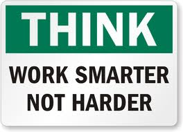

看结果，而不是看时间，如何提高效率：

陈小蒙 发表于 10/10/12 09:07 | 分类标签: 

专栏 生活方式 效率

---

时间：下午五点。地点：办公室。

因为速度够快，你已经完成了一天的工作，很想回家。但是，你的同事们一个个都还没有走，所以，你又不得不在办公室呆上一两个小时，上上网，或者再重新读读邮件什么的。这样…就没人当你是懒汉了。

这是一个典型的不幸事实：在如今的各大公司，讲究效率反而没有得到应有的提倡和鼓励。当我还在华盛顿一家律师事务所工作时，我就经常有这种体会。因为我之前有一些经验，所以通常都可以快速地回答一个客户的问题，这实际可以节省我们双方的时间。但是，跟很多律师事务所一样，我们这家事务所也是按照小时来付工钱的，所以，我的效率反而让我吃亏了。

从律师事务所的角度来说，按小时付费有一定的合理性：因为一旦我的工作所花去的时间超过预期，他们也能将这种风险转移到客户身上。但是，从一个客户的角度来说，这对他们就不怎么利好了。因为这会鼓励律师们对某个案件投入过多精力，过度调查。而对我自己来说，按小时付费也不公平。因为我回答问题总是很快，所以我的付费时间就不会很长，这就意味着我自己承担了收入不足的风险。

不过，那些看重工作小时多于看重工作结果的公司实际还真的不少。在2010年的一项调查中，研究人员对39名的公司经理进行了采访，并询问了他们对公司员工的看法。结果，这些经理们认为那些在工作时间内老老实实呆在办公室的员工为“高度可靠”、“非常可以仰仗”，而那些在周末过来加班或者在工作日在办公室呆到很晚的员工则被视为“对工作尽心尽力”。

有一个经理这样说道：“有这么一个员工，他会出席每一个会议。尽管很多时候他都一言不发，但他就是很准时，大家会注意到这一点。这个人绝对会被认为是一个努力工作、可以信赖的员工。”另外一个经理则说：“在周末加班能给人留下一个好印象。因为你是在传达这样一个信息：你在为团队做贡献，并在付出额外心力完成工作。”

其实这些经理的反应还是可以理解的，这是工业时代遗留下来的经验判断——因为在那个时代，工人们在流水线中的工作被完全标准化了（在这种情况下，时间代表了劳力）。但是，对知识工作者而言，一个基于工作小时的评估体系可以说是没有任何意义。因为他们做出的贡献，是通过他们的价值，即他们通过运用自己的想法和经验创造了多少价值，这一点来评估的。

很多组织都将工业时代的那种思维方式带到了21世纪的职场，而他们这么做恰恰是在打击员工提高效率的积极性。假如员工需要在下班后刻意留得比较晚以取悦老板，那么在白天的正常工作时间内，他们怎么可能还有动力把该做的事情都做完呢？因为毕竟，他们怎么样都能把这段必须“露脸”的时间花掉，不管他们真是在分析客户数据还是仅仅在上网。在这种情况下，很多职场人员患上拖延症，却很难在一个任务上集中精力，也就不足为奇了。

而这里面的解决方案也显而易见：通过你创造的结果来评估自己，而不是在那计算你的工作时间。想想看，你有没有处理掉挤压的客户订单，有没有想出一个新的点子来解决一个棘手问题，有没有为下周截稿的文章写上一篇初稿。显然地，这些成就，而不是你游荡掉的时间，才会最终决定整个机构的成功。

关于这种以结果为导向的战略的制定，实际应该基于你的工作、公司的具体情况来具体处理。不过，这里面还是有一些在各行业通用的、可以提高效率的方法：

- 限制会议。内部会议可以浪费大量时间。一个短小的会议有可能利于讨论一个有争议性的问题，但是长会议——我是指那些超过60到90分钟的会议——通常情况下的产出却很低。在会议中，很多公司的老板都会花很多时间背诵一些介绍性的资料，而参与者最终只会失去注意力。

假如你预感某个会议会很长，而且产出不高，那你一定要尽力避免掉这样的会议。可能的话，你可以向你的同事指出工作的deadline来推掉这些会。假如你没法这么做，那就跟他们直说，你最多只能听前面的60分钟，然后你就得接着干那些更紧急的事情。另外，你自己在组织会议的时候也得足够谨慎，因为其实大部分问题你都可以通过电子邮件或者快速打个电话解决掉。

假如你参与到了一个会议的计划和组织当中，也记得一定要保证这个会议会有足够的产出。做个组织会议的会议议程，并确保每个流程都不拖沓。然后，至少提前一天把会议议程，以及任何相关资料发给其他人。另外，在每一次会议中，你都必须指定一个“魔鬼代言人”，指定这么一个人是为了确保一个话题的潜在不利因素已经得到讨论。

在每一次会议结束时，你也要确保大伙儿都对接下来的各个战略没有异议，每一项职责都已经分配给某个参会者，并包含了具体的期限。

- 不用什么都读。你没有必要把工作中碰到的所有材料都从头到尾读下来，即便那些材料来自你的老板。尽管一页页读文章可能会让你自觉效率很高，但是实际上你可能可以更好地利用时间。很有可能的情况是，一份资料中只有很少一部分内容对你的工作非常重要。所以你需要记住的是那个大的、主要的意思，而不是里面的各种细节。也或者，你可能只需要在里面找到一两个能说明一个更大观点的例子而已。每一次你开始读文本时，都要记得去主动搜索那些重要信息，那些不太相关的部分跳过即可。

当然,有些资料确实需要你掌握所有的细节。假如你现在在读一篇跟公司最新的重磅产品相关的文章，那么你从头到尾仔细读是应该的。不过，对那些不是很重要的任务而言，你就没有必要这么细致了。

然后，你也要避免重复读电子邮件。我自己就非常信奉一个原则：一次处理干净。当你在读一封邮件的时候，你就要决定要不要回复它。假如你需要回复，那么就当时当刻回复。我发现，80%的邮件，不管是内部还是外部邮件，都不需要回复。

- 写得更快。即便你想把一个项目做到A+，你也不用一开始就做到尽善尽美。很多人在写文章的时候，都要把前面一句话写得完美无瑕，才会继续写后面一句话。他们希望一次性把一个写作过程全部完成。这其实是最困难不过的一项工作。根据我自己的经验，这样做的写作效率非常低。

一种更好的方法是，你先想想几个主要步骤。先为你要表达的内容准备一个大纲并想想各部分的次序。接着写一个草稿，而且你应该清楚一点，即这个草稿不可能没有瑕疵。在这些流程之后，你可以重新把草稿过一遍，然后把该修改的地方修改掉。这个时候，才是你真正应该完善句子用词的时候。

一般来说，假如一份工作做到B+就可以，你就没有必要做到A+。你可以把额外的时间放在那些真的需要做到A+的项目上。

当你尝试上面的和其他各类以结果为导向的方法时，你发现你在办公室花的时间将会更少——这可能会让一部分的老板不安。毕竟，传统的评估方法，即按照员工的“露脸”时间来评估员工对公司价值的方法，对经理们来说更加简单，因为简单计算时间比真正评估结果要省力多了。不过也正因如此，你才需要跟你的老板建立一种新的关系。

你必须得让老板相信，你就是可以在更短的时间内把工作做完。这里面的一种办法是，仔细思考你所在的组织，并学会观察你的老板。问问你自己：你这个单位最重要的目标是什么？你的老板在面对哪些压力——是全球扩张、引进新产品、降低成本还是其他什么别的压力？这个老板的性格和管理风格又会对这类问题产生什么样的影响？

不过光是思考和观察还是不够，你还必须学会沟通，而且需要经常沟通。每周，你都需要写一个清单，把分配给你的任务都写在上面，不管是短期任务还是长期任务，而且还要从你自己的角度，按照重要性给它们排个序。然后，你需要把这个清单拿给你的老板看，让他来权衡这个清单。

接下来，你应该跟你的老板就你所涉及的每一个项目指标达成共识。假如你的老板没有给出任何指标，你就需要自己向他暗示。这些指标既可以包括定量的结果，也可以包括定性的结果。它们为评估最终结果提供了客观的测量方法——而且也让你的老板不再单纯依赖“露面时间”判断你的工作绩效。另外，建立整个指标的全过程也可以让你跟老板看清楚，实际怎么做才会最好地完成一个项目。

一旦你的老板深信你知道自己要做什么，怎么去做，你就需要向他证明，针对那些优先级高的项目，你可以始终带来满意的结果。这里面没有什么特定的秘密：竭尽全力，你才能达到设定的目标。另外还得记住一点，大部分项目在实施过程中都会碰到坑坑洼洼甚至是路障，所以你要及时向老板反馈问题，并提供一些可能的解决方案，甚至…修订项目指标本身。

我知道，从关注工作时间到关注结果，对某些组织而言会是一个大挑战。但是，假如你可以非常礼貌地向你的老板提出这个关于效率的问题，并告诉他你愿意为自己的工作结果、而不是工作时间负责，你的老板很有可能还是会接受这一点。另外，这也就意味着你可能可以在家做更多的工作，假如这是你所希望的话。

不过，即便你处在一个以结果为导向的团队文化中，有时候你也必须到办公室工作，而且有些工作也确实需要员工百分百在公司。在几乎所有的工作场所中，同事之间都需要聚在一起头脑风暴挖掘想法、解决难题或者建立团队纽带。不过，这类互动绝对没有理由占据你的很大一部分时间。

以我自己为例，通过强调结果而不是工作时间，我几乎可以每天在晚上7点就回到家——除了一些紧急情况以外。这极大地提高了我的家庭生活质量，而且也给了我另外一个好处：一个富有成效的休息。晚上10点在家的时候，我曾经解决了工作中最为棘手的几个问题——当我跟妻子和孩子们聊了几个小时、重新振奋以后。

可以说，专注于结果而不是工作时间，可以让你在工作时完成更多的事，同时又留出更多的时间给其他事。跟你的老板去谈这些问题，别害怕。引用管理学大师彼得德鲁克的一句名言来说，尽管你不一定要喜欢你的老板，但是你必须要能管住他/她，因为这样你才能有一个成功的事业。

本文作者Robert C. Pozen是哈佛商学院的一名高级讲师,布鲁金斯学会的资深研究员,著有《极端生产力:提高你的结果,减少你的时间》