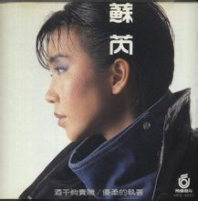
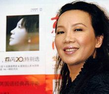
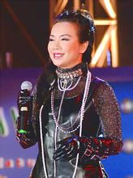
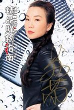
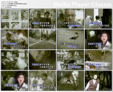
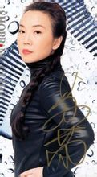

编辑本段人物简介

  

苏芮1986

　　1968年，苏芮开始音乐生涯，在香港及台湾的夜总会及俱乐部里演唱英文歌曲。1976年出版一张英文唱片，1983年凭《搭错车电影原声大碟》大器晚成，一跃成为华语歌坛“黑衣歌后”、摇滚女神，街头巷尾到处都回旋着她摄人心魄的歌声。随后的几张大碟也都集中了最优秀的音乐工作者，苏芮以她在歌坛不可动摇的地位，成为东南亚地区歌坛巨星。连日本著名音乐评论家富泽一诚也称赞苏芮具有欧美超级巨星的气势，歌声足以代表台湾的现代音乐。 　　作为八十年代最著名、最有成就的实力派歌手代表，九十年代至今苏芮仍有不少佳作传世，影响了两岸三地几代的歌手和乐迷，其音乐魅力历久弥新。可以毫不夸张地说，全世界有华人的地方就一定会有苏芮的声音。 　　她声音的特质与力度没有人能望其项背。她使女歌手的地位大为提高。过去，女歌手只能唱一些软性的、无病呻吟、阴柔的小调，而苏芮却能唱出比男性还要阳刚的歌曲。（罗大佑语） 　　苏芮可以说是整个华语歌坛确立明确音乐风格的一个音乐人和艺术家，如果确立国语演唱标准的话，邓丽君是一个，苏芮是另一个。她的歌曲铿锵有力，是一种情感的爆发，是一种艺术和功底的爆发。(那英语) 　　1999年参演了中央电视台春节联欢晚会歌舞：《激情飞越》。

编辑本段个人档案

　　中文名：苏芮 　　英文名：Julie Su 　　别名：苏瑞芬

  

苏芮

　　星座：双子座　　血型：AB 　　身高：158cm 　　学历：高中 运动：慢跑、羽毛球、游泳 　　嗜好：听歌、看电影 最喜欢的一本书：《三国演义》　　最喜欢的男歌手：Michael Jackson最喜欢的女歌手：Aretha Franklin 　　最喜欢的男演员：Tom Cruise 最

苏芮(4张)

喜欢的女演员：Bette Miller 　　最喜欢说的口头禅：顺其自然 最喜欢的异性类型：潇洒、大方 　　最大的愿望：能当“长青歌手” 最讨厌的事：说错话 　　最希望去的地方：悉尼最害怕的东西：蛇、老鼠 　　最经典专辑：搭错车电影原声带/第六感/蓦然回首/台北·东京（跟着感觉走） / 东方快车谋杀案 / 牵手 / 花若离枝

编辑本段星路历程

　　1983年，苏芮首张国语专辑“搭错车”推出是她演唱生涯的一次转折。这张专辑体现了故事与音乐互为附注的完美结合，在当时靡靡小调盛行的台湾流行乐坛几乎具有划时代的意义。这种反叛精神的背后凝结了新一代台湾流行音乐人(包括罗大佑、梁弘志和李寿全等人)的心血付出。可以讲，如果没有苏芮，邓丽君的歌曲会延长流行至少十年。 苏芮的演唱可谓是厚积簿发，她的嗓音时而高亢嘹亮，时而婉转低沉，极为到位地将歌曲中的情绪表达出来，让听者不由自主地随着歌声的起伏而感动，也使得在歌坛沉浸了十多年的苏芮终于大器晚成，更使得台湾流行音乐进入了一个个性化的时代。同时，她的黑衣摇滚造型也引领了黑色在华人时尚界的流行。 　　她的歌声具有特有的韧劲，加上其宽广的音域，造成一种强烈沧桑感，给人以极其深刻的印象。这种忧郁的本质与蓝调音乐一脉相承，在中文歌曲领域，苏芮蓝调摇滚的演绎风格至今无人能够超出。 　　1983一夜成名后，苏芮迎来了歌唱生涯的黄金时期。在随后的7年中，她以每年两张专辑的速度扩张着自己的影响力，并相继推出了很多令人难忘的金曲。这一时期的“黑衣歌后”苏芮风光无限，她高昂的唱腔、超凡脱俗的演唱，不仅令当时的乐坛为之倾倒，更是在很大程度上指引了华语流行音乐的走向，成为众多港台及内地歌手的模仿对象。到了1988年，随着《台北东京》专辑的发行，她迎来了个人事业的第二个高峰。至此，“苏芮”两个字已不仅仅是一个歌手的名字，更成为实力和成就的象征，成为用心血和灵魂去歌唱人生的典范。1990年后，盛名之下的苏芮进入了事业的平台期，这期间她离开了飞碟，加盟到福茂，并经历了丧父、生子等人生变故，事业因此而有所停滞。苏芮在飞碟的7年是很多歌迷心中永恒的7年，这段时间不仅是华语流行音乐史上好歌迭出、空前繁荣的时代，更是苏芮成就斐然的7年――她大部分最著名的歌曲都是在这一时期推出的。

30多张金唱片

　　自1983年踏入国语歌坛，苏芮一共发行了20张个人专辑和1张迷你专辑，横跨国语、粤语、英语、日语和闽南语等多种语种，是名副其实的“多声带歌手”。如果加上精选及同张唱片的不同版本，总数30余张。她早期的每一张唱片都堪称经典，尤其是《一样的月光》，《蓦然回首》，《尘缘》，《有情天地》，《亲爱的小孩》，《第六感》，《台北东京》，这些唱片不仅立意深远、格调高雅，更是在对生活的反思上达到了前所未有的高度；中期的作品以《牵手》最为出色，不仅销量喜人，艺术水准也堪称上乘；后期的作品则以《花若离枝》最为成功，苏芮凭借这张唱片拿下了1998年的金曲奖最佳方言女歌手奖，也让她创下了首次演唱台语歌就在金曲奖上封后的奇迹。

40余首流行金曲

　　苏芮是开演唱会最不发愁没歌可唱的歌手，她的好歌多到迄今为止的每一张精选集都有“挂一漏万”的不足。甚至飞碟和丰华唱片老板彭国华也说：“没有哪个歌手像苏芮一样，可以有这么多经典的歌曲。”虽然人们将目光过多地集中在了《一样的月光》、《酒干倘卖无》、《跟着感觉走》、《牵手》等名曲之上，但稍稍懂苏芮的人都知道，真正的好歌远远不止这些。以下是她最负盛名的40首金曲：《一样的月光》、《是否》、《酒干倘卖无》、《请跟我来》、《心痛的感觉》、《是不是这样》、《迷失》、《明天还是要继续》、《顺其自然》、《内心交战》、《沉默的母亲》、《错》、《亲爱的小孩》、《证人》、《谁可相依》、《车站》、《优柔的执着》、《风雨情怀》、《唱出我和你》、《飞跃的羚羊》、《休息 工作 再工作》、《跟着感觉走》、《奉献》、《钢铁的心》、《一切为明天》、《Papaya》、《凭着爱》、《再回首》、《风就是我的朋友》、《蜗牛的家》、《停在我心里的温柔》、《牵手》、《爱过就是完全》、《不要说走就走》、《我不该看你的眼神》、《花若离枝》、《爱就这么来》、《河》、《你赢》和《我想更懂你》。

30多个重要奖项

　　有那么一段时间，苏芮可以说是拿奖都拿到手软了。从台湾到香港，从新加坡到马来西亚，从大陆到美 　　国，从金鼎奖到金钟奖，从金嗓奖到金碟奖，从金曲奖到金像奖，大大小小50来个奖项，见证了苏芮颠峰时期的荣耀与辉煌。 　　如今的苏芮正以顽强的斗志频繁奔波于两岸三地的舞台上，像个新人一样真诚而执着地对待自己的事业和歌迷。“黑色旋风”虽已青春不在，但她坎坷的人生历程以及非凡的个人成就，必将成为歌迷和后辈歌手心中永恒的榜样和标杆。

编辑本段歌手履历

　　有4个哥哥2个姐姐。 　　1960年代

  

苏芮

初中担任班级康乐委员。

1968年

　　翘课参加歌唱比赛被选中，加入Zero合唱团演唱西洋歌曲，开始歌唱生涯。后加入Action合唱团，取英文名 Julie，全台湾省巡回驻唱，驻唱地点包括知名的77和香港西餐厅等。

1971年

　　高中毕业。 　　与黄莺莺赴台中清泉岗美军俱乐部（CCK）驻唱，并结为好友。

1973年

　　成为台北希尔顿的第一位驻唱女歌手。

1975年

　　被推荐到香港希尔顿饭店演出。在港演唱3年。 　　参加香港无线电视台比赛，获得最佳演出奖。

1976年

　　签约香港house唱片公司。 　　英文专辑 What a Difference a Day Makes发行，翻唱12首英文歌。 　　到新加坡宣传英文唱片，举行个人演唱会。

1978年

　　因签证问题从港返台。 　　于门雷弟餐厅驻唱。 　　在委托任职女店员。

1979年

　　再次到香港发展，但因环境变化，无工作证无法上电视，半年后返台。 　　与香港鼓手阿文结婚。

1980年

　　经好友陈淑桦提醒，发现阿文有第三者，离婚。 　　于美侨Club等西餐厅演唱。

1981年

　　于Star Ship等西餐厅演唱。 　　签约宝丽多（即后来的宝丽金）唱片公司。 　　宝丽多合辑《齐唱45》发行，演唱“热舞”等歌曲。

1982年

　　于音乐城餐厅驻唱。 　　应崔苔青之邀，在其主持的电视节目《夜来香》新开辟的西洋歌曲单元演唱Papaya，被电影导演虞戡平发现，确定为其执导的歌舞片《搭错车》主唱。

1983年

　　签约飞碟唱片公司。接受飞碟唱片老板吴楚楚和统筹彭国华建议，取艺名苏芮。 　　6月18日 《搭错车》电影原声大碟（即《苏芮专辑》）发行。 　　专辑打破唱片销量记录。“一样的月光”在台湾国语歌曲排行榜9周排行第一，为新成立的飞碟唱片公司打下半壁江山。 　　《搭错车》电影原声大碟后来成为华语流行音乐史上里程碑式的作品，并荣获“台湾流行音乐百张最佳专辑”第2名，仅次于罗大佑的《之乎者也》。 　　《搭错车》电影原声大碟成为大陆出版的第一张台湾唱片。 　　“酒干倘卖无”荣获香港电台第7届「十大中文金曲奖」奖 。 　　《搭错车电影原声带》在香港成为白金唱片。 　　“酒干倘卖无”荣获第3届「香港电影金像奖」最佳电影插曲，《搭错车电影原声带》荣获第3届「香港电影金像奖」最佳电影配乐（陈志远、李寿全）。 　　11月《一样的月光》荣获「台湾电影金马奖」最佳电影插曲。《搭错车电影原声带》获「金马奖」最佳电影配乐。 　　12月 荣获「金碟奖」最佳唱片女歌星奖，《苏芮专辑》荣获最佳制作、编曲、歌词、录音奖。

1984年

　　1月《蓦然回首》专辑发行。 　　《蓦然回首》荣获“金鼎奖”优良唱片奖。 　　个人电视专辑“蓦然回首”在台视播出。 　　《蓦然回首》蝉联台湾「流行歌曲畅销排行榜」11周第一。在“台湾流行音乐百张最佳专辑（1975－1993）”中排名43。 　　于新加坡「丽士剧院」举行个人演唱会18场。 　　于马来西亚「金马剧院」举行个人演唱会7场。 　　9月《尘缘》专辑发行。 　　《尘缘》在「流行歌曲畅销排行榜」数周排行第一。 　　荣获“金嗓奖”最受欢迎女歌星奖。 　　香港“红堪体育馆”举行个人演唱会2场，安可达7次之多。 　　台北“中华体育馆”举行个人演唱会1场，齐豫、齐秦、李宗盛等众多艺人到场欣赏，盛况空前。 　　“是不是这样”荣登新加坡十大流行金曲榜首7周。 　　荣获新加坡“银唱片奖”最佳女歌星。新加坡全年十大歌手之一。

1985年

　　荣获“金嗓奖”最受欢迎歌星奖。 　　主持“流行歌坊”电视个人专辑综艺节目13集。 　　2月 与刘威麟结合，开始第2次婚姻。 　　4月《有情天地》专辑发行。 　　接受日本NHK“海外一周”节目专访，荣登“东南亚风云人物”。 　　与甄妮、梅艳芳、林子祥、许冠杰和张国荣等歌手于香港参加白金巨星耀保良慈善演唱会。 　　《有情天地》中“沉默的母亲”荣获「金鼎奖」最佳歌词（陈克华作词）。 　　“沉默的母亲”在台湾流行曲唱片畅销排行榜数周排名第一。 　　《新歌+精选》精选专辑发行。 　　12月《亲爱的小孩》专辑发行。 　　“谁可相依”荣获香港电台第8届「十大中文金曲奖」和「最佳中文(流行)歌曲奖」。 　　“谁可相依”荣获香港「TVB十大劲歌金曲奖」、「最佳作曲奖」和「最佳编曲奖」。 　　“谁可相依”荣获第5届「香港电影金像奖」最佳电影插曲。 　　“酒干倘卖无”荣获香港电台「十年最受欢迎演出奖」。

1986年

　　1月《富贵列车·龙的心》迷你专辑发行。 　　荣获台湾华视「年度最佳综艺主持人奖」。 　　4月11、12日 于香港红堪体育场举行个人演唱会2场。 　　《新曲+精选》获香港「白金唱片奖」。 　　“亲爱的小孩”荣获「台湾电影金马奖」最佳电影插曲。 　　与林子祥、汪明荃、张国荣、张学友、刘德华、陈百强、梅艳芳等艺人于香港博爱欢乐传万家慈善演唱会。 　　10月《第六感》专辑发行。 　　于新加坡「金国歌剧院」举行个人演唱会16场，创下纪录，成为在新举办个唱场数最多的歌手。 　　“新歌新曲”电视个人专辑在华视播出。 　　赴美及加拿大举行个人巡回演唱会9场。

1987年

　　1月《休息工作再工作》粤语专辑发行。 　　《亲爱的小孩》荣获新加坡1986年十张最佳华语唱片第1名。 　　《第六感》荣获新加坡1986年十张最佳华语唱片第9名。 　　于香港红勘体育馆参加“倾城之夜林敏怡林敏聪作品演唱会”。 　　5月《Changes》英文专辑发行。 　　《风雨情怀》电视个人专辑在华视播出。 　　荣获“金嗓奖”最佳演出奖。 　　荣获“金钟奖”最佳女歌星。 　　荣获美国「1987国际天使奖」。“国际天使奖”旨在奖励传达正面社会道德信息的艺人及电视、电影作品。 　　于马来西亚举行个人演唱会11场。 　　《砂之船》日语专辑发行。

1988年

　　1月《台北/东京》专辑发行。“ 跟着感觉走”迅速登上排行榜首。 　　《跟着感觉走》电视个人专辑在华视播出。 　　《台北东京 跟着感觉走》荣获香港「白金唱片奖」。 　　与钟镇涛、青山、罗文、郑少秋、张学友、陈淑桦等艺人参加香港慈善星辉仁济夜演出。 　　10月《一切为明天》专辑发行。

1989年

　　4月《I’ve got the music in me》英文专辑发行。 　　5月《凭着爱》粤语专辑发行。 　　与张学友、王杰、林忆莲等歌手于香港参加星光熠熠耀保良慈善演唱会。 　　7月 签约福茂唱片公司。 　　“凭着爱”荣获第9届「香港电影金像奖」最佳电影插曲，成为荣获「香港电影金像奖」最佳电影插曲次数最多的歌手（3次），此记录1993年被梅艳芳追平。 　　“凭着爱”荣获香港商业电台「叱咤乐坛至尊歌曲大奖」。 　　“凭着爱”荣获香港作曲家与作词家协会、电台及电视台粤语流行曲最广泛演出奖(Radio)。 　　“凭着爱”荣获香港电台第12届十大中文金曲奖「最佳中文(流行)歌词」（潘源良作词）。 　　《不变的心》在大陆发行。 　　12月20日《苏芮经典》精选集发行。 　　12月22日《东方快车谋杀案》专辑发行。 　　《东方快车谋杀案》电视个人专辑在华视播出。

1990年

　　参加中央电视台“综艺大观”，演唱《一样的月光》、《风就是我的朋友》，在人民大会堂演唱《奉献》。 　　5月 与罗大佑参加90自由音乐节，柏林、洛杉矶、香港3地联播。 　　5月16日 参加中央电视台大型晚会《光荣与梦想》。 　　凭《东方快车谋杀案》荣获“金带奖”最佳表演艺术奖。 　　10月17日《停在我心里的温柔》专辑发行 。 　　因怀孕暂停工作。

1991年

　　3月 儿子诞生。 　　12月《苏芮经典II》精选集发行。 　　《给我现在》在大陆发行。

1992年

　　“苏芮在北京”电视个人专辑在中央电视台播出。 　　4月22、23日 与张雨生、林子祥、叶倩文、陈百强、杜德伟等歌手参加上海绿满全球演唱会2场。 　　父亲去世。 　　于海南、深圳、广州等地参加希望工程义演7场。 　　凤还巢，再次签约飞碟唱片公司。

1993年

　　1月1、2日 与钟镇涛、姜育恒、张雨生、吴奇隆、伊能静、郑智化等飞碟歌手于上海举行飞向未来演唱会2场。 　　2月 第1次参加中央电视台春节联欢晚会，以卫星连线的方式与那英、解小东、罗文和巫启贤合唱“携手同行”。 　　3月《牵手》发行，主打歌“牵手”点播率数年内居高不下。 　　9月，参加了中央电视台举办的巴萨罗纳奥运会庆功暨申奥大型晚会《奥林匹克风》。晚会结尾，两岸歌手（苏芮/解小东/杭天琪/红豆/毛阿敏/姜珊/张雨生/章鹏/齐秦/那英）高歌一曲《奥林匹克风》； 　　与王杰等参加于台北举行的“西洋金曲往日情”演唱会。 　　与众歌手于台北参加「流行金曲交响夜」演唱会。 　　《牵手》音乐电视荣获中央电视台MTV一等奖。 　　在美国举行个人演唱会5场。 　　《爱过就是完全》粤语专辑发行。 　　10月 与叶倩文、潘越云、张清芳等入围台湾第5届金曲奖最佳国语女歌手奖（叶倩文获奖）。 　　“牵手”入围台湾第5届金曲奖最佳年度歌曲奖（“吻别”获奖） 。 　　11月20日 “牵手”荣获台湾第5届金曲奖最佳国语歌曲作词（李子恒作词）。

1994年

　　“牵手”荣获台湾《中时晚报》唱片评鉴大赏年度最佳单曲。 　　于大连、成都、武汉、宁夏等地巡回演出10余场。 　　9月22日《变心》专辑发行。 　　10月 参加于台北举行的“西洋金曲往日情”演唱会。 　　与张雨生举行台湾校园巡回演唱会10场。 　　“不要说走就走”电视个人专辑在中央电视台播出。 　　《牵手》专辑获得南京电台500张专辑评选第一名。

1995年

　　参加中央电视台元宵晚会。 　　“牵手”荣获台湾84年度「歌我台北」活动优良歌曲。 　　在美国“Atlantic city, Trump plaza”演唱两场。 　　在美国“Los Angeles, Commerce casino”演唱两场。 　　在丽星邮轮船队演出4场。 　　台湾唱片市场经历集团并构与变革，华纳（Warner）国际唱片公司收购飞碟。原飞碟唱片统筹彭国华等人成立丰华（Forward）唱片公司。 　　签约丰华。 　　“因为你因为我”获慈济大爱年度票选第一名。

1996年

　　在丽星邮轮船队演出8场。 　　与张雨生、郑智化等发行合辑《麻将电影原声带》。 　　于美国举行个人演唱会4场。 　　于台湾国父纪念馆举行「苏芮+底细演唱会」2场。

  

苏芮

1997年

　　3月《花若离枝》台语专辑发行。 　　在丽星邮轮船队演出6场。 　　香港丽星酒店演唱会1场。 　　《国语精选16首》精选集发行。 　　6月 两岸三地歌手苏芮、解小东、韦唯、赵传等拍摄《激情飞越》MV，为6月1日在亚洲飞人柯受良的飞越黄河的活动助威。

1998年

　　1月 与李茂山于美国拉斯维加斯举行新春贺岁餐晚会。 　　4月 与蔡琴、张宇、邰正宵于广州天河体育馆举办演唱会。 　　5月29日 荣获第9届台湾金曲奖最佳方言女歌手。 　　“花若离枝”获第9届台湾金曲奖最佳作词（蔡振南作词）。 　　与张惠妹在台湾“金曲奖”颁奖晚会共同演绎《河》纪念逝去的张雨生。 　　6月13日 在北京“首都体育馆”举行个人演唱会1场。开始在在大陆举行巡回演唱会。 　　30日与罗时丰于美国拉斯维加斯举行端午演唱会。 　　8月13日《爱就这么来》专辑发行。 　　录制《苏芮的音乐爱情故事》电视专辑。 　　录制《苏芮15年音乐Party》电视专辑

靓声丽影(6张)

1999年

　　2月 第2次参加中央台春节联欢晚会，与韦维、温兆伦和黄伟麟合唱“激情飞跃”。 　　3月 签字离婚，维持了14年之久的第2次婚姻破裂。 　　5月22日 于新加坡海港之苑举行个人演唱会1场，继续保持在新举办个唱场数最多歌手的记录。 　　10月2日 参加MTV音乐台于台北华纳威秀广场的露天募款义卖演唱会 　　12月 马来西亚云顶“云星剧场”举行个人演唱会2场。

2000年

　　参加安徽卫视春节晚会录制。 　　2月 与程琳在《同一首歌—走进台湾元宵晚会》首次合唱《酒干倘卖无》，荣获“最佳合作奖”。 　　5月 在北京与齐秦、赵传举行“5.27”「世纪之梦」演唱会。 　　与齐秦赵传、林志炫、孟庭苇等歌手于石家庄举行“爱心跨千年”文化扶贫公益演唱会。 　　6月17日 与齐秦于成都参加“联想之夜”文艺晚会。 　　10月 “ 歌谣百年 台湾世纪金曲票选”总揭晓，3首歌曲入选“1980~2000年流行歌曲”，与蔡琴并列成为获选歌曲最多（3首）的歌手。 　　11月11日 于台北参加金色年华演唱会。

2001年

　　2月14日 与齐秦、黄品源、迪克牛仔等歌手于汕头体育场举行“情人节音乐会”。 　　于山西参加“群星万里行申奥大联欢” 　　5月12日 与齐秦、迪克牛仔、顺子于广州赛马场举行“音乐创世纪超大音乐晚会”。 　　19日 与杜德伟、迪克牛仔、林志炫等歌手于天津举行“群星世纪牵手”大型演唱会。 　　25日 与齐秦、许美静、迪克牛仔等歌手于广西举行“五星级华语歌坛演唱会”。 　　7月13日 与齐秦、巫启贤、动力火车、迪克牛仔等艺人受邀参加申奥成功《奥林匹克情》晚会。 　　29日 伯乐之一、丰华唱片老板彭国华病逝。 　　8月18日 与众友人参加彭国华追思礼拜，带领唱诗班合唱“耶和华是我牧者”，独唱一曲“奉献”，以至哀思。

2002年

　　1月4日 与齐秦于北京参加《飘动的红丝带》公益晚会，合唱“最亲的人”。 　　在央视录制《朋友》节目。 　　10月13日　与莫文蔚、伍佰、张宇、胡瓜等歌手举行相聚沈阳巨星演唱会。 　　12月22日 与陈晓东等艺人于湖南参加第三届中国电视金鹰艺术节闭幕式晚会。

2003年

　　1月19日 与张信哲于加拿大温哥华举行「苏芮·张信哲演唱会」1场。 　　4月4日 与毛阿敏、童安格等歌手于河南新郑市参加“中华根脉·同根同宗同源同唱一首歌大型文艺晚会”。 　　7月 发行《20年特别选》。 　　8月3号 「情声艺动 苏芮20」个人演唱会1场。 　　9月 发行《回首——苏芮时代全经典》。 　　6日　与许茹芸、苏慧伦等歌手参加中国杭州首届的士节“的士之夜”晚会。 　　9月20日 与张信哲等艺人于北京参加庆祝北京建都850周年《辉煌北京》大型文艺晚会演出。 　　11月15日 与张惠妹、五月天、信乐团等30多位歌手于南港101举行“雨生欢禧城”演唱会。

2004年

　　3月27日 在北京“首都体育馆”举行“牵手2004”个人演唱会1场。 　　荣获第4届百事音乐风云榜年度港台及海外华人“终身成就奖”。 　　8月27、28日 与黄莺莺、郑怡、蔡琴、谭咏麟等歌手于台北参加「民歌30 向梁弘志致敬」演唱会3场。 　　10月30日 与齐秦、李宗盛等两岸歌手于北京工人体育馆参加“情系两岸 相约东南”晚会。 　　31日 与姜育恒、张信哲等歌手于新疆乌鲁木齐举行经典金曲演唱会。 　　11月16日 与高胜美、张镐哲、文章、迪克牛仔、刀郎等举行深圳群星演唱会。 　　12月 与刀郎、张信哲等艺人于成都参加《华西都市报》创刊10周年暨跻身全球日报发行百强《影响中国》晚会。

新世纪的苏芮(19张)

2005年

　　1月7日 于香港大球场参加“爱心无国界演艺界大汇演”，为南亚海啸受灾灾民筹款。 　　29日 与罗大佑、姜育恒、赵传、 张镐哲、辛晓琪和童安格于福建举行“榕耀经典 全球通群星演唱会”。 　　4月2日 与邰正霄于美国纽约举行演唱会1场。 　　6月 于上海荣获当代中国电影音乐庆典「中国台湾地区电影音乐家特别奖」。

2006年

　　2月 与殷正洋等于台北参加「金曲飨宴怀旧老歌欣赏会」。 　　19日 与罗大佑、周杰伦、张惠妹等两岸艺人于台北巨蛋体育馆参加“情声艺动 相约东南”晚会。 　　与潘玮柏合唱《我想更懂你》。 　　6月24日 参加成龙和他的朋友们南京慈善演唱会。 　　12月24、25日 于美国加州举行「完全动感 苏芮圣诞演唱会」2场。

2007年

　　丰华唱片发行《苏芮25周年纪念辑》。 　　华纳唱片发行《苏芮 Julie Su XRCD Special》。 　　3月4日 与巫启贤、蔡依林等歌手于上海录制“群星耀东方—好孩子之夜”演唱会。 　　5月13日 于上海举行母亲节「愿天下的母亲都美丽」个人演唱会1场。 　　6月27日 与黄品源等艺人于深圳参加“辉煌十年 庆祝香港回归十周年晚会”。 　　30日 于马来西亚云顶举行「牵手2007」个人演唱会1场。 　　9月22日 与潘越云、姜育恒于美国纽约举办“爱心助学演唱会”。 　　11月 与罗大佑、王杰、潘美辰、赵传、姜育恒、郑智化于哈尔滨举行“百年情怀 经典记忆”演唱会。

2008年

　　1月19、20日 于美国南加州华人工商大展举行「一样的月光」演唱会2场。 　　“牵手”被用作民视电视剧《娘家》片尾曲，15年后走红台湾。 　　丰华唱片发行《苏芮20年特别选 LPCD45》。 　　5月10日 于美国大西洋城海澋豪华大赌场举行「2008时代经典演唱会」1场。 　　25日 与周蕙等艺人于重庆奥体中心参加“抗震救灾周杰伦慈善募捐演唱会”。 　　6月1日 于香港参加“演艺界512关爱行动”大汇演。 　　9月8日 参加“海上明月共潮生—2008年两岸四地迎中秋大型民族音乐会”。 　　26、27 日 于澳门举行「牵手2008」个人演唱会2场。 　　10月2日 与S.H.E、王力宏、阿杜、黄以达等参加“哈尔滨金秋十月大型群星演唱会”。 　　4日 丽星邮轮演出1场。 　　12月6日 于澳门参加“2008歌舞星辉耀濠江”演出。

2009年

　　1月3日 丽星邮轮演出1场。 　　2月8日 于印度尼西亚 Mikie Holiday Resort Hotel举行怀旧演唱会1场。 　　6月 《花若离枝》荣获金曲20「我的最爱 一首歌」1990-1999年时间组第5名。 　　7日 与周杰伦等歌手于河南安阳举行群星演唱会。 　　7月19日 与张镐哲、黑鸭子于福州参加怀旧经典演唱会。　 　　9月23日　发行单曲“玉兰花”。 　　11月6日 于福州荣获第七届东南劲爆音乐榜“劲爆大奖”。

2010年

　　2月5日 丰华唱片发行《苏芮20年特别选》(HQCD) 。 　　4月4日 与张伟文于美国康州快活豪华大赌场MGM大剧院内举行[苏芮 张伟文复活节演唱会]2场。 　　7月18日 与周杰伦、信等歌手于银川参加宁夏第二届国际文博会开幕式晚会演出。 　　9月2日 与张帝、宋祖英等艺人于河北廊坊参加第十五届城博会主题晚会。 　　29日 与周杰伦、宋祖英等艺人于辽宁参加央视《艺苑风景线》“情系辽阳”大型演唱会。 　　10月24日 与周杰伦、蔡依林、SHE、姜育恒等歌手于江苏淮安举办亚洲巨星演唱会。 　　30日 与苏慧伦、羽泉等艺人于山东济宁参加山推公司30周年晚会。 　　11月 香港华纳发行《牵手》AQCD。 　　12月12日 于广州举办的“华语金曲奖”30年经典评选“30人30歌30碟”中3项均入围获选。 　　12月18日 作为80年代一代天后的杰出代表，苏芮与罗大佑、谭咏麟、张惠妹、韩红、解小东等歌手助力“城市有爱 爱在武汉——我们的80年代”大型公益演唱会。演唱曲目是《酒干倘卖无》、《一样的月光》，并牵手解小东深情演绎《请跟我来》，反响热烈。 　　12月31日 与周传雄、方大同等艺人于上海参加上海世博庆典广场跨年倒计时音乐会。

2011年

　　1月19日 于河北省沧州市参加《放歌沧州》春节晚会录制压轴演出。 　　1月21日 与巫启贤等艺人于广东东莞参加《感恩十载、再创辉煌——宇阳集团十周年庆典》。 　　2月16日 与姜育恒等艺人参加燕郊国家高新区2011年元宵文艺盛典。 　　3月26日 于湖北省参加“孝敬父母 走进郴州”音乐会。 　　4月9日 与张小燕、张清芳、姜育恒等艺人于台北参加编曲大师陈志远追思会，献上一曲《奉献》，用歌声缅怀好友。 　　5月7日 与罗大佑、陈慧娴、李翊君等艺人在东莞举办群星演唱会。 　　5月20日 于台湾日月潭涵碧楼“贵宾之夜”作压轴演出。

编辑本段音乐专辑

飞碟唱片

　　苏芮 (一样的月光)(1983.6) 　　蓦然回首(1984.1) 　　苏芮 3 (尘缘)(1984.9) 　　有情天地 (沉默的母亲)(1985.4) 　　苏芮 1986 (亲爱的小孩)(1985.12) 　　龙的心-富贵列车(1986.1) 　　第六感 (风雨情怀)(1986.10) 　　休息、工作、再工作 (粤语)(1987) 　　Changes(1987.5) 　　台北东京 (跟着感觉走)(1988.1)

  

苏芮

　　一切为明天(1988.10) 　　I've got the music in me(1989.4) 　　凭著爱 (粤语)(1989.5) 　　苏芮经典(1989.12)

苏芮活動照(19张)

　　经典 2(1991.12) 　　牵手(1993.3) 　　变心(1994.9)

福茂唱片

　　东方快车谋杀案(1989.12) 　　停在我心里的温柔(1990.10)

CBS Sony (日本)

　　砂の船 (日语)(1987)

Goldenpony

　　爱过就是完全（粤语）（1993)

丰华唱片

　　花若离枝(1997.3) 　　爱就这么来(1998.8) 　　20 年特别选(2003.7) 　　苏芮25周年纪念辑（2007） 　　苏芮20年特别选 LPCD45（2008） 　　《苏芮芮20年特别选》(HQCD （2010）

华纳音乐

　　回首-时代全经典(2003.9) 　　华纳No. 1 系列 苏芮 （2006） 　　苏芮 Julie Su XRCD Special （2007） 　　《牵手》AQCD (2010)

编辑本段音乐作品

　　 

热门歌曲

| 01． | 牵手 | 02． |
| - | - | - |
| 酒干倘卖无 | 03． | 奉献 |

| 05． | 车站 | 06． |
| - | - | - |
| 跟着感觉走 | 07． | 亲爱的小孩 |

| 09． | 一样的月光 | 10． |
| - | - | - |
| 是否 | 11． | 月满西楼 |

查看更多以上内容来自

专辑

显示方式：专辑列表 | 专辑详情

| 专辑名称 | 发行时间 | 语言 | 试听专辑 | 详情 | 爱就这么来 | 1998-06-01 | 国语 | 花若离枝 | 1997-12-04 | 国语 | 经典老歌 | 1994-06-01 | 苏芮经典 |
| - | - | - | - | - | - | - | - | - | - | - | - | - | - |
| 1994-04-27 | 经典 | 1994-01-01 | 停在我心里的温柔 | 1994-01-01 | 国语 | 变心 | 1994-01-01 | 牵手 | 1993-03-18 | 国语 | 爱过就是完全 | 1993-01-01 | 给我现在 |
| 1991-01-13 | 国语 | 不变的心 | 1990-01-01 | 东方快车谋杀案 | 1990-01-01 | I've Got The Music In Me | 1989-04-01 | 一切为明天 | 1988-10-12 | 国语 | 凭着爱 | 1988-01-01 | 国语 |
| 工作·休息·再工作 | 1987-04-23 | 休息工作再工作 | 1987-01-01 | 苏芮 | 1986-05-01 | 国语 | 尘缘 | 1986-04-19 | 国语 | 亲爱的小孩 | 1985-01-13 | 有情天地 | 1985-01-12 |
