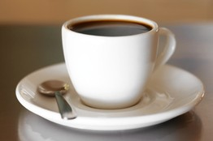

要在昏暗、安静、温度稍稍偏低一点的房间中睡觉。

许

多人都难以迅速入睡，往往要辗转反侧30多分钟时间后才能睡着。由于最近有研究表明安眠药与死亡和患癌症的风险加大存在关联，一些曾依赖药物入睡的人开始转向非药物的解决方法。在下文中，纽约-长老会医院(New York-Presbyterian Hospital)科曼斯基儿童保健中心(Komansky Center for Children's Health)/威尔康奈尔医学中心(Weill Cornell Medical Center)的睡眠问题专家哈薇瓦•维勒(Haviva Veler)就如何迅速进入宁静的梦乡提供了一些贴士，对于成人及青少年均适用。

《华尔街日报》：人为什么会睡着？

Getty Images

在白天锻炼有助于改善睡眠。

维勒：当外面天黑时，随着四周环境光线的减少，人的脑部会分泌荷尔蒙褪黑激素。这会导致我们产生疲倦感或瞌睡感。

《华尔街日报》：您会建议您的患者做些什么来更快入睡？

维勒：首先，要保持睡眠规律，周末期间尤其要注意。如果你在周末一觉睡到中午，你的生物钟就会被完全打乱。

其次，要在昏暗、安静、温度稍稍偏低一点的房间中睡觉。当人体在傍晚开始进入准备睡眠的阶段时，体温就会开始下降，所以不要在睡前洗热水澡或喝热牛奶，不要做会导致体温升高的事情。实验表明，如果房内的温度高于华氏75度（约合摄氏24度），入睡时间就会延长。

出于同样的原因，尽量不要在睡前大量进食……因为分解糖分的过程会导致我们的体温升高。

《华尔街日报》：锻炼会使人更容易入睡吗？

维勒：在白天锻炼有助于改善睡眠。它会使你觉得更加疲劳，因此你会更快入睡、睡眠也更持久，但是要避免在睡前一小时过度锻炼。

Getty Images

咖啡因会让你在晚上睡不着觉并且在晚上醒来好几次。

在睡觉前那一个小时，试着在昏暗的光线中做些安静的事情。不要看电视、查看电子邮件以及接触我称之为“i-系列物品”的那些东西，比如iPad和iPod等。它们散发出的明亮光线会抑制褪黑激素的分泌，可使用光线更柔和的Kindle用低亮度阅读。

不过，阅读有时候也会是个问题，因为如果你所读的书非常有意思的话，你可能会过于沉迷其中，连续读上几个小时。不会激起你过多兴趣的东西，比如一本枯燥的书或是一份枯燥的报告，比可能会让你熬夜的对你有吸引力的东西要好。

《华尔街日报》：有睡眠障碍的人最晚什么时间可以喝含咖啡因的饮料？

维勒：咖啡因的功效很持久，会让你在晚上睡不着觉并且在晚上醒来好几次。它的半留存期，即留存在你体内的时间，约为八个小时，所以你在睡觉前八小时绝对应该避免喝这种饮料。

《华尔街日报》：倒时差时如何更好地入睡？

维勒：在身处的时区改变之后，在上午时接触尽可能多的光线，这会延长你清醒时段的时长，有助于同步你的生物钟，带来更好的睡眠。褪黑激素既可用作有效的镇静剂，也有助于使你的生物钟适应新时区。

Nancy Matsumoto

