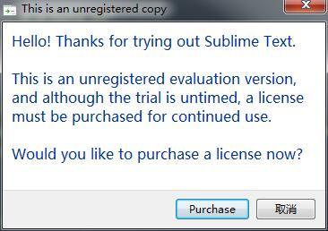

我们的方案并不是说让这个窗口不出现，而是出现的时候仅仅是一闪而过（可以说完全不会对你造成什么影响）。

Windows上面的解决方案需要安装360

Sublime Text 永久激活，注册码，破解
我的方案并不是说让这个窗口不出现，而是出现的时候仅仅是一闪而过（可以说完全不会对你造成什么影响）。
Windows上面的解决方案目前需要安装360

为了去除这个窗口

然后开始找到注册码，输入后要么发现无效，甚至也修改了host，一开始注册成功了，但是过一会儿突然被识破了，结果收到如下信息：

Your license key is no longer valid, and has been removed

我的方案并不是说让这个窗口不出现，而是出现的时候仅仅是一闪而过（可以说完全不会对你造成什么影响）。Windows上面的解决方案目前需要安装360。50元永久解决此问题，要就联系mathjoy@wo.cn
 