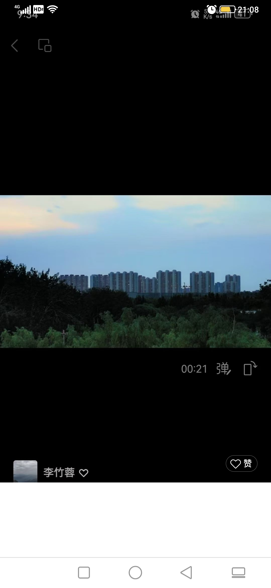

从一开始她说，如果她是刘亦菲的话，我可能会不会拒绝，然后包括今天聊天，他说我命由己不由天，来自哪吒这部电影。包括说什么人难做屎难吃。

对人性的理解差一点，对客观事实的理解也差一点，能够看出文化程度低一点
但总体而言还算真诚，这也许跟他社会磨炼不多应该有一些关系。

目前的认识就是，除非她自觉地向更优秀，彼此靠拢，这样的话我可能才会更喜欢一些。总的来说，目前可以再交流看看了，就看她的进步。

还有就是今天交流完回家的时候，回到了屋。如果我觉得够细心的话，似乎想问一句。你到家了没？但是她没问我，然后我是主动问她的。但也可能跟她回家去要做饭忙不得问我有关系吧。所以这个可以暂时忽略，她后面再继续观察一下吧，还有就是今天出来玩的话，他也没有带水之类的，但是我却带了。

我说我去山上看书，他说我有那个闲心，而这就让我感觉，她似乎不认为这是一个很重要的事情。
反正一开始见面给我的感觉就是很农村朴实，然后文化程度稍微低一点的感觉。
但是今天也说到了，文化程度低一点也许家务事这些能干程度这些可以补上，所以也不能以这个点就完全打死。

第一次坐着休息起来的时候，他把手机忘了放在那里，这玩意儿让我感觉是不是有点太细心了

也许是应该抓主干而抛弃细枝末节吗？

还有就是他花5000多块钱买了一个编程课去学，这一点让我觉得他自己自学能力是不是不够强呢？如果强的话，其实哔哩哔哩找视频应该也可以学下去。就是自己探究的能力好像也不太强之类的这种感觉。
当然了，总的来讲，有这个上进心是好的。

微信签名是你真好听。难道我太过于关注细节了吗？她这个背景我也感觉不太喜欢。