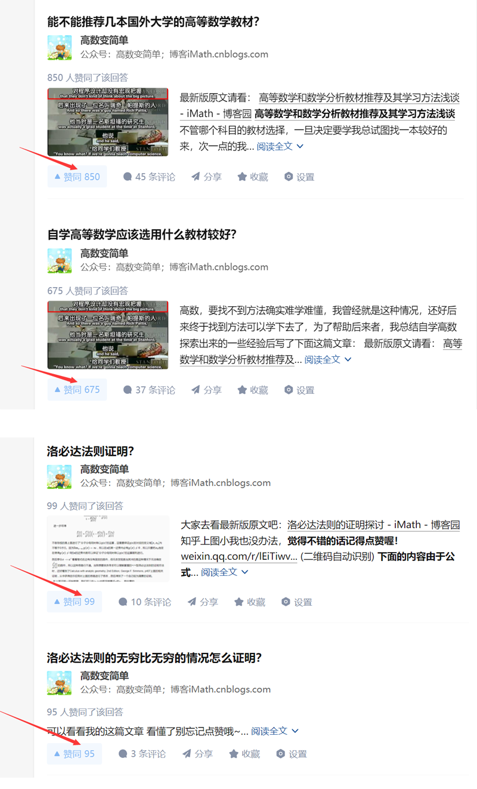
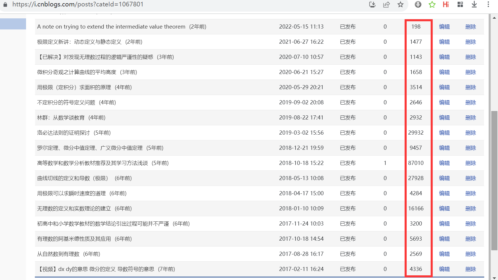
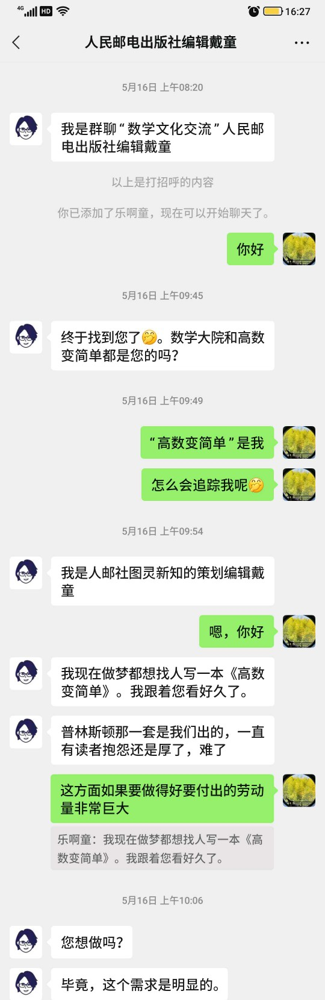

过去几年在知乎上分享数学内容最高获得800多点赞，

所写的高等数学文章也都发布在自己的博客上（[https://www.cnblogs.com/iMath/category/1067801.html](https://www.cnblogs.com/iMath/category/1067801.html)），基本上都有上千或万的点阅量，

因为对内容的一丝不苟、精益求精、保证质量，所以还获得了人民邮电出版社邀约出书

数学方面我辅导过一位七年级的学生，让他从对自学感到陌生惧怕达到了开始自我思考、敢于提问，并慢慢走上自学轨道，建立了学习的信心。