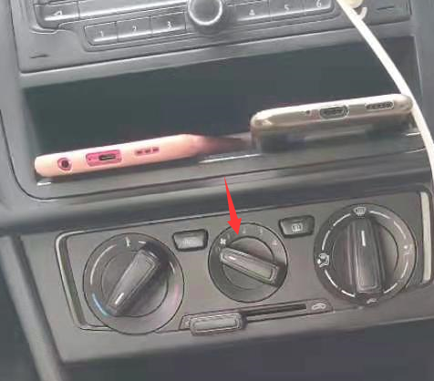

开动检查

侧方位是按照以前的试一下

上坡那里，这里的坡因为比较缓，所以要按照快到中间空白线的时候就来吧，这边30厘米以内一定要做到，保险的那个随意

倒库这里的话按10厘米和6厘米来算吧

位子坐上去看到车前盖缩为大约0.5cm（目前0.3cm），双手长度位置，不行的话垫垫子

倒车入库：黄线练习倒库 左右对线内10cm（目前是过就打）开始转，口内5cm（目前是接触就停）打住；出神入化，要领是：宁可提前打满转弯。

侧方位：比以前延后1s，出来的时候待今后调整

上坡：不要在这一项刻意追求满分，熄火要回空档。新方法：半联动，油门稳定在2000转以内，放手刹

千万别忘记打灯

---

倒库进去的时候宁愿提前打转也不能延后，否则可能是无力回天

开冷风空调，拧到这个位置

启动：灯，档，号，刹，观察，镜

调镜子（用手按左镜子后轮切上来一点以便看到更多的后方视野）
座位要直
慢慢来，稳住离合器（稳中求胜
别忘记打灯：直角转弯、侧方位停车

倒库和侧方位刻意提前回一些方向盘
s弯进去的时候，左右大灯未界限，反转的时候车中间为界限；

上坡快到第一条横线就开始踩离合器减慢速度，对准停止线中间线前边停车

短暂停车时间5分钟

一档最多15码

科二椅子要直才能看的准，科三椅子正常后靠一点

脚尖部分踏离合器踏板

考试场地：侧方位练习第一个方便后续好理线

坡 
30  雨刮铆钉对准右侧线左侧，不要在这一项刻意追求满分，
对准停止线中间线前边停车
新方法：半联动，油门稳定在2000转以内，放手刹

考试场地：倒库不倒第一个，之前常常倒数的第二个，或第一个
左轮对准裂线——因为差不多也就是1.5m
停在口线内5cm

侧方位  离线宽可以提前打方位

练习倒库 
左右对线内8cm开始转，口内8cm打住