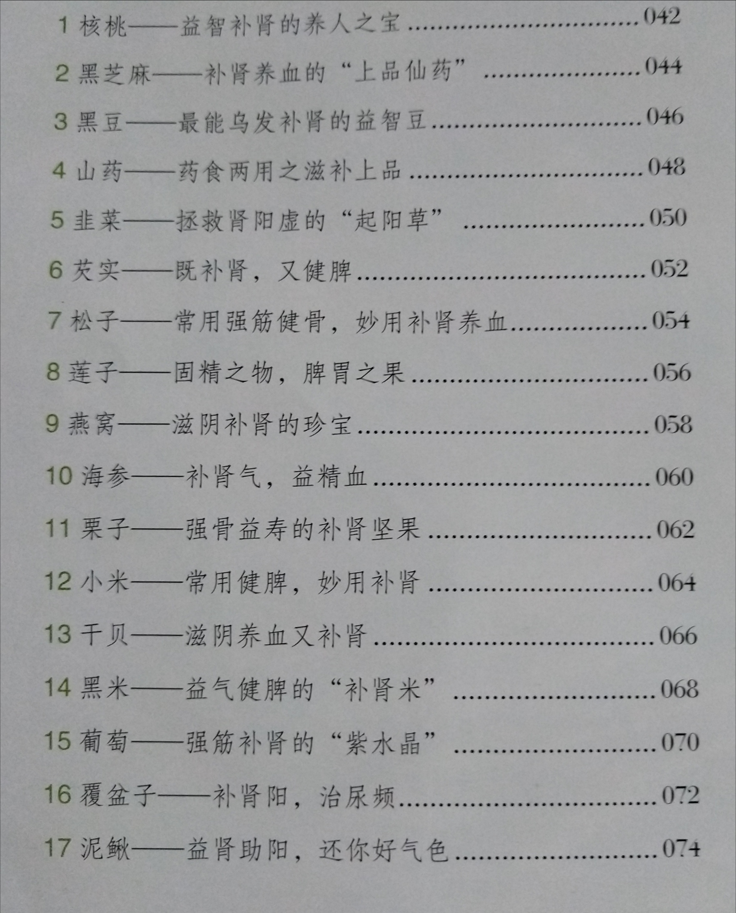
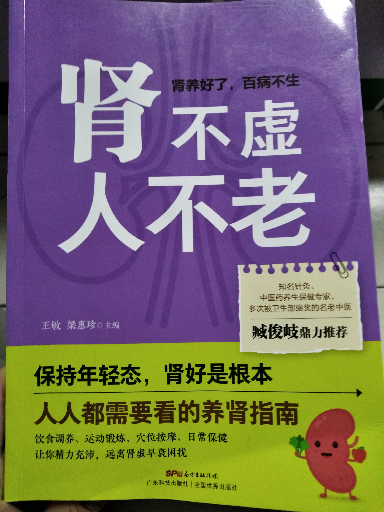
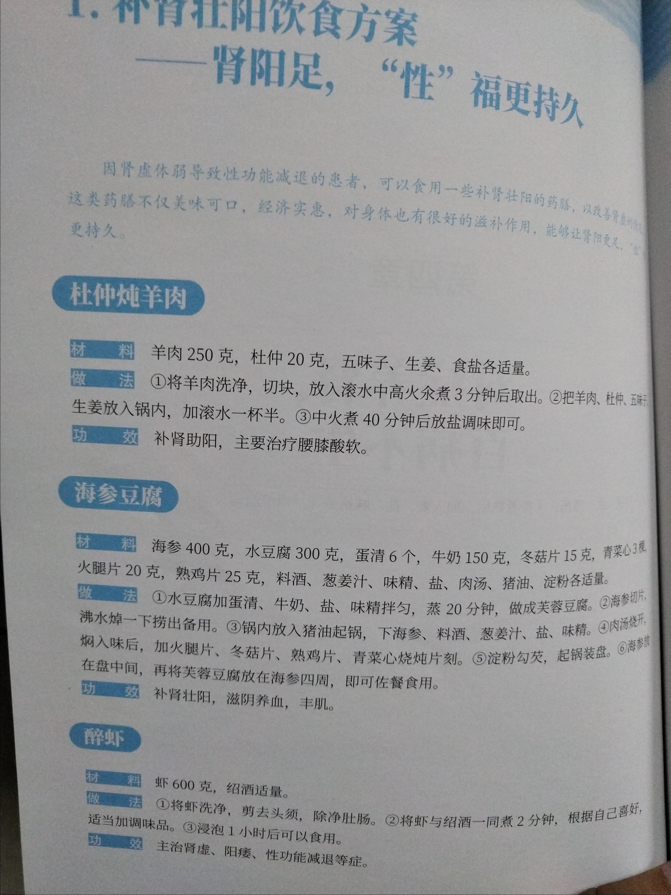
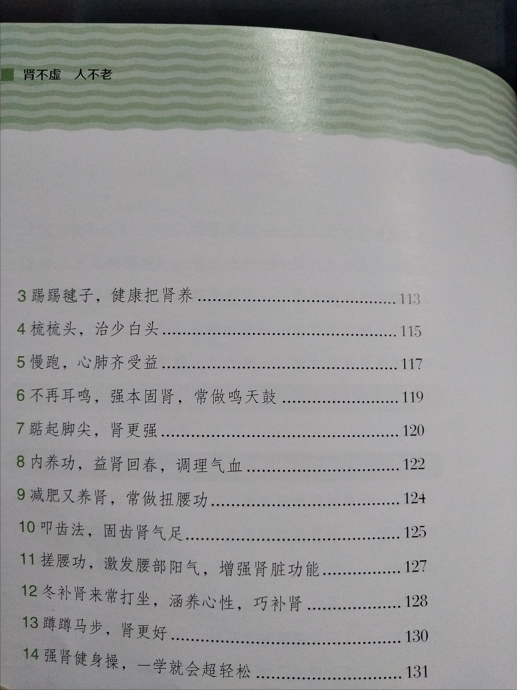

节欲的好处
历代著名的医学家和养生学家都十分强调节欲,避免纵欲导致肾虚、早衰、早逝的情况,从而使人保持身体强壮,延年益寿。唐代著名长寿医生孙思邀认为各年龄段的人行房事的频率应为:20岁左右的人房事的次数每4日1次为宜,30岁左右的人则8日1次为宜,40岁左右的人大概14日1次为宜,50岁左右的人则20日1次为宜,60岁的人如果身体还算强壮则可以30日1次。现代医学研究也认为,青壮年一周的性生活在2次左右比较适宜。

对于肾气不固型的肾虚早泄可以采用方剂金匮肾气丸进行加减治疗,也可以选用中成药金锁同精丸进行治疗。
金匮肾气丸加减
【方剂】山茱萸10克,泽泻10克,牡丹皮10克,肉桂9克,制附片(先煎)9克,熟地黄15克,巴戟天20克,沙苑蒺藜20克,山药30克,生龙骨30克,生牡蛎(先煎)30克。
【用法】水煎服。每日1剂,每日服2次。
可选中成药
【金锁同精丸】参照说明书或遵医嘱使用。

覆盆子，核桃，山药，韭菜，葡萄

泥鳅

莲子只，再好不过

