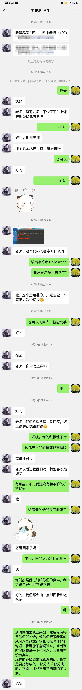
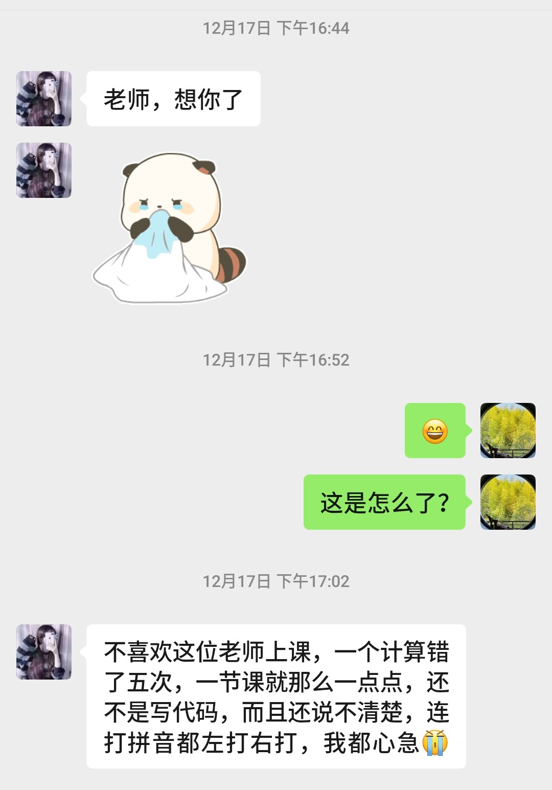
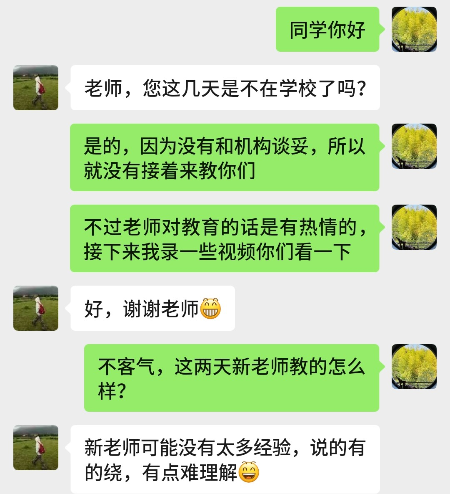
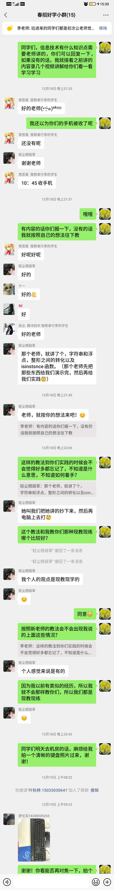

最近因为某个机缘教了两个星期350多位要高考但是因为成绩不好而被学校分流选择走春季高考的学生，和他们见面介绍的时候我就跟他们说：“你们之所以被分流到这里基本不是因为智力的问题，可能是因为你们之前的学习方法或态度不对，没有碰到好的老师，没有好的环境，或者也没有得到好的引导所以才沦落至此，但这并不是人生的终点，各位正处于人生的花季，怎能甘心还未绽放就被定调为不好的人生，我不谦虚地说我是比你们见到的绝大多数老师都好的老师，我希望各位认真对待我的教学，我们一起努力为你的人生创造新的可能性，打开新的出路！”然后向他们展示了一下以前学校网站上面我在列的获奖名单，演示了一下我以前做的软件和用英文写的数学文章，通过这些想让他们知道这位老师是有实力的，希望他们能够把握机会好好跟我学。
在后面的教学过程中我也逐渐认识到他们的基础情况。我教的是信息技术，一开始学习的是Python。有好些学生给他们一个网址都不知道怎么用浏览器去访问，然后好多学生不知道星号*中括号[]大括号{}在电脑上怎么打出来（后面离开机构后有学生跟我说了我才知道他们中有不少是之前基本没有接触过电脑的），那几天教学的时候为了帮助这些学生成功输入这些符号我拍了一张键盘的照片，然后指挥着他们先按哪个键再按哪个键才能把这些符号给输出出来，对知识点的教学的话考虑到大脑认知的特性所以每次讲解基本只讲两个知识点就马上让他们在电脑上练习，因为如果一下子讲太多的话他们会接受不了学习效果就会大打折扣，这也是后面我走了之后新老师犯的错误（学生跟我反映这个问题时我让他们去找相关的老师反映或者找家长和这些老师说）。学生练习过程中我会在机房里前后走动辅导，如果发现学生们比较普遍的问题的话就会马上到教师机上控制所有学生的电脑给他们演示那个问题怎么解决，然后很多常犯的错误比如英文符号的输入涉及到输入法中英文模式的切换也跟他们反复强调了好几次，很高兴有的学生感受到了我的细心。
因为和机构有达成合作，后面我走了之后换的新的老师的水平赶不上我，然后学生觉得教的不行，然后就纷纷微信加我，既有反馈新老师的问题的，也有说我之前教的是如何好的，都比较希望我重新回去教他们，后面和机构再谈还是没有谈成，我就爱莫能助了。因为自己有爱心，然后面对那些之前没有碰到好的教育环境培养的学生们想给他们一些指引，所以离开了一周后的周天就[通过腾讯会议和几位好学的学生开了一次告别赠言](https://www.bilibili.com/video/BV13nk9Y7EVH/)，给他们一些学习和未来发展方面的指引，其中包括让他们去学学习的方法和多多阅读。我也额外又录了[10个Python教学视频](https://space.bilibili.com/89675688/channel/collectiondetail?sid=4378645)辅他们再走一程，学生们都比较感激我。
过往我的活动主要是在网络上——在网络上推广自己的软件和用户交流、接单、在网络上进行高等数学的教学分享。虽然说也有一些网友感谢我做的，知乎上也有800多点赞的回答，但是始终还是没有线下人跟人交流互动那么直接，而这次一下就接触了350多位学生，这让我充分认识到了我是可以通过自己的教学改变和影响到他们的人生的。以前我做的是软件工程，最近做的是人类灵魂工程（因为老师有一个高贵的称谓叫作“人类灵魂的工程师”），两类都是工程，但从影响力和目前兴趣的角度来看，我现在对人类灵魂工程更有兴趣，也觉得这是更有意义和影响力的事情，而相比自己之前做的有些软件真可以算得上可有可无，因为做这些事情无法凸显我的价值的独特性。以前也做过一段时间的培训机构老师，但是我并不是太热衷于干这种事情，因为我总觉得现在的教育制度不太合理，然后做这种事情的话只是让学生拼命刷题考高分，虽然做的时候也会好好做、认真负责地做，但是并没有太多的认同感，但是这次接触到这些学生是确实需要被培训的，所以教他们的话也确实是有感受到通过自己的教育能够影响和改变他们，这使得我在追求人生的意义及其影响力这条路上会考虑未来可能会通过线下教育进一步实践认识。

下面是和学生的聊天记录截图

