假一吊二撤三醉五逃终身酒犯罪

https://www.cnblogs.com/east7/p/13284385.html

饮酒后或者醉酒驾驶机动车发生重大交通事故，构成犯罪的，依法追究刑事责任，并由公安机关交通管理部门吊销机动车驾驶证，终生不得重新取得机动车驾驶证。

既然是不正当手段获得的那就会被撤销

没有逃现场的，那就三年以下；先死伤后逃逸，3-7年；先逃逸后死亡，7年以上。

这些是解释，不用看。《中华人民共和国刑法》第一百三十三条：
违反交通运输管理法规，因而发生重大事故，致人重伤、死亡或者使公私财产遭受重大损失的，处三年以下有期徒刑或者拘役；
交通运输肇事后逃逸或者有其他特别恶劣情节的，处三年以上七年以下有期徒刑；
因逃逸致人死亡的，处七年以上有期徒刑。

机动车应当按照下列规定使用转向灯（记一个就行了）

(一)向左转弯、向左变更车道、准备超车、驶离停车地点或者掉头时,应当提前开启左转向灯;

(二)向右转弯、向右变更车道、超车完毕驶回原车道、靠路边停车时,应当提前开启右转向灯。

在没有限速标志、标线的道路上，机动车不得超过下列最高行驶速度：
无线（没有中心线）----城三公四
有线（  有中心线  ）----城五公七

后面这些内容暂时不用记（《实施条例》第四十五条：在没有限速标志、标线的道路上，机动车不得超过下列最高行驶速度：

(一)没有道路中心线的道路，城市道路为每小时30公里，公路为每小时40公里；

(二)同方向只有1条机动车道的道路，城市道路为每小时50公里，公路为每小时70公里。

中线+树木=70公里 中线+楼人=50公里 无线+树木=40公里 无线+楼人=30公里 有房有人是道路（没线30有线50） 没 房没人是公路（没线40有线70）

------------

高速公路最高车速120最低车速60
同方向车道最低速度（从左到右）
两条车道是:100  60
三条车道是:110  90  60
四条车道是:110  90  90  60

双黄线左边是快速，右边是慢速
超车都是从左边超，所以左侧是快速车道。停车都是靠右边停，所以右侧是慢速车道，
入高速公路开启左转向灯，离开开启右转向灯
我觉得总之，要加速就开左转向灯，要减速就开右转向灯。

掉头、转弯、急转弯、窄路、窄桥、铁道路、下坡、冰雪、泥泞路。 要转的，变窄的，路不好走的，非正常路的 都是30.30,30,30,30,只要记住不好走的都是30

机动车在夜间通过急弛、坡路、拱桥、人行横道或者没有交通信号灯控制的路口才,应当交替使用远近光灯示意。

在第89题前后再练习一次，看成解释就可以了。

总结处200-2000元罚款，并处吊销驾驶证的情况：
1.超速50％
2.醉酒驾驶
3.将车交给驾驶证被吊销人员

4. 开改装车

机动车超车时，应当提前开启左转向灯、变换使用远、近光灯或者鸣喇叭。

一般看到“立即”都是错的！超车后应该先与后车拉开安全距离，若立即驶回原车道容易造成碰撞！

有靠山的让着没有靠山的，所以没有靠山实力弱，让你先走。

转弯：右<左<直。                         右让左，左让直，转弯让直行

解析：图中两辆车均未开启转向灯（让车的时候要注意这点），所以都是直行；且是没有交通标志、标线的交叉路口，根据通行原则，要让右方道路的来车先行。

十字路口的几辆车都直行的情况下，不转弯，右侧来的车先行。

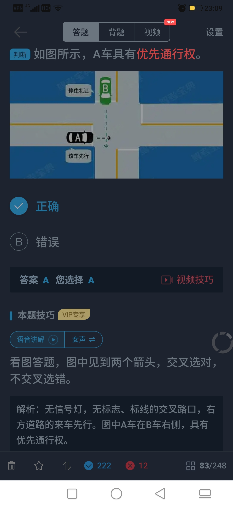

白色菱形，人行道预告，减速!

人行横道和实线处都不能掉头
看图答题,图中前方是绿灯,且左侧是虚黄
,所以选从中心线虚线处掉头。掉头就要找虚线，在虚线的地方掉头，如果在车的两侧都没有虚线的话，那就不能掉头。

不可左转则一定不能掉头

机动车在有禁止掉头或者禁止左转弯标志、标线的地点以及在铁路道口、人行横道、桥梁、急弯、陡坡、隧道或者容易发生危险的路段，不得掉头。

警告标志放在“车后”，而不是“车前”。

因为警车超车也必须从左侧超车  所以要变道到右边，把左边让出来

马路牙上如果有黄色实线的话禁止停车！！！！！虚线可以短时间停车！！！！

在道路变化的部位如交叉路口、铁路道口、急转弯、宽度不足4米路段，桥梁、陡坡隧道等都是50米以内不能停车；
对各种站点则在30米以内不能停车。

高速路开车：

时速超过100,车距100以上!
时速低于100,车距50以上!

高速路能见度问题

记口诀：261、145、520（离）（520表示

能见度200, 十速不超过60,车距离100以上;
能见度100,时速不超过40,车距50以上。
能见度50,车速不超过20,从最近的路口尽
快驶离高速;路都快看不清了,只能低速或者尽快驶离高
速。(高速上不能停车)

普通公路行驶，能见度小于50米，则最高时速30。

车辆发生故障，车后设置警告标志距离:
高速上是150m开外; 普通道路上是
50-100m。

撞车只要无人员伤亡，无重大事故，怎么简单怎么来，保持交通畅通才是最重要的，不要以为你自己的事就是天大的事。

连续开车4小时必须休息20分钟。

初次升领驾驶证有效期是6年，每个计分周期未满12分的可以换发10年的驾驶证

证书范围：小型汽车准驾车型是小型、微型、轻型、低速四种车型。所以选“低速载货汽车”。

准驾车型为小型自动挡汽车，只能驾驶自动挡的车。小型汽车可以驾驶自动的，自动的却不可以驾驶小型汽车的。

驾驶证 (人的) 补发--核发地
行驶证 (车的) 补发--登记地

危险驾驶罪，追逐竞驶，醉酒驾驶，情节恶劣，处拘役并处罚金。酒驾还会吊销驾驶证,五年不得再考

两证两标一号牌（行驶证、驾驶证、保险标志、检验合格标志、车号牌），五样东西缺一或假的，扣车

强险是国家规定必须要交的,如果未交,可依法扣留车辆。

6种情形可扣留（应该也是吊销）驾驶证:
1、饮酒、醉酒开车
2、将车交由没有驾照和被吊销、暂扣驾照的人开
3、超速50%
4、驾驶拼装和报废标准的车 

      上面的顺便200－2000元罚款

5、发生重大交通事故构成犯罪 

6、扣12分

申请换证：信息变更提前-30;有效期满前-90天

特殊原因无法审验驾驶证的可以3年延期3个月换证30天换信息。没有审验的过程中不能够驾车。

造成人员死亡，承担同等以上责任，但未被吊销驾驶证的，要在记分周期结束后30日内接受审验。

大、中型客货车驾驶人每年参加审验，审验时自己申报身体条件情况。

六分主要记三点：1.违反交通信号灯  2.违法占用应急车道  3.不按规定避让校车

上道路行驶的机动车未悬挂机动车号牌的，或者故意遮挡、污损、不按规定安装机动车号牌的，一次记12分。

1.酒驾或毒驾、2.无驾驶资格驾车（更没有带驾驶证是两回事）、3.车辆有安全隐患、4.无牌车或报废车、5.严重超载、6.肇事逃逸，具有以上任意一种行为，且致人重伤，负全部或主要责任的，都是交通肇事罪。

有障碍的让无障碍的一方先行，但有障碍方已驶入障碍路段时可先行。

路上画的标志代表进入路口之后可以直行也可以左转。不是意味着可以在路口前往左宝线变道。

图是无人看守的铁道路口，用来警告车辆驾驶人注意慢行或及时停车，设在无人看守的铁路口以前适当位置。火车头是无人看守，栅栏是有人看守。红色的斜线，一条表示还有50米，2条10米，3条150米。

驾驶证被注销一年以上不满两年的，只需重考科目一，合格后方可恢复。科目一是道路交通安全法律、法规和相关知识考试。

红灯分为圆形和箭头两种，圆形红灯是可以右转的，箭头红灯要看箭头导向行驶。图中是圆形红灯，在确保安全的情况下，可以右转。

人体每100mL毫升血液中含有酒精80mg毫克以上均为醉驾。大于20毫克小于80即为酒驾。酒驾与醉驾二者都是酒后开车。因酒精含量增加，驾驶人行为失控也相应增大。危险程度不一，所以二者处罚标准也不一样。

驶入环岛的时候由直线进去圆环，开启左灯是为了引起左边来车的注意。而驶出开右灯，这个好理解，因为驶出的方向是向右，需要右转弯，当然得开右等。

垂直交叉路口没有标志的话，哪一个通过路口的路程少的话，哪一个先走。也要留意一下别的车辆的后车灯。

开动的机动车与行人发生事故，机动车一方无过错的，承担不超过10%的赔偿责任。如果车是禁止的话，那么就不用赔。

超车条件：虚线一侧才能超车，对向无来车才可超车，需要满足这两个条件。图中对向有来车。所以选“放弃超越C车”

实习期上路行驶，要有三年以上驾龄的驾驶人做陪同。

圆形灯的情况下 单向车道 绿灯亮了 可直行可右转 红灯亮 只能右转 不可直行 且都在不影响行人的情况下

直行灯是绿灯可以通行，但是直行线堵车，为了不阻碍交通（要注意看前车的后车灯），就不能过停止线

红灯亮时,右转弯的车辆在不妨碍被放行的车辆、行人通行的情况下,可以通行。 应该是车体全部越过停止线才可以继续通过,红灯时前轮刚过线就必须停下来,不然闯红灯。

小型汽车、摩托车等车型驾驶人审验的情形有两种：
一是发生交通事故造成人员死亡承担同等以上责任未被吊销驾驶证的，应当在记分周期结束后三十日内到公安交管部门接受审验；
二是驾驶证转到异地或者有效期满换证时，应当到公安交管部门接受审验。12分扣完是需重新教育 重考科1

交通标志按颜色区分类型：黄牌-警告标志，红牌-禁令标志，蓝牌-指示标志。

标识：反向弯路就是左转再右转，或者右转再左转，连续弯路是多个反向弯路

标识牌：

直行车道两边有虚线，单行道两边没虚线

标识牌上面   小车正脸表示机动车，侧身是小型客车。此标志是机动车行驶。

分向行驶预告：（虚线隔开 ） 没有距离和文字提示
分道信息预告（是单个图形）：没有线   有距离和文字
交叉路口预告：（实线隔开，如下） 有文字和距离

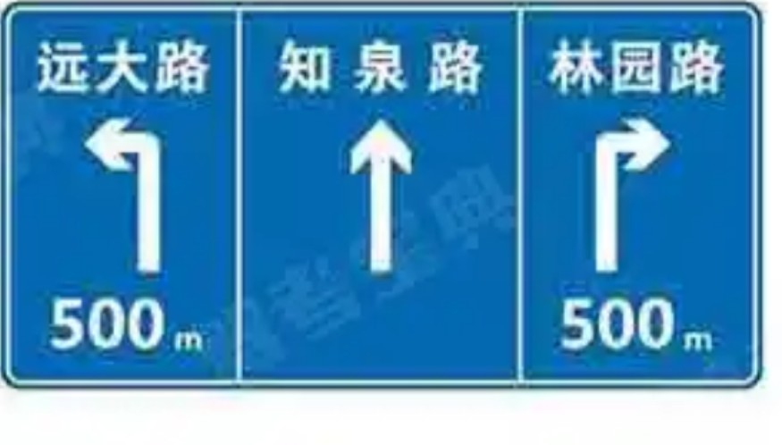

蓝色标识：三变二车道变少，二变一是合流

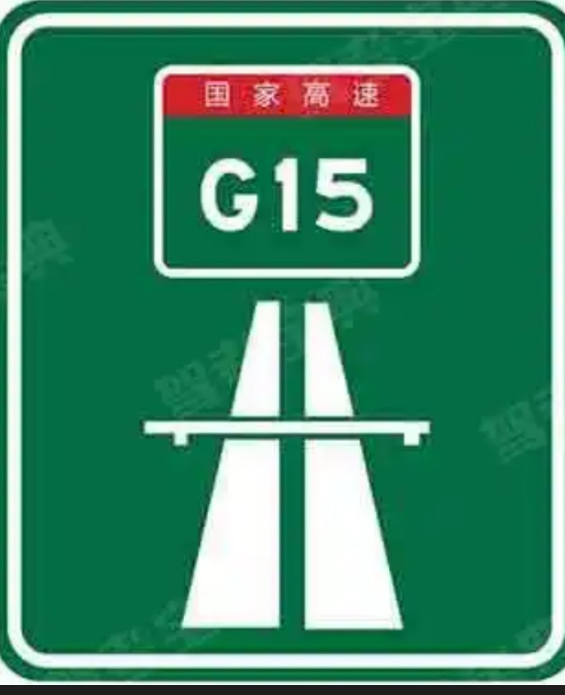

起点标识：没有“入口”两个字是一条很长的路，是长方形的。如上图所示。

高速公路入口标识：上面写了“入口”两个字，有箭头，是正方形的。

高速路入口预告标识  上面的两个地点名字背后是什么含义？意思就是去深圳和汕头都统一从这个路口进入

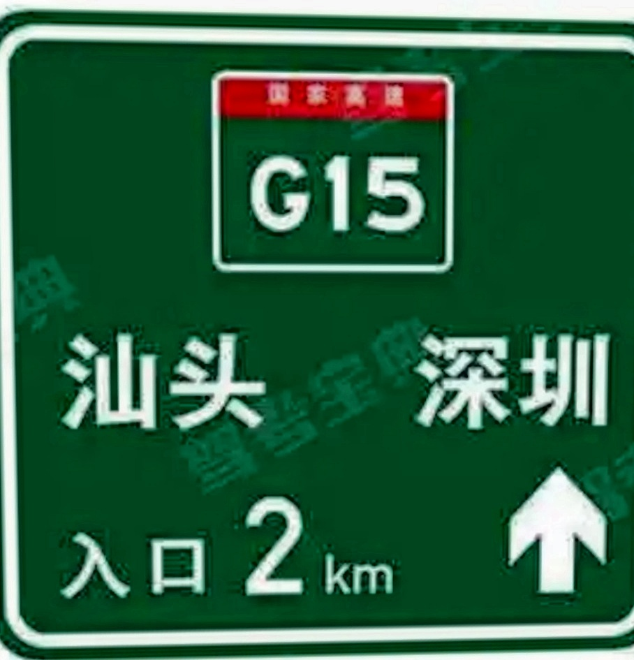

牌子上的速度文字的颜色

黄色数字→→最高速度
白色数字→→最低速度
黑色数字→→建议速度

图中见刀叉选服务区，见到茶杯选停车区，只见P字选停车场。

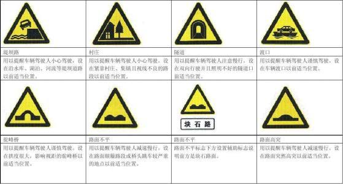

一个拱形中间空：驼峰桥； 两个拱形中间实：桥头跳车。车经过两个突起物后一颠一颠的，叫跳车。

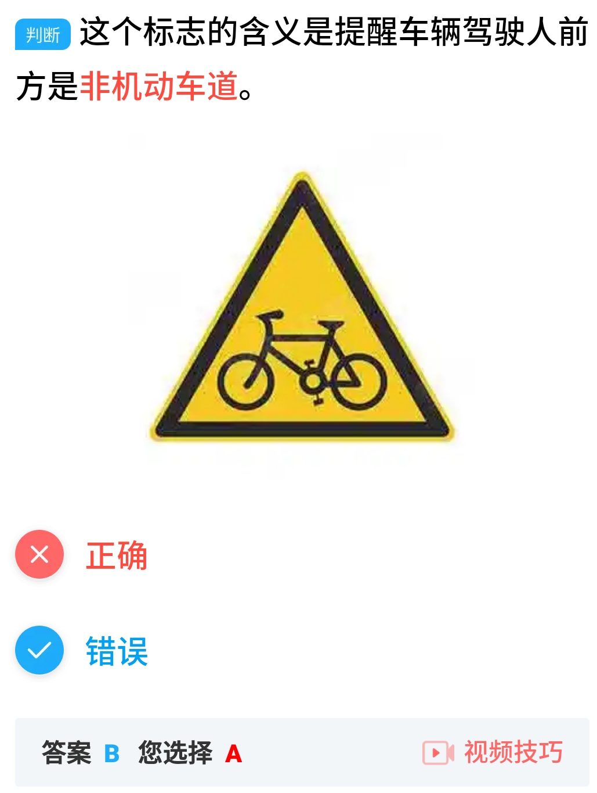

非机动车道标志，有标志，还要有车道线，颜色也不是这样。

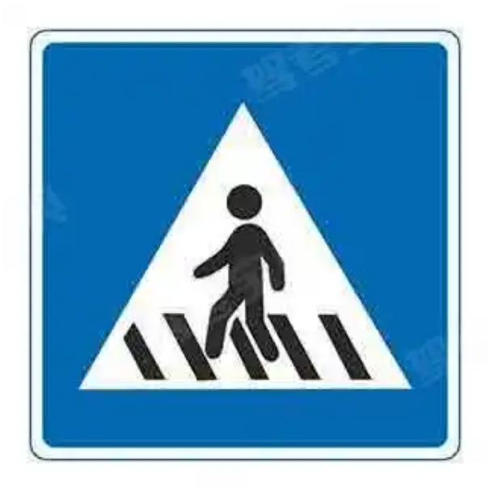

三角黄牌是警告，所以要注意行人。正方形蓝色是指示，没有注意，所以是人行横道。圆的有小孩是步行。

黄色是警示注意，蓝色是指示

两边虚线中间实线港湾式停车道 
全虚线是应急车道
无线是错车道

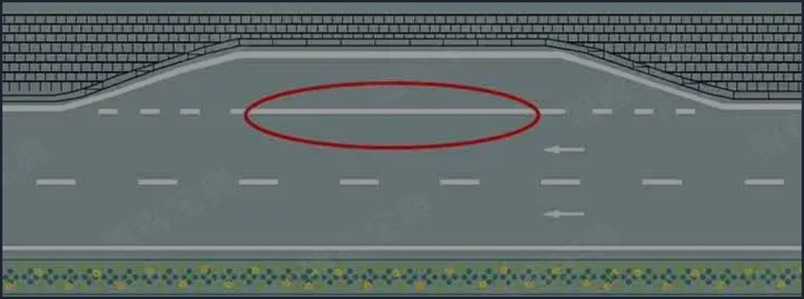

马路沿上黄色实线禁止停车，虚线禁止长时间停车

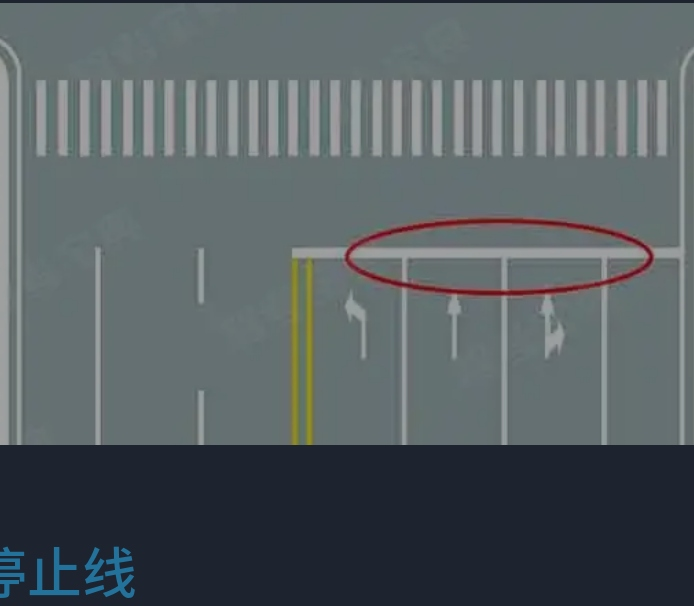

单白横实线是停止线；

双白横实线是停车让行线；

双白横虚线是减速让行线。

从1001题看起，多熟悉交警手势

单行路、直行车道、只准直行的区别

https://jingyan.baidu.com/article/ff42efa9d9caf8c19f220261.html

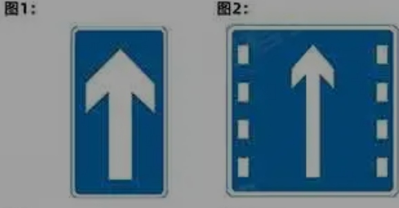

图一矩形单行道或单行线，图二是直行车道。

地上的虚线表示指示 实线禁止

我们老师说了，有理让无理，珍爱生命。开车不能争抢，要有好心态。

谨慎驾驶的三原则是集中注意力、仔细观察和提前预防。

手动挡车辆脚下三个踏板，从左到右依次是离合、制动和加速踏板。

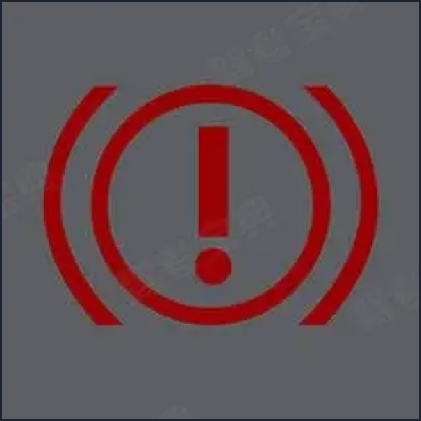

中间轮子，两遍刹车片，感叹号，代表制动有问题。中间是P的话代表处于制动状态。

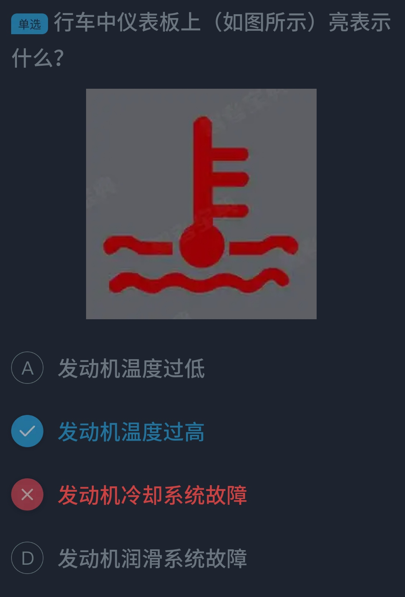

看图中仪表板上是水温指示灯 车辆启动后一直亮起，说明发动机温度过高，可能是冷却液不足，需要停车检查。

把它看成温度计，温度都升上去三个点了，温度肯定高了啦，嘿嘿

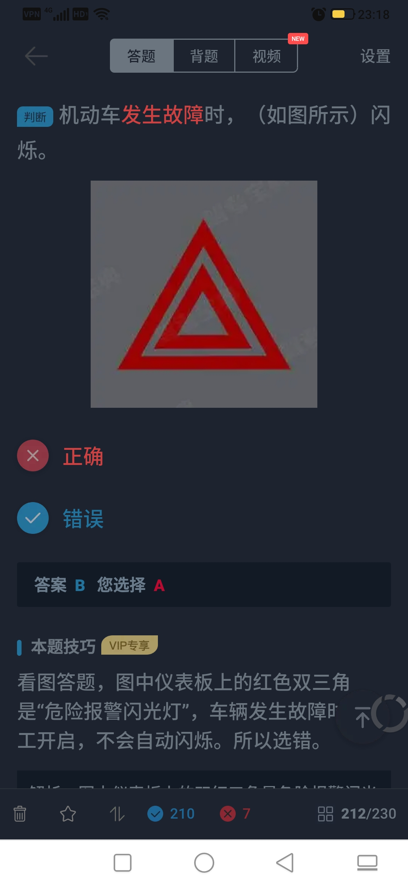

开启之后才会自动闪烁，双闪

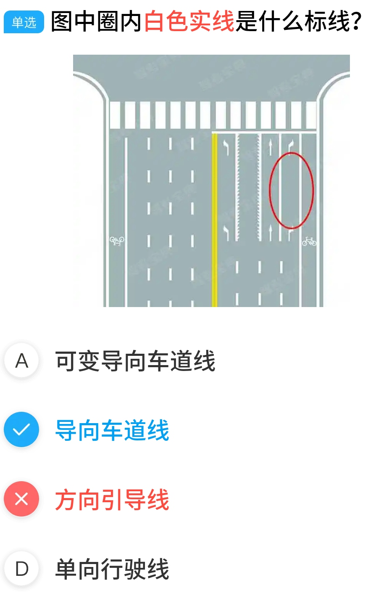

实线代表导向线，虚线代表方向引导线

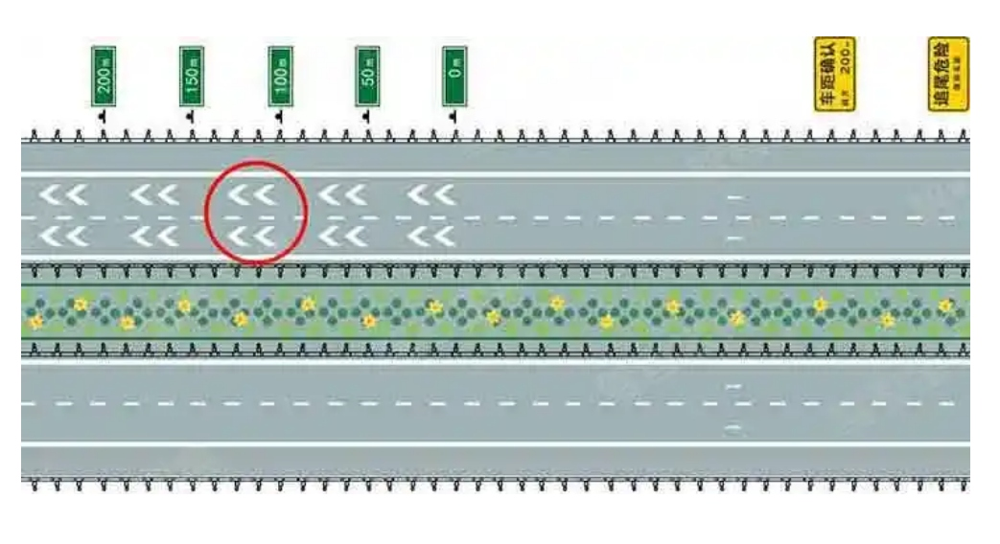

一个箭头是注意车距，两个是车距确认

车灯开关

https://haokan.baidu.com/v?vid=9367007096623045291&pd=bjh&fr=bjhauthor&type=video

《实施条例》第五十九条：
机动车在夜间通过急弯、坡路、拱桥、人行横道或者没有交通信号灯控制的路口时，应当交替使用远近光灯示意。机动车驶近急弯、坡道顶端等影响安全视距的路段以及超车或者遇有紧急情况时，应当减速慢行，并鸣喇叭示意。

驾驶技能准考证明有效期3年，从科目一考试合格后开始算起。

黄灯闪不停表示信号暂解除

黄灯，应该是看路口，交叉路口如果接下来要直行就停车等待（其他的情况包括闪烁都是观察安全之后就可以通过。）

一条直接没有分叉口注意瞭望安全可以通过。

持续闪烁的黄灯是闪光警告信号灯，提示车辆、行人通行时注意瞭望，确认安全后通过。

下面的算作解释，不用看：

“闪黄灯”和黄灯亮起是不一样的，黄灯亮起是绿灯变红灯的中间过程。

黄灯作为提醒车辆慢速通过的信号灯，目的是清空进入路口的车辆，为红绿灯切换准备一定的时间，一般闪烁只有数秒。

黄灯闪烁是绿灯切换到红灯的缓冲方式，所以必须尽快减速停车防止闯红灯，但是当路口只有一个黄色信号灯连续闪烁时，你不用傻傻的停在线内等它变成红灯，因为它只是一个闪光警告信号灯，它的作用是提醒你，路口要提前减速，认真观察了，在确认没有危险或者其他行人车辆时 ，是可以通过的。

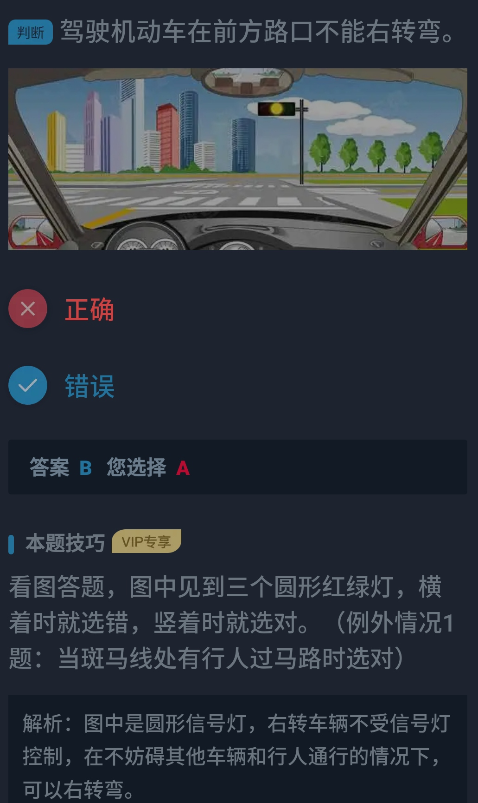

下面几个标识是反方向的，然后还有前后雾灯也是反方向的。

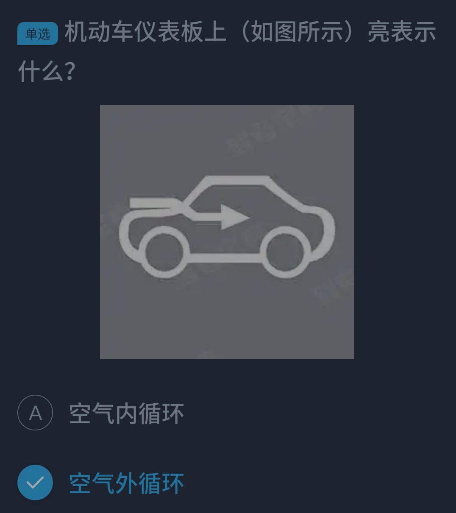

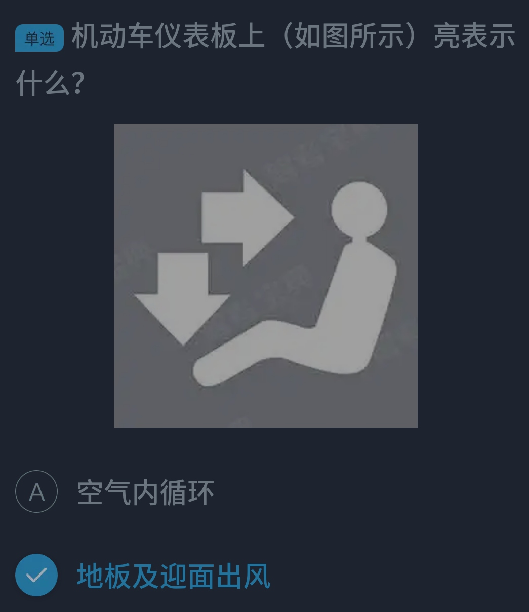

驻车制动器操纵杆俗称手刹，在变速器操纵杆后边，选手刹的时候 其前方会有虚拟可视的变速器操纵杆图示

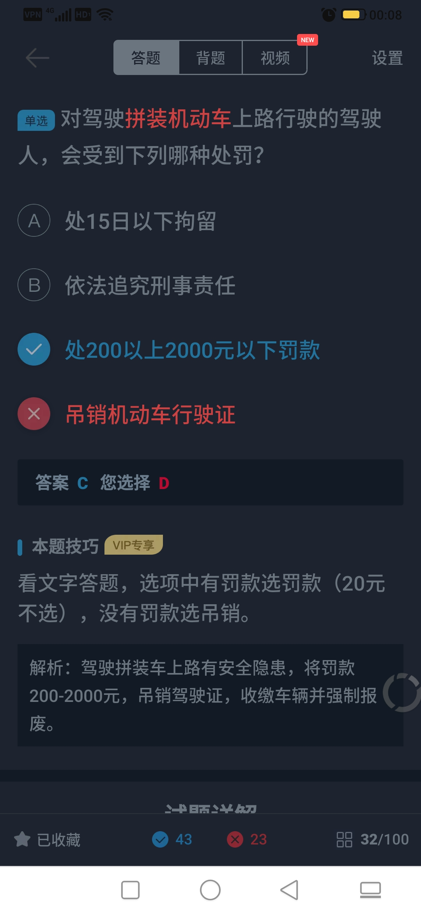

尤其要注意细节

夜间通过交叉路口、人行横道、急弯、陡坡等特殊路段，应交替使用远、近光灯，提示其它车辆。

在狭窄的坡路，上坡的一方先行；但下坡的一方已行至中途而上坡的一方未上坡时，下坡的一方先行。

