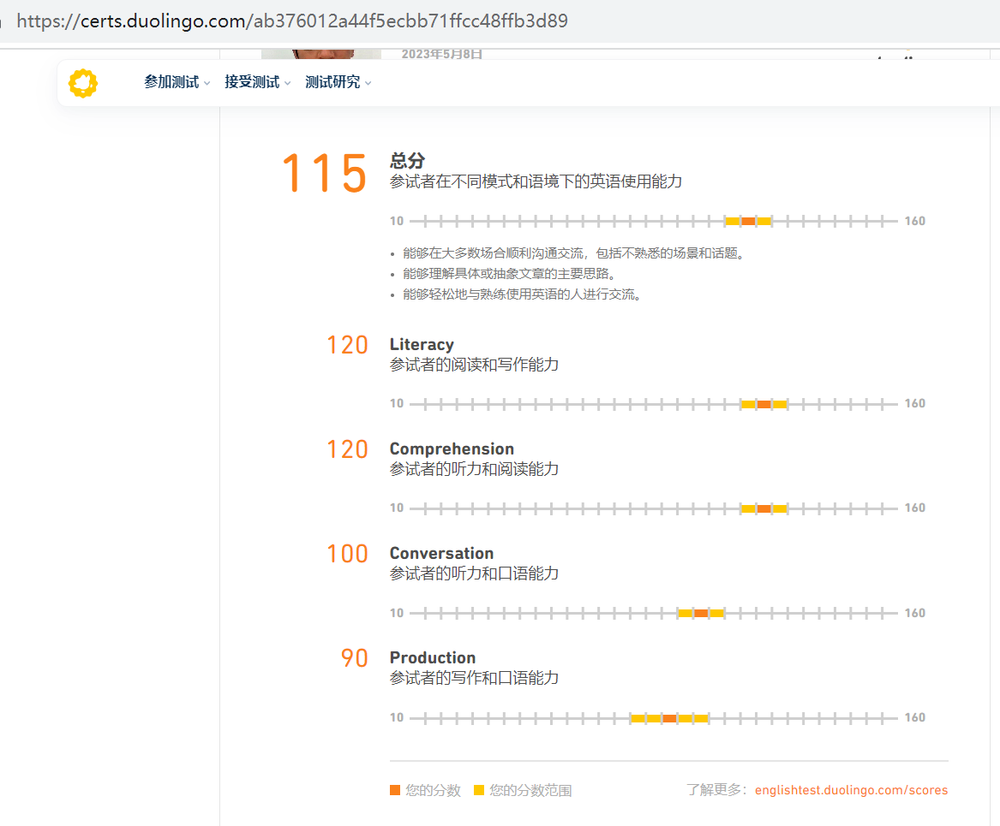
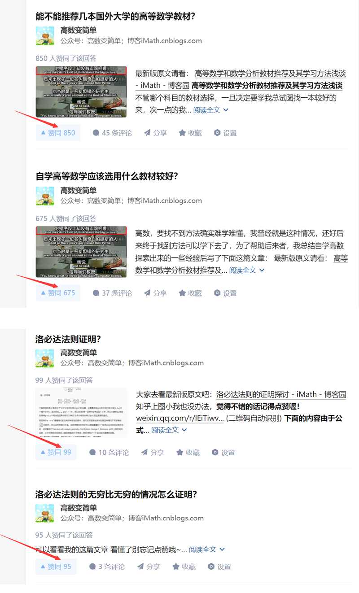
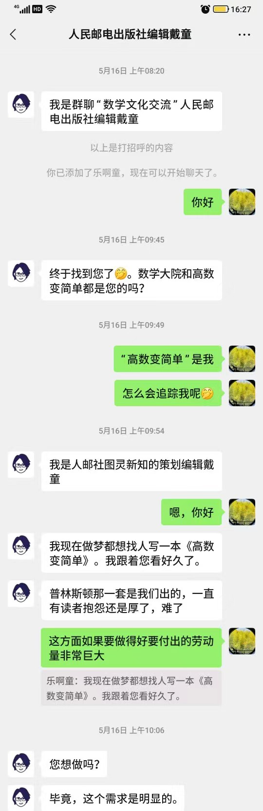

您好！我面向小学、初中、高中阶段的学生提供英语、数学、少儿编程方面的培训服务。我毕业于昆明理工大学，在培训机构做过老师，英语雅思6分，数学作为一种兴趣爱好这几年持续在网上分享内容前一久获得人民邮电出版社的出书邀请，编程方面因为自己就是软件开发自由职业者，所以也不在话下。除了具备这三项专业能力外也懂认知心理学，这对于有效教学大有帮助！
我会力求做到以下这些方面：
1.      强调启发引导而不是灌输，争取用尽可能少的时间引领学生学会自学，以后少上甚至是不上培训班；
2.      初次教学如果不满意无需任何费用；
3.      一对一上门或小班教学；
4.      可通过微信等工具远程教学或督促学生落实学习方法；
5.      如果学生能够自律可免费提供GPT人工智能软件并教会用来辅助学习。

我接手过小学、初中和高中的学生。学生成绩的提高更多还是在于课后认真实践我课上教授的方法和布置的课后任务，为了防止学生课后拖沓懒散的情况，我主要叮嘱家长多监督，此外也都加了家长或学生的微信，每次的上课情况及其课后任务都会反馈给家长，学生课后不懂的也鼓励他们微信上问我。在教学过程中我深刻体会到要成为一名好老师的两项必备品质——责任心和耐心，而我也确实能做到，并得到了家长的肯定，同时也领会了做老师要甘为人梯的含义——要确实愿意舍得花时间、花精力去陪伴学生的成长。
教师教书不能让学生离了老师就学不进去，而是要让学生学会自学，最终能够在离开老师之后依然能在学习这条路上富有成效地走下去。很少有孩子是不聪明的，他可能只是经受了有问题的教育模式，并且又没有找到自己的学习方法才至于如此，而我会尽己所能教会他自学和恢复他对学习的信心！如果你感兴趣的话我推荐看一看可汗教育创始人关于教育问题和方法的演讲
[https://www.bilibili.com/video/BV16b411C7yp?p=1](https://www.bilibili.com/video/BV16b411C7yp?p=1)

下面将提供上述三个科目相关的个人能力信息供您参考！
英语方面：
我的英语已过四六级，去年五月份考了多邻国，115分，

按照新航道网站上面的换算方法对应的雅思成绩范围是5.5-7分，到现在已经过了一年了，在这段时间里我也在不断提高自己的英语水平，现在比以前又有了很大的进步。
我第一次辅导的是一位四年级的女生英语。最困扰她的是大多数单词都不会读，以至于对这个科目有畏难情绪。我从音标开始教会这个学生拼读单词，然后理解一个英语句子的意思，还找来与课程配套的英语听力录音给她学习跟读，然后也加了家长的微信，课后学生碰到学习问题可以直接微信问我，及时帮助解答问题。后面学生说月考的时候由60多分考到了80多——我的付出收获了效果，让我倍感欣慰。
第二次是辅导两位六年级的男生英语。他们快要小学毕业升初中了，主要是语法太差，所以我找了一本小升初的英语总复习书从冠词使用和单复数变化教起，一步一步帮助他们搞清楚之前迷迷糊糊的语法知识，并印了些题目给他们巩固知识点。英语语法知识繁多，考虑到学生的接受能力，所以我并没有要求他们记下书上所有的语法知识，只是教给他们最基本最常用的语法规则，这样他们能够轻松学习的同时也能解决常见的大多数题目。
第三次是辅导三位幼儿园毕业的小朋友英语。这个时期的小朋友显然不能找课本枯燥地带着他们学习，于是我找了一套通过迪士尼动画学英语的课程带着他们学习最基本的起步英语，因为是跟着视频有声有色地学习，所以他们还是比较能够集中注意力跟着学。课后也把课上学过的单词和对话的录音发给家长督促他们跟读巩固学习，最终做到让他们自信地开口说英语，教学成果可以看这个视频[https://www.bilibili.com/video/BV1pW411D7kK](https://www.bilibili.com/video/BV1pW411D7kK)

数学方面：
过去几年在知乎上分享数学内容最高获得800多点赞，

所写的高等数学文章也都发布在自己的博客上（[https://www.cnblogs.com/iMath/category/1067801.html](https://www.cnblogs.com/iMath/category/1067801.html)），基本上都有上千或万的点阅量，

因为对内容的一丝不苟、精益求精、保证质量，所以还获得了人民邮电出版社邀约出书

数学方面我辅导过的一位七年级的学生，让他从对自学感到陌生畏惧达到了开始自我思考、敢于提问，并慢慢走上自学轨道，建立了学习的信心。

编程方面：
可点击网址[https://www.cnblogs.com/iMath/category/1107555.html](https://www.cnblogs.com/iMath/category/1107555.html)查看我制作的一系列软件，如果想使用免费的GPT人工智能软件那么请使用我制作的这个软件[https://www.cnblogs.com/iMath/p/EngkuDict.html](https://www.cnblogs.com/iMath/p/EngkuDict.html)

遇到具有跨学科能力且认真负责的老师的机会不多，请把握机会！