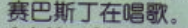

在海底

Flounder ___(爱)  Ariel.   loves

Ariel ___(有)  a father.    has

They're   ___(dance).   

Sebastian  ___   ___(sing).

___(她的) friends.   Her

___(这) is a dog.   This

___  ___  dog.   

一条小狗

 His name is Tod. 另外一种同样的表达   He's Tod.

___ your name? 

你叫什么名字？

