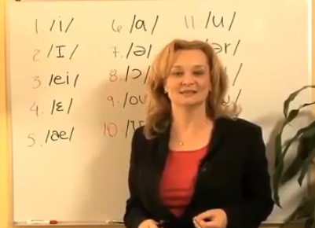
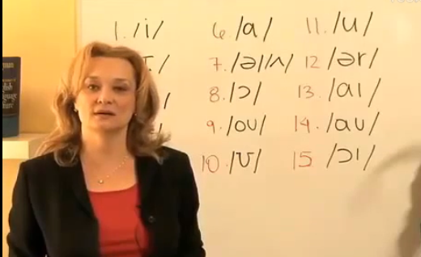
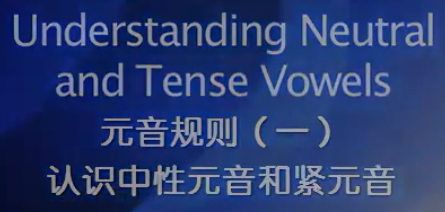
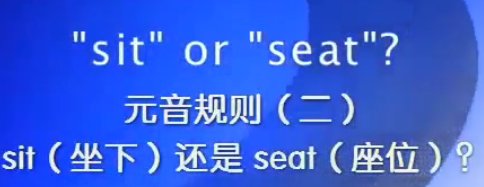

http://i.youku.com/i/UMTU5NDYwNDY0/videos?spm=a2hzp.8253869.0.0&q=%E5%8F%91%E9%9F%B3%E6%8A%80%E5%B7%A7&order=1&page=2&last_item=&last_pn=1&last_vid=675782191

15个元音

see

if

late

bed

apple

father            ɑ---tense

net    nut

always

go

pull

room

earth

time

now

boy

口型紧和放松的差别

neutral(or relaxed) 放松读： /ɪ/、/ɜ/、/ə/和/ʌ/（love）、/ʊ/

tense和relaxed的区别

feet     fit

leave    live

these    this

长读强调的音节或单词 I like the job

弱化的音节或单词发e的音节for--fe

发到每一个音（尤其是辅音），不要含糊其辞和偷懒 probably

声带震动的是浊辅音，不震动清辅音

vowel comes before the voiced 长读vowel ，bag

θ-voiceless出气，bath，math，thank，ð-voiced声带震动，father，mother，不要太用力，轻轻地

末尾ed读法

t、d结尾的单词，读did，如needed、waited

末尾是清辅音（voice-less），读作t，如stopped、worked

末尾是浊辅音（voiced），读作d，如robbed、realized

