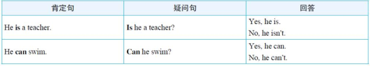
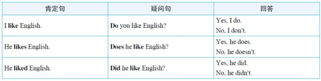

我的角色：教五年级学生的英语语法老师

受众：五年级学生

教学目标

陈述句变一般疑问句

读法

回答

运用一般疑问句进行练习

课堂内容

He is a teacher. 

怎么问

Is he a teacher?

比较句子区别（找学生），得出句型变化的基本规则

读法（找学生），犯错后纠正，升调↗

你来回答：肯定回答用“Yes，主语+be\情态动词.”，否定回答用“No，主语+be\情态动词+not.”---疑问词n't

学习这种变换问句的规则是为了提问:你是一个学生吗？

（情态动词例子）He can sing

这个怎么问？提示把can提到句子前面，其他的和上面一样，找学生上来黑板写出来、读出来

给出一般规则：句中谓语动词中含有am/is/are或can/will，变问句，最主要将这几个单词移到句首，其余留意读法、句号变问号，单词大小写。

练习：

翻译：他能游泳吗？

I am a student----从意思上去理解，而不是死记结构：回避（be动词，no, 主语+疑问词+not.），避免人称转化

---

He likes reading.

怎么问

Does he like reading?

比较句子区别（找学生），得出句型变化的基本规则

读法、回答方式:“Yes, 主语+ do\does.”，否定回答用“No, 主语+do\does not.”

一般规则：谓语动词不含am/is/are或can/will的情况，将do或does（第三人称单数用does）放在句首，谓语动词变回动词原形，其余留意读法、句号变问号，单词大小写。

练习

补充说明：

少提概念：一般疑问句、Be动词、情态动词、助动词、陈述句（叙述一件事情或    

说明说话人的看法）=====少则明多则惑

结合课本内容做取舍，was/were/did不列进来，may/might, shall/should, must和had better 

回顾

作业布置：复习规则，一般疑问句问题汉译英题（why：巩固），10遍unit5里的句子对话（加深记忆，内化语法，培养语感），回家当天内容有问题微信问老师

备课材料：五年级英语上册(精通)、英语语法新思维初级教程：走近语法

