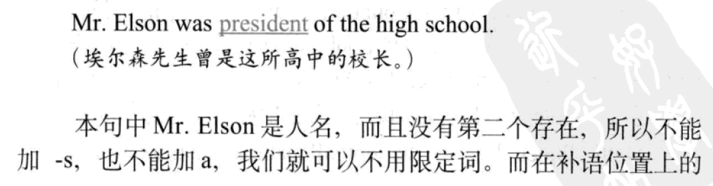

He died

I like cats

The dog seems friendly(-补语)

He found the trip [exciting]补语

john's father gave him [a dog]宾语

john's father call him [a dog]补语

练习加深记忆、理解、掌握

句子结构教法

各个句子类型找几个来教学生翻译，做完后呢同样的方式可以布置作业，阅读来内化

阅读，在语境中内化

还是在多多阅读的语境中内化吧，语境内化

在阅读中潜移默化造就语感

《英语魔法师之语法俱乐部》作者号称规避了很多语法书的问题，也许吧，但是书中有些叙述不够简洁、章节末练习题安排的考点有些也是没对上点

