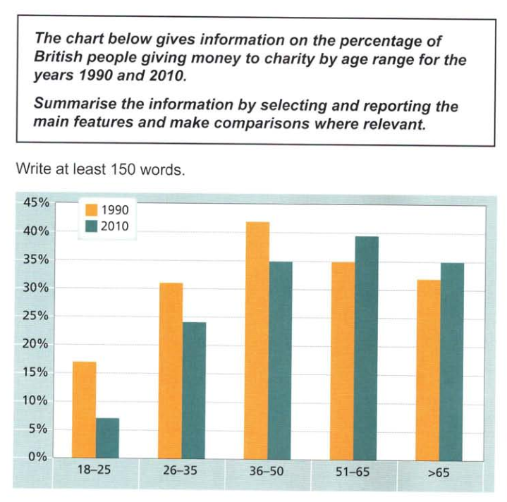
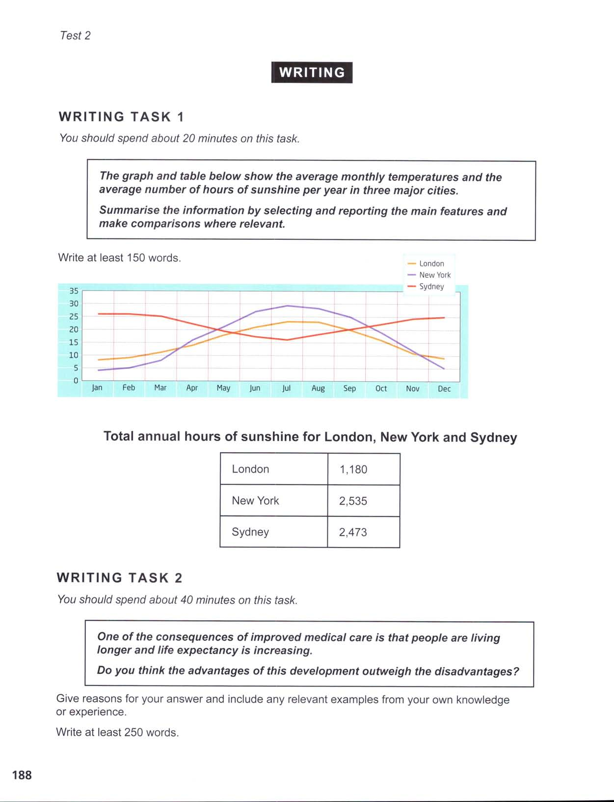
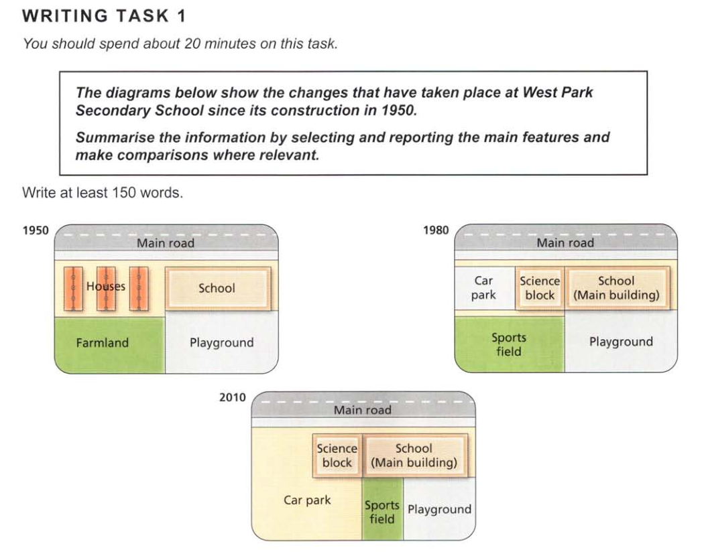

The chart examines the levels of donation among people of different ages in Britain.
Overall, a greater percentage of British people gave money to charity in 1990 than in 2010. However, across the two years, the pattern differs before and after the age of 50. 
In 1990, 42% of the 36-50 age-group made charitable donations, and this figure is the highest on the chart. The 18-25s contributed the least at only 17%. By 2010, these figures had fallen significantly to 35% and 7% respectively.The level of donations from the 26-35 age-group also experienced a decrease in 2010 from 31% to 24%.
While donations up to the age of 50 declined across the two years, they rose among the 51-65 age-group from 35% to nearly 40%, which was the highest percentage for 2010. The figure for the over 65s was lower than this, at 35%, but it was still a little higher than the 1990 figure of 32%.

The data provides information on average temperatures and annual hours of sunshine in London, New York and Sydney.
The temperature patterns for London and New York are similar, although New York has warmer summers and colder winters.In both cities, peaks occur in July/August, at 23° in London and 29° in New York. In contrast, Sydney's hottest weather is in December/January when temperatures average 25°. During this period, New York's temperatures dip to an average of around 5°, compared with 8° in London. On the other hand, Sydney's lowest average temperatures in July are just over 15°.
As far as hours of sunshine are concerned, New York and Sydney have similar averages of 2,535 and 2,473 hours respectively. London, however, has a much lower average of 1,180 hours.
Clearly, London is the coldest city and has the fewest hours of sunshine. New York has the hottest summers, but Sydney enjoys the warmest overall climate.

The diagrams show West Park School at three different stagesin its development: 1950,1980 and 2010.In 1950, the school was built close to a main road and next to anumber of houses. A large area behind the school was turned intoa playground, while the area behind the houses was farmland.
By 1980, the houses had been demolished in order to makeway for a small car park and an additional school building.which became the science block. In addition to the existingplayground, the school also gained the farmland andconverted it into a sports field.
In 2010, the school building remained unchanged but the carpark was extended to cover the entire sports field. As a resultof this, the original playground was divided into two so that itprovided a smaller playground and a small sports field.During this period, the school has increased in size and a car parkhas been created and enlarged. The combined recreational areashowever, first expanded and were then reduced in size.