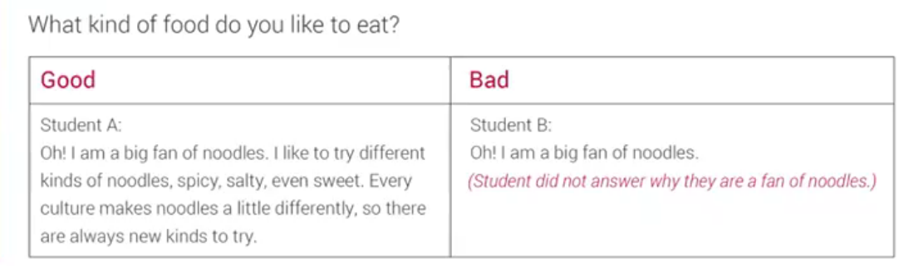

"Hello. My name is Kara and I'll be interviewing you today.

"Hi. My name is Emily. Nice to meet you.

像热心人一样尽可能提供更多的细节描述和信息

谈谈理由、例子、细节、猜测或假设、以前或今后

没听清楚重新问了考官一次

高分句子

I suppose I'd be happy to leave my country if l was offered a cool job abroad."

5 techniques to extend your answers:

1. Providing reasons

2. Providing examples

3. Providing detail

4. Talking about the past/the future

5. Making speculations

https://haokan.baidu.com/v?pd=wisenatural&vid=11657029721969648139

.第一阶段：按照思路自己准备例子。

①首先把我总结的三种回答问题的轮廓框架背熟。

②对照题库，按照思路准备例子，并写下来。

③对写下来的例子进行修改，比如说语法错误，句型词汇可以进行适当的升级。

④朗读自己写过的例子。

Part 1

每道题的回答时间要控制到半分钟之内，也就是20秒左右;

多说一点 As a general rule, a good answer is about 3-5 sentences

Part 2

a cue card，上面的问题不一定都要回答，是用来辅导话题的；90-100s

Part 3

每个题目回答1min

