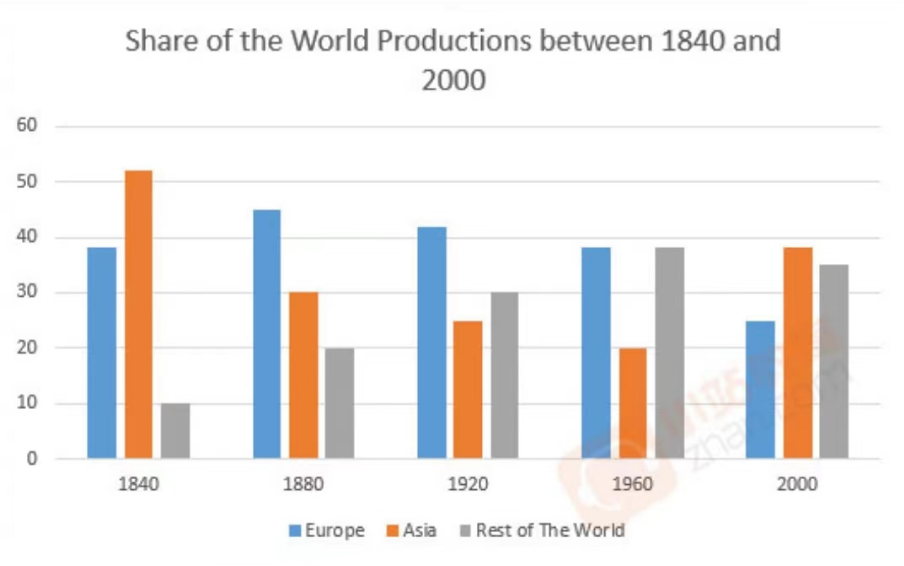
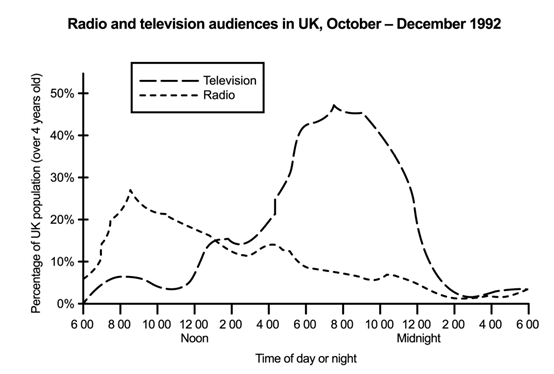

The chart shows the share of productions inEurope , Asia , and the rest of the world between 1840 and 2000.
Overall, both the share of productions in Europeand Asia in 2000 was less than that of 1840, while the share of productions in therest of the world was increasing.
Asia attained its greatest share of productionsaround 52% in 1840, and the least 20% in 1960, then followed up by a nearly 20%increase in 2000, surpassing Europe and the rest of the world. Unfortunately, theshare of productions in Europe began to decrease from 1880 to 2000, and becamethe least among Asia and the rest of the world in 2000. Luckily, the share of productionsin the rest of the world increased about 25% from 1840 to 2000, although the productionshare in 2000 decreased a little more than that of 1960.
By analysing the data in 1960 and 2000, wecan conclude that the share of productions in Asia had a growing tendency, whilea decreasing tendency in Europe.

The graph provides information about the televisionand radio audiences throughout a day of the UK people from October to December in1992.
Overall, television has a larger audiencethan radio. Television is mostly watched in the evening and radio is mostly listenedto in the morning.
The television audience reaches its peakamong 7 p.m. and 9 p.m. each day, and clearly there are only a few people watchingTV between 2 a.m. and 6 a.m. each day. Interestingly, people tend to listen toradio rather than watch TV in the morning, the audience of radio reaches itspeak at around 8 o’clock each day, then decreases slowly down to the bottom at approximately3 o’clock the following day. As with television, radio audiences are very lowbetween 2 and 6 o'clock.
Another interesting point worth noticing isthat there are still a few people willing to watch TV in the morning, thus 8 a.m.witnessed a small bump in the TV audience, then followed a decrease perhaps peoplehave to leave home to go to work.

The graph depicts that, radio used inmorning time more than night time. **In contrast**, television watched innight with the highest number more than morning.

1970s **witnessed** a considerablerise, and then a peak of 60 took place in 1980, followed by a sharp fall overthe next ten-year period.

then followed数据情况加对比

The graph shows information about Britishmen and women on further education and whether they were studying full-time orpart-time from 1970 to 1990.
Overall, the British preferred to takefull-time further education rather than to take part-time further education,and the number of people taking further education whether it was full-time orpart-time increased over the past two decades, except that the number of menwho took full-time further education fell nearly 100 thousand from 1970 to1990.
In 1970, both the number of men takingfull-time or part-time further education were greater than that of women,interestingly, the situation changed to the opposite in 1990, it suggested thatmore and more women realized the necessity of education. A slightly strangefact was that the number of men enrolling in full-time further educationdecreased nearly 150 thousand from 1970 to 1980, it seemed worthwhile toinvestigate the cause behind it.

