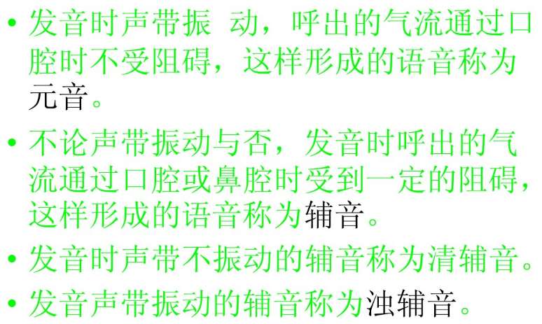
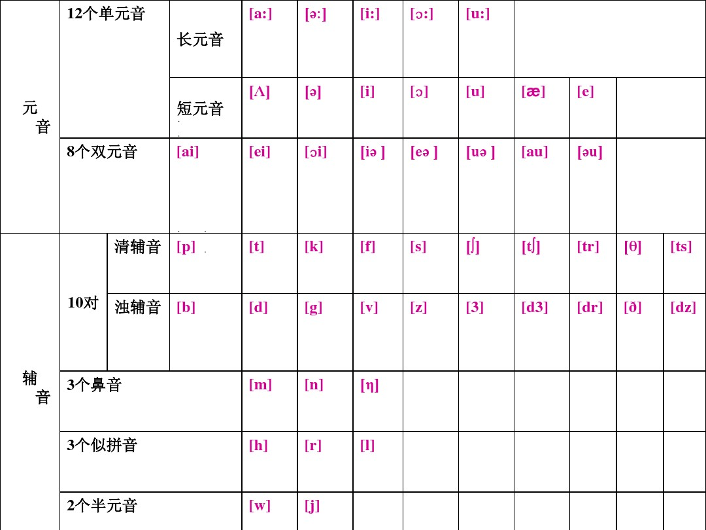
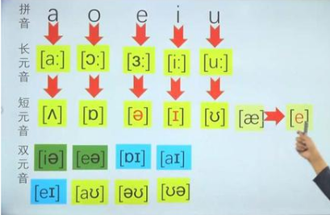
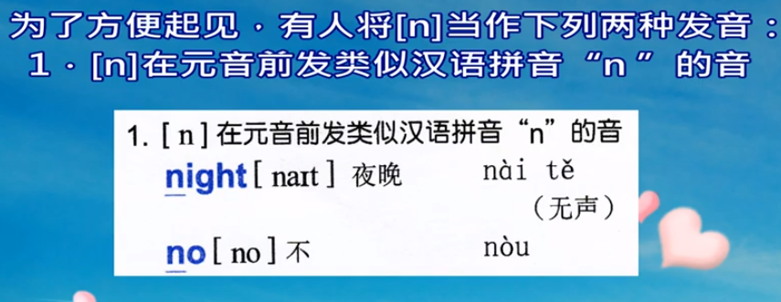
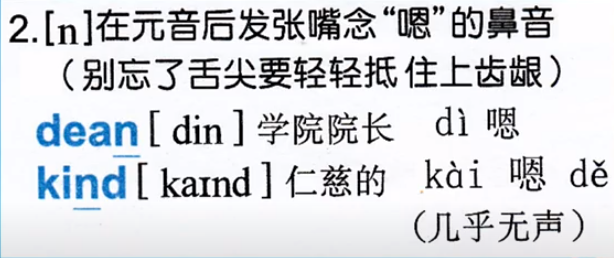
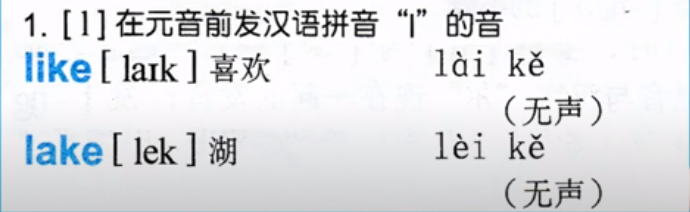
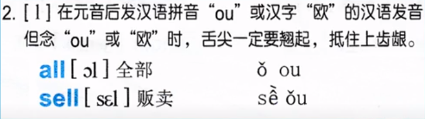

http://en-yinbiao.xiao84.com/biao/26643.html

http://i.xiao84.com/allimg/150910/1-1509101514023M.gif

l 在音节首、元音之前发汉语拼音的 l 如 like leave，舌尖抵上齿龈，声带自动发音   https://www.youtube.com/watch?v=DK3ANORjxt8

l 在音节末或辅音之前（dark l）发：舌头在上齿后发oh， 如 tell

l也可以不发音 如 calm half  发不发音看音标

https://www.zhihu.com/question/21792672

m嘴闭着

n嘴微开，舌尖抵上齿龈

ŋ嘴张大开，舌尖抵下齿龈，舌根后部顶住上颚，让气流从鼻腔出来

j舌尖抵下齿龈，舌根后部顶住上颚

/iː/嘴张得比较宽开

/ɪ/嘴放轻松

这两个舌尖都抵下齿，/æ/嘴巴张大张宽、/e/张嘴不用太大          

很轻松自然地，什么动作都不用做（舌尖不抵下齿），/ɜː/长音、/ə/短音（轻松自然）， 嘴巴不用张太大

/ɑ/嘴最大，/ʌ/（读四声a，but、must），但是/ə/音不发出来，

u du起嘴巴来读，ʊ（轻松自然）

ts--ci

dz--zi 两个都是舌尖顶住紧闭的牙齿

1. /θ/像一张嘴，咬住舌头，正是这个音标的发音。/ð/与之相同，只不过清浊有变化。

1. /tr/发音其实是/tʃr/的缩写，不能省略/r/的舌音。

1. /dr/发音其实是/dʒr/的缩写，不能省略/r/的舌音。

合音，每个分音都读到，但是快速过去

重读：更长更大声

China /ˈtʃʌɪnə/      because /bɪˈkɒz/

赖世雄各个音标的读法（有参考价值）https://www.youtube.com/watch?v=hvvMmlbs2KI&list=PLPQT_l4rJ8CDHEr550NJmgO3_rrVo_EoB&index=45

海伦英语音标入门http://v.youku.com/v_show/id_XMzAwNDc5NjE3Mg==.html?spm=a2h0k.8191407.0.0&from=s1.8-1-1.2&f=51320127

谢孟媛http://www.iqiyi.com/w_19rr3niw51.html?list=19rrocokbi

小宝的英语教室 音标第17课 [eə]：https://www.youtube.com/watch?v=EKuZ8AHx0fY

---

不是靠清浊对立而是靠送气不送气来区分音位

在/s/后面，如果跟的是/p/、/k/、和/t/等清辅音，可以相应的被浊化成/b/、/g/和/d/，但也不一定都发生在词头    在音标中有几对爆破音 p--b t---d k--g 当他们前面的字母是S的时候，(s是首写时)读音就变成相对应的了例如：spring p发b 的音 stay t 发d school k 发g 

如果/st/等不在词首，但其前是常见的前缀，如dis, con, sub, in, re等，也要浊化。比如，construction

如果/st/在词尾，通常不要浊化。如cast。

除以上情况外，当/st/等出现在词中间，如customer，pasture，sister, question，不需要浊化。

---

苹果电脑打印就用PDF吧，不然word排版有问题

[音标学习材料.pdf](attachments/音标学习材料.pdf)

word底稿

[音标学习材料.docx](attachments/音标学习材料.docx)

[音标学习材料 - 以前的讲稿.docx](attachments/音标学习材料 - 以前的讲稿.docx)

