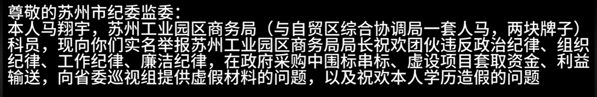

你的群体不理解你，甚至是排斥你，还逻辑错乱的讲，你旷工就应该被开除

我是一个有用的人，有价值的人，他因为我而活  ，一颗认真的心被院长问你吃啥？
蓝主任，你要把医院整垮
你这是对人民群众的精神贿赂？
用寻讯滋事收拾你
——有文化的流氓，精明的流氓

站在更高维度讲是医疗体系的问题，导致医院需要过度医疗来创收
被排挤，别人也不敢再和你在一起，孤独
采购，行情，向上举报觉得是正常的，没有任何问题，被降职，被批斗，各种不好的接踵而至，
利用救灾善款，寻求个人利益；，最终还弄得要离婚，这到底是为什么？值得吗？

从他的个人发展来讲，也是受到一些理想主义的一些信念的一些支持吧

假如你是蓝月风，你会怎么做
宫腔

了解一下市场行情是什么情况，都是那样的话那就算了，但是又这么一想，大家都这么干的话，这个就彻底没有希望了，所以最重要的结论是每一个好友好心的人，如果良心难以明灭的话，就干那么一两次吧。因为如果要不干的话，有良心，过不去，要干太多的话风险又太大，所以就干脆干个两次吧。

正是因为他们这些人的存在，让我觉得人事还有一些希望，还有一些光辉。

他另外一方面做这种事情的话，也是有风险，自己会受到打击报复，人身攻击，人身安全得不到保障，地沟油的记者就被这样了，马哥也被，提升只要花个一两万块钱，把一个长大之后就可以来修理你，而你对于世人的大爱并很难换的是人对你的保护

有时候也会觉得自己很爽，那些人和自己完全不认识，却为他们搞得这样，换句话说，地沟油的那位记者如果是被砍伤了，待在病床上，他会又会怎么想。如果是在这种处境里面，大家又会怎么想？想保护好众人的利益的，首先要保护好自己，尤其是自己的人身安全。红十字会的观念都从舍己为人变成饱己为人。
不可避免地也会让家人受到心理上的负担
大家都为你自豪，那又如何呢？同样失落的境地还是没有什么改善

马哥作为内部人员，是懂行的，证据重点突出，编号之类的；

“换人打电话问——有组织骚扰”
举报成功的因素：学历、时间（晚间21点）
懂法律，法律武器
懂程序，懂流程，愿意配合调查：并非专项工作组发出的命令那公回到他所控制的范围内呢……请专项工作组联系我全力配合调查

如此好声好语，有点美人计，不太懂点可能就回去了——有去无回
如此好声好语——这种人也是其中一员，蛇蝎毒妇

呼吁网友不要去网报无辜人员（这种情况下一般是愤怒）——减少敌人，不然无法推进

受贿，单独卡，曾国藩

公务员搞事情吗
被网骂了怎么回击

