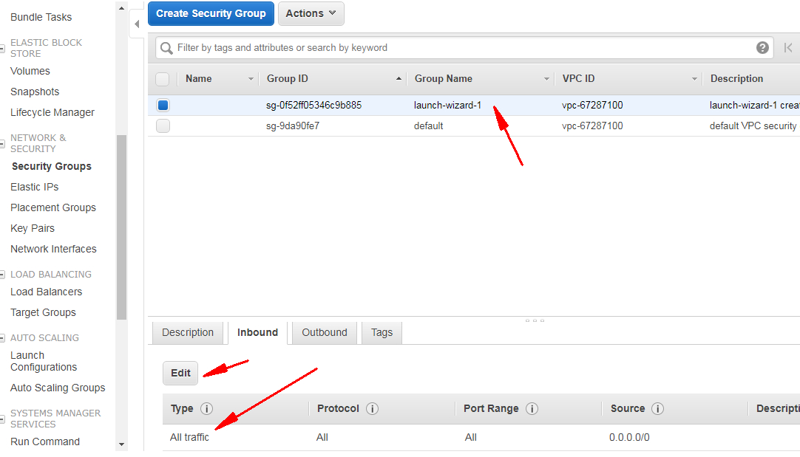

信用卡建议使用浦发银行的ego卡，直接通过app申请，通过亚马逊的验证后可以立即打电话给浦发银行取消，这样就不会因为直接的误操作而被扣钱了。

现在的Lightsail性价比就非常的无敌了，加上可以在淘宝购买150美元的抵扣码，价格在60-80元人民币左右，有效期一般是一年左右，变相的说，每个月最低配只需要5元人民币。

> 如果有edu邮箱，可以自行通过aws eduate获取； 淘宝购买，直接搜索“aws 150”关键词即可。

开启AWS入站端口：在启动实例后，把滚动条滚到最右边，点击安全组下的launch-wizard-1。

点击操作，编辑入站规则。

anywhere

winscp登陆aws

https://winscp.net/eng/docs/guide_amazon_ec2

sudo su-

https://blog.jamesbayley.com/2014/01/28/how-to-connect-as-root-using-winscp/

