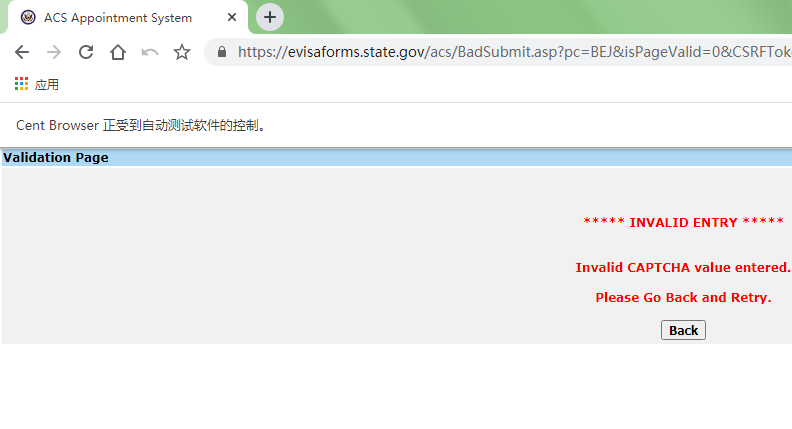

每次要通过Excel传入新数据，请首先关闭本软件，然后在“申请人信息.xlsx”的第二行及其以下填入或修改数据，处理完之后请关闭文件，然后再启动软件。

表格里所有的日期只能是如下两种格式：

| 2021/5/25 |
| - |
| 2021-05-26 |

Excel里批量修改日期的方法：先修改好起始行的日期，然后按住shift上或下连选其它要改成该值的表格，Ctrl+D

countryName只能是如下之一：

| CHINA - MAINLAND |
| - |
| HONG KONG S. A. R. |

cityName只能是如下之一：

| BEIJING |
| - |
| GUANGZHOU |
| SHANGHAI |
| SHENYANG |
| HONG KONG |

点击AppointmentAPP.exe启动软件后过大约半分钟可以访问

http://localhost:8000/admin/appointment/appointmentdetail/

登录信息：

用户:860893693

密码:000000001

这个网页管理系统目前仅仅用来查看预约情况和取消预约（删除相关信息即可），修改数据只能在Excel里进行

预约成功了，但是想要取消然后重新预约的，（1）去网页管理系统删除相关的信息，（2）关闭本软件，（3）更改“申请人信息.xlsx”里的相关的信息（日期等），关闭Excel文件，（4）重启软件重新预约

要在不同电脑上处理不同的申请人信息，只能使用我传过来的一手（未使用过）压缩包里的软件

有时候验证码错误（如下图所示），软件会等待20秒才会重新处理验证码，请耐心等待

要查看预约成功的信息，请刷新http://localhost:8000/admin/appointment/appointmentdetail/

然后预约成功的申请人是“firstName  surname---True”这种形式，False的都是预约还没成功的

预约成功打印好的PDF在static这个文件夹下