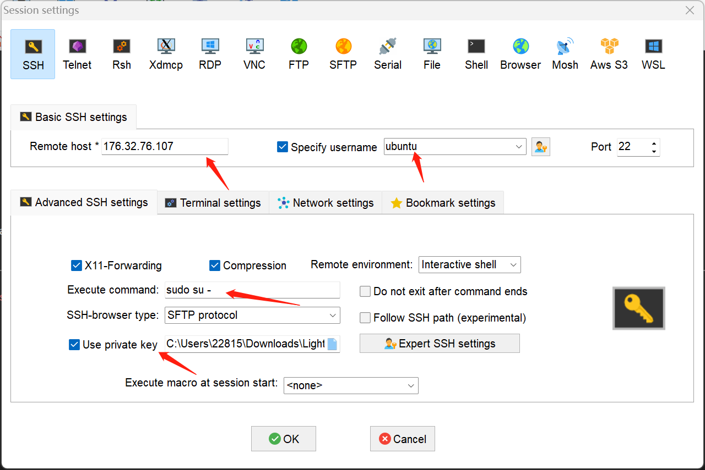
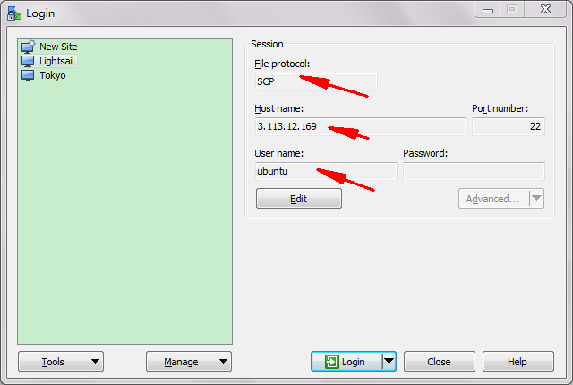
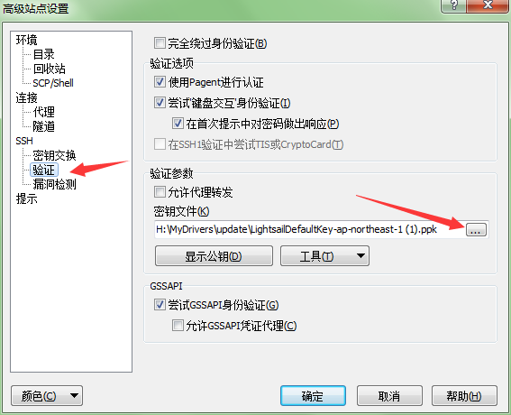
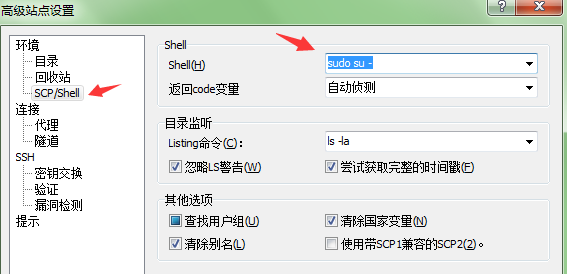
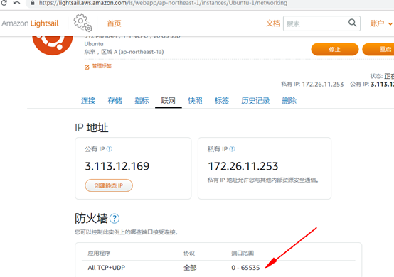

ip，如果登录不上请确认ip https://ip.tool.chinaz.com/mathjoy.ml

3.112.220.173

On the Advanced tab of WINSCP specify the Shell to be

1. sudo su -

From：https://blog.jamesbayley.com/2014/01/28/how-to-connect-as-root-using-winscp/

