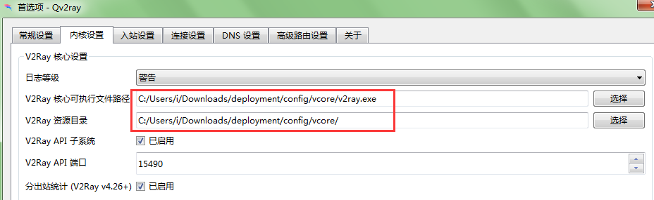
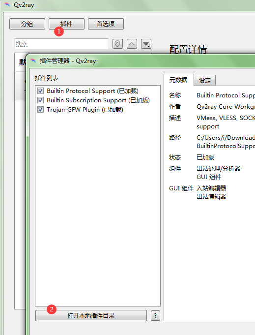
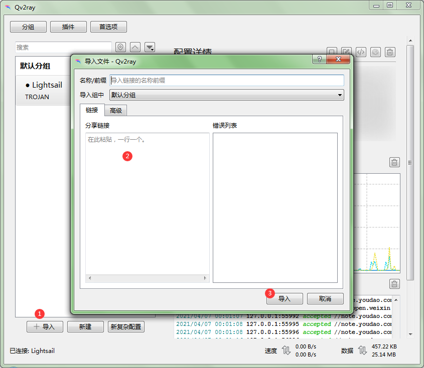
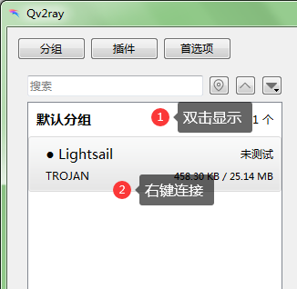
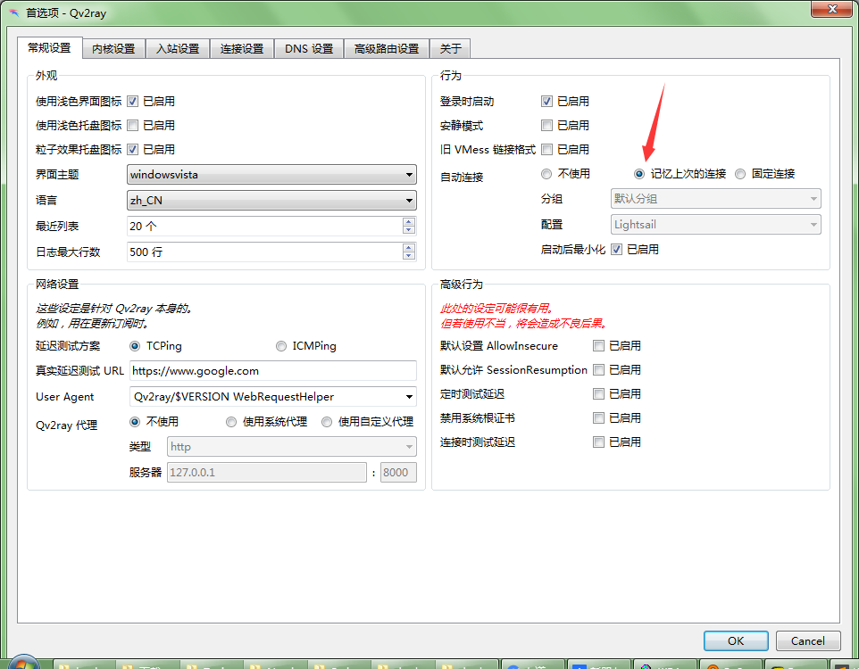

服务端部署

1. 首先  sudo su -

1. https://github.com/trojan-gfw/trojan-quickstart

1. /etc/trojan/config.json 或 /usr/local/etc/trojan/ （具体是那个可以看sudo systemctl status trojan-gfw产生的信息）改


"password": [


        "ccd072cf-1205-46a6-8c5b-2f8a99ecf5ea"


    ],

1. 然后sudo systemctl start trojan-gfw


出问题的话就用老方法安装一遍，然后再用上面的方法安装覆盖，配置改成老方法生成的那些

trojan -version

-------------------------

老方法的话要更改里面的trojan网址

https://github.com/ace2417/trojan-wiz/blob/master/ins.sh~（

```javascript
wget -N --no-check-certificate https://raw.githubusercontent.com/redstoneleo/trojan-wiz/patch-1/ins.sh~ && chmod +x ins.sh && bash ins.sh
```

）

为最新版https://github.com/trojan-gfw/trojan/releases


1. 首先  sudo su -

1. 里面的url要改成上面改好的最新版https://manateelazycat.github.io/proxy/2020/03/17/best-proxy.html

1. 然后sudo systemctl restart trojan-gfw


qv2ray

https://github.com/Qv2ray/Qv2ray/releases

https://github.com/v2fly/v2ray-core/releases

并命名为v2ray ，发到这两个路径下面




https://github.com/Qv2ray/QvPlugin-Trojan/releases





重启


trojan://8655c73e-442c-4b57-b472-ea82e004c485@3.112.220.173:443?allowInsecureHostname=1&allowInsecureCertificate=1&allowInsecure=1&tfo=1#Lightsail











Installing trojan 1.16.0 to /usr/local/bin/trojan...


Installing trojan server config to /usr/local/etc/trojan/config.json...


Installing trojan systemd service to /etc/systemd/system/trojan.service..