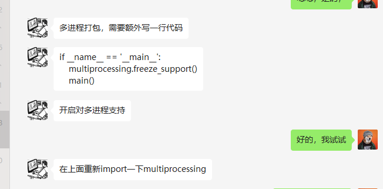

出现问题的首要解决方法是手动复制全包（包括找不到dll之类的问题）

其次是升级到最新包然后再复制

其次是--exclude-module EXCLUDES后复制全包

再不行就把egg-info这些也复制进去

再不然就是分析源代码

还有一些用了相对路径的那些，只能从原代码最初的位置运行一次看看要注意 cmd窗口的路径关系就是它的路径要和生成的exe所在的路径是一样的才行，不然的话会有问题

有不少是因为安装了多个版本的Python之后出现的问题，所以把无关的那个的路径重命名排除干扰。

有时候安装包不成功可以把旧有的全部删了，然后再安装

pip install -U pyinstaller

pyinstaller RARFileProcessing.py --add-data="./WinRAR;./WinRAR/" -y

pyinstaller main.py -w  -F --collect-all PIL --icon=./AutoFirPro.ico

ImportError: ERROR: recursion is detected during loading of "cv2" binary extensions. Check OpenCV installation.

对策：pip install opencv-python==4.5.5.64

我百度的原因是pyinstaller 少打包了kernel32.dll 和 nvrtc64_102_0.dll ，那么我们只要找到这两个dll，复制到XXX文件夹下面即可。

我在Windows/system32文件夹下找到了kernel32.dll，环境bin文件夹里找到了nvrtc64_112_0.dll，复制过去就行了。

mayavi、pyface、Traitsui---遇到traitsui.toolkits找不到的情况就手动补包或用--collect-data traitsui --collect-submodules traitsui ，或者按下面的方式hook pyface，或者hook traitsui.toolkits .py

https://github.com/enthought/traitsui/issues/458#issuecomment-817260112

---

pip config set global.index-url https://mirrors.cloud.tencent.com/pypi/simple

pip install --upgrade pyinstaller Nuitka pyqt5

python -m nuitka --standalone --mingw64 --remove-output --show-progress 

pyinstaller runDjango.py

pyinstaller test.py  --exclude-module pandas  --exclude-module numpy --exclude-module  matplotlib

pyinstaller WeiPinHui.py  --windowed       --icon=logo.ico  --onefile 

pyinstaller  --icon=1.ico --hidden-import=matplotlib testmain.py  --windowed --onefile

pyinstaller  --icon=1.ico --onefile  --hidden-import=matplotlib  --add-data="C:\Users\i\AppData\Local\Programs\Python\Python38\Lib\site-packages\matplotlib\mpl-data\matplotlibrc;." testmain.py

pyinstaller --onefile --add-data="D:\ProgramData\Anaconda3\Library\bin\mkl_intel_thread.1.dll;." --add-data="D:\Documents\PycharmProjects\riskinfor\services\riskinfordb.db;./uituiti" login.py

hook-matplotlib.py==================="import matplotlib; print(matplotlib.get_data_path())"

https://pyinstaller.readthedocs.io/en/stable/usage.html

cxfreeze -c .py --base-name=WIN32GUI

python -m nuitka LYYDownloader.py --standalone --mingw64 --remove-output --show-progress --plugin-enable=pyqt5

--include-module=sqlalchemy.sql.default_comparator

  --include-package=VideoParser   --include-package=quickjs --nofollow-import-to=ykdl --windows-icon-from-ico=icon256.ico --windows-disable-console

tqdm相关问题：

--hidden-import=pytorch --collect-data torch --copy-metadata torch --copy-metadata tqdm --copy-metadata regex --copy-metadata sacremoses --copy-metadata requests --copy-metadata packaging --copy-metadata filelock --copy-metadata numpy --copy-metadata tokenizers --copy-metadata importlib_metadata --hidden-import="sklearn.utils._cython_blas" --hidden-import="sklearn.neighbors.typedefs" --hidden-import="sklearn.neighbors.quad_tree" --hidden-import="sklearn.tree" --hidden-import="sklearn.tree._utils"

multiprocessing打包的问题

multiprocessing.freeze_support0

按照自己的方式恣意生长，创造独特的美丽

舍身的反弹

打包的问题要看一下打包成功之后是否有依赖文件没有转进去

有不少是因为安装了多个版本的Python之后出现的问题，所以把无关的那个的路径重命名排除干扰。anaconda也带pyqt5，所以他的那个部分也要删掉

有些不相关的包造成打包失误，可以把那些东西删除