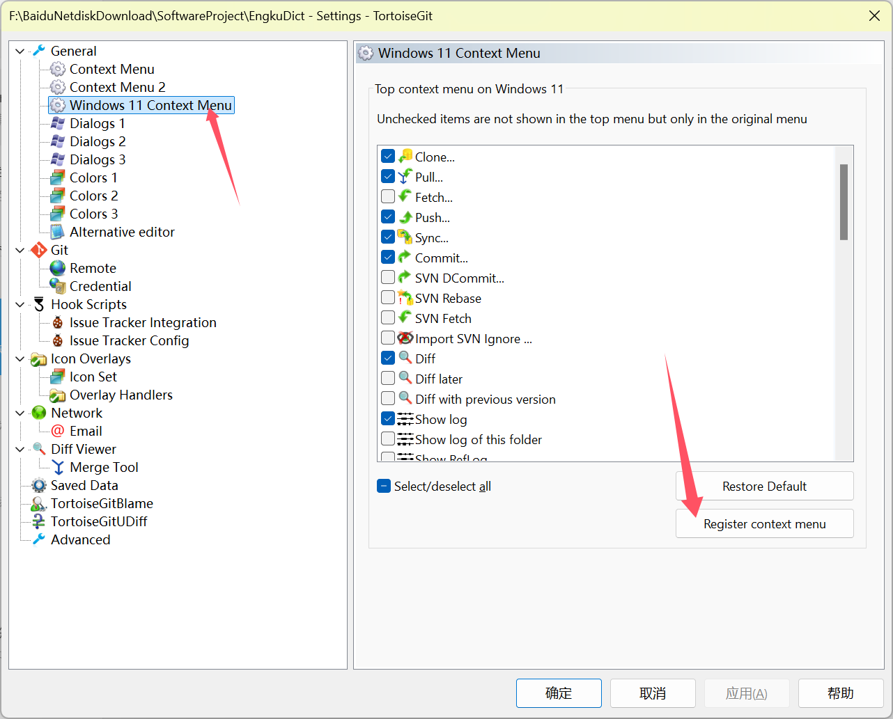

pip config set global.index-url https://mirrors.cloud.tencent.com/pypi/simple

pip config set global.index-url https://pypi.python.org/simple/


uv pip install --upgrade  pyqt6 PyQt6-WebEngine  pyside6 openpyxl django pyinstaller pywin32 selenium apscheduler m3u8 requests  pyperclip BeautifulSoup4 Pillow  ordered-set nuitka cryptography openai thonny eric-ide spylls edge-tts azure-cognitiveservices-speech peewee  google-genai  pydub  azure-identity pywinauto uiautomation qasync nodriver --system


uv cache clean


https://github.com/simonflueckiger/tesserocr-windows_build/releases


pip install 

pip install --upgrade  https://github.com/boppreh/keyboard/archive/master.zip https://github.com/boppreh/mouse/archive/master.zip


celery需要

https://www.erlang.org/downloads

https://www.rabbitmq.com/docs/download#downloads-on-github


安装

https://tortoisegit.org/download/

运行

F:\BaiduNetdiskDownload\SoftwareProject\tortoisegit-iconOverlayFixer修复.py

然后设置下面，然后重启电脑




git config --global http.proxy http://127.0.0.1:10808


git config --global https.proxy http://127.0.0.1:10808


pyqt6 dll 问题的方法

```css
pip3 install PyQt6 PyQt6-WebEngine --user --ignore-installed
```


不用U盘使用微PE工具箱，安装最纯净win10、win11没有任何捆绑【用ISO里的工具在pe模式下安装】

https://haokan.baidu.com/v?pd=wisenatural&vid=14035587365322932968&source=1030865f-0-1029429w


罗技g300s鼠标设置

Logitech Gaming Software

https://support.logi.com/hc/en-in/articles/360025298053-Logitech-Gaming-Software


休眠按钮

https://www.bilibili.com/video/BV12T411j7Wd/?spm_id_from=333.337.search-card.all.click&vd_source=825815005ceb8b5e3e6f7b489e027957


win11拖拽开启

https://www.isumsoft.com/windows-tips/how-to-enable-drag-and-drop-in-windows-11-taskbar.html#Method3


去除密码登录

https://zhuanlan.zhihu.com/p/458134548


去掉图标小箭头

https://jingyan.baidu.com/article/cbcede070175a902f40b4df7.html


驱动精灵万能网卡


显示我的电脑

桌面-------右键--------“个性化”------------左侧的“主题”----勾选“计算机”，

搜狗拼音输入法

https://pinyin.sogou.com/windows/?r=mac&t=pinyin

https://potplayer.daum.net/


Everything

https://www.voidtools.com/zh-cn/


Free Download Manager

https://www.freedownloadmanager.org/zh/download.htm


2345看图

http://pic.2345.com/


https://tim.qq.com/download.html

w微信

谷歌ocr https://github.com/UB-Mannheim/tesseract/wiki


aquile reader

pdf编辑器用Edge就可以了

 

ffmpeg

https://ffmpeg.zeranoe.com/builds/


360


Listary


PDF xChange Viewer                    （Accessibility 设置颜色、右下角设置页面连续性）


Inno Setup

https://jrsoftware.org/isdl.php#stable

https://github.com/KngStr/Inno-All-in-One-Setup/blob/master/Res/Languages/ChineseSimp.isl

https://mobaxterm.mobatek.net/preview.html


HM NIS Edit

https://sourceforge.net/projects/hmne/


sublime text

https://www.sublimetext.com/

配置 https://zhuanlan.zhihu.com/p/129086836

https://stackoverflow.com/questions/33449969/sublime-text-run-code-in-a-new-file-without-saving-to-disk-and-the-default-lang/55436658#55436658


adsafe

http://www.ad-safe.com/

oCam

autohotkey


SumatraPDF

https://www.sumatrapdfreader.org/download-free-pdf-viewer.html

ZoomIncrement = 3

羊皮纸背景色#E9DDC1

豆绿#C7EDCC ​​​​

ExternalViewers [

[

CommandLine = "C:\Program Files\Tracker Software\PDF Editor\PDFXEdit.exe" /A page=%p "%1"

Name = PDFXEdit

Filter = *.pdf

]

]


Word设置自动保存为5分钟

 

 改造版软件

http://bbs.wmzhe.com/forum.php?mod=forumdisplay&fid=4

http://www.flighty.cn/index.html

 

 看电脑时保护眼睛的好方法

（204，232， 207）

202,234,206

win10

https://www.kafan.cn/A/jv4155zpvr.html

禁用系统视觉动画效果

http://www.xitongzhijia.net/xtjc/20150303/39688.html


专业软件

https://docs.conda.io/en/latest/miniconda.html   python  

https://anaconda.org/conda-forge/tesserocr   

环境变量

C:\Users\Oscar\AppData\Local\Continuum\miniconda3

C:\Users\Oscar\AppData\Local\Continuum\miniconda3\Scripts

pip ssl问题https://github.com/conda/conda/issues/8273


https://jrsoftware.org/isdl.php#stable


VS code https://stackoverflow.com/questions/56776521/python-in-vscode-set-working-directory-to-python-files-path-everytime/62331298#62331298


django pyautogui pynput 

cyhunspell ：Microsoft Visual C++ Build Tools https://go.microsoft.com/fwlink/?LinkId=691126   ------------select only the “Windows 10 SDK” (assuming the computer is Windows 10)


https://www.python.org/downloads/windows/

https://www.python.org/downloads/release/python-3810/


cx_Freeze

http://www.lfd.uci.edu/~gohlke/pythonlibs/


pip install eric-ide

pycharm

pywin32

https://github.com/mhammond/pywin32/releases

QtConsole

jupyter qtconsole --generate-config

then add

c.JupyterConsoleApp.confirm_exit = False to C:\Users\i\.jupyter\jupyter_qtconsole_config.py


mingw

64位 下载https://nuwen.net/mingw.html    https://www.zhihu.com/question/26201557

32位 http://www.3h3.com/soft/124834.html

环境变量  设置https://github.com/Nuitka/Nuitka#install-the-c-compiler