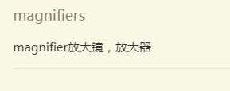
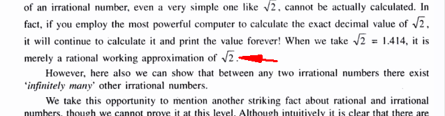
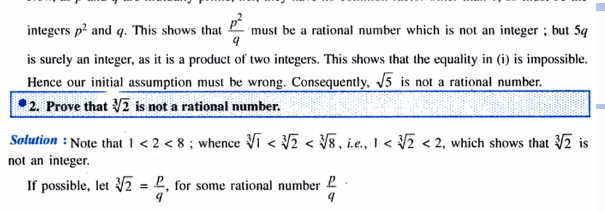
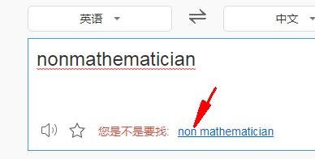
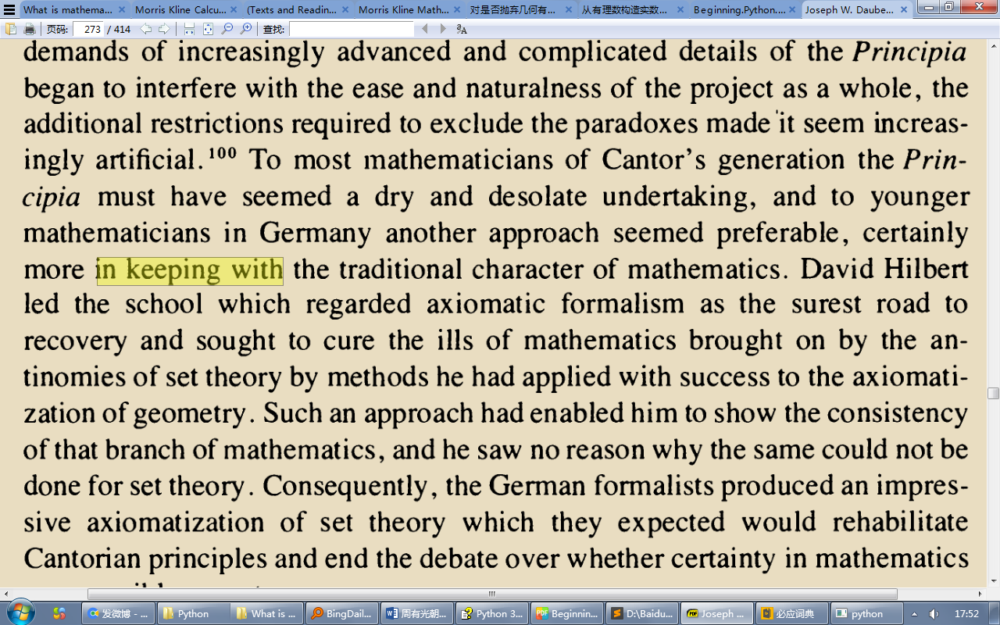
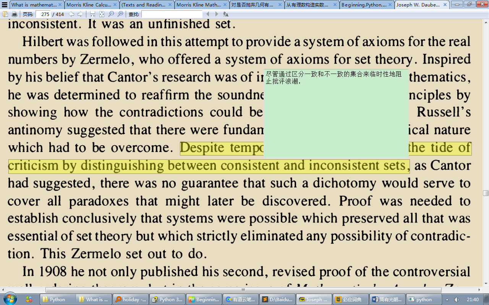
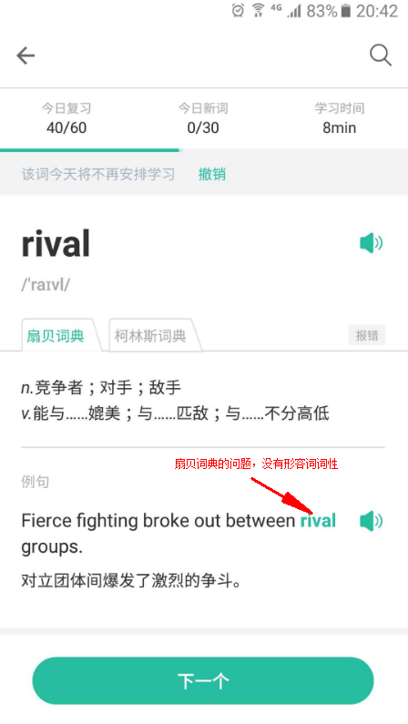

寻找chrome的方式换成根据启动命令寻找 ，判断是不是有remote-debugging-port

前提是把默认浏览器设置为谷歌防止测试崩溃

单词记录方面   添加备注（比如来自我看书的纳瓦尔宝典）

OCR识别那里要去掉标点符号，比如The noun form of "appropriate" is "appropriateness." →  "appropriateness."

升级pyqt6的时候：

- 注释掉dpi、

- 主文件和webview文件里的.view()替换

- createStandardContextMenu

- mini window 里的setSource

搜索northern的时候会出现问题

测试的时候开启webview文件里的file.write(dictsResult)

下载的，查询book的时候有问题，test就正常，问题应该出在insertAdjacentHTML相关的代码

功能描述：鼠标手势、查找

鼠标手势1向下翻页

谷歌搜索功能

VIP才去广告，想想X浏览器纠纷

以Android的UA去访问百度词典之外的网页，为的是去广告（也为了防止去广告犯法）

文档更新：

left ctrl','left windows'): [self.lookupSelectedText,

单独文章宣传  pdf文字复制不带转行空格

英酷词典查must的柯林斯词典情况

headphones柯林斯词典图片出不来

点击原词header进行排序

加入生词本的是不是应该是矫正过来的单词（dictKeyText）

换了默认词典后就出问题

鼠标移到面板上面也要显示原单词

简明词典  词库里没有Arctic

断网情况下的翻译提示

中建粘贴的时候应当判断一下是否是中英文

复制翻译后有文字选区，鼠标点击实现deseleect ----点击去选取的方法容易让选中后右键copy或网页标注工具悬浮按钮够不到

why英酷词典（给我个使用的理由）

简明英汉词典 需要提示只有联网才能发言

mouseHoverOnTabBar停留几毫秒再显示

详细释义的时候可选隐藏简明词典

右下角词典列表悬浮

生词本 header 名称  顺序

右键lemma的时候取消处处译

断网情况下的处理

虽然广告没有了，但是还要隐藏广告展示区域 

最快的发音方式

- subprocess.call(['ffmpeg-shared/ffplay', "-nodisp", "-autoexit", "-hide_banner", audioPath])

- QProcess.execute

- subprocess.Popen

想办法让例句或意思导入更方便  CheckBox 在最前的方法

tooltip show immediately

sumatra的边缘问题、万一里面的是图片英文PDF

没启动anki时导入的提示

剑桥词典里取词后不会加入生词本

把checkbox变成圆的

maven faucet 美、美口   转语音 美语、美国口语

pitch动词释义看词典质量

lemma右键时自动去除查词

单词错误的时候，你是不是要找___？

启动软件的情况下，允许外部接口调用：socket发送单词过来就行了

你可能一时不想看那么多的使用说明，OK，您可以先去直接体验软件，但是过一段时间你要是仍然在使用本软件，那么我强烈建议你回来看看这些使用说明，大有裨益！

seize的音标获取是什么情况 【莫名其妙】  词典里没有saw这个词？   词典按照中文意思比对，决定重新制作词典

fenced 的音标问题，现在的db里没有，但是百度翻译已经有了

释义or例句有一个就行了   按照这个规则过滤

选中行的时候切换到百度翻译添加单词的释义例句功能

加进一个词之后就select那一行

句子不要加入生词本

说明编辑anki的时候要说明 [sound:mentorship.mp3] 是什么东西

输入框需要strip

从百度翻译（甚至是每一个翻译引擎）输入新词的时候应该把word设置为新词

找到的是word会加入生词本

剪切板变化的时间-点击的时间《某个值的时候取消ocr   为了防止点击mennu复制的时候结果马上又取到context menu上面的字体的情况

词性占比  groove  谷歌翻译或者是对应的mdx

百度语音合成tts token一月一换

Traceback (most recent call last):

  File "D:\BaiduYunDownload\编程\Python\django-test\EngkuDict\MainWindow.py", line 271, in clipboardTextChanged

    self.translate(self.selectedText)

  File "D:\BaiduYunDownload\编程\Python\django-test\EngkuDict\MainWindow.py", line 309, in translate

    transResultDict = Utils.ecdict(englishText) or Utils.baiduTranslate(englishText)  # googleTranslate(englishText)#

  File "D:\BaiduYunDownload\编程\Python\django-test\EngkuDict\Utils.py", line 146, in baiduTranslate

    return {'englishText':queryText , 'chineseMeaning': repliedJson["trans_result"][0]["dst"]}

KeyError: 'trans_result'

处理MDict的一系列协议 entry  @@@LINK=fence

create word card的时候，已经加入的单词要不要重新改变加入的状态变为False

---

放在记事本里面ocr的时候mute出不来

- hoarse

- dumb

- husky

- mute

- dumbness

---

提醒用户点击不出现的时候，换个位置——word的正中央

timer 控制  available area预加载

取屏幕1/3  2/3位置处的小图片，timer检测是否不同，若不同，则 available area预加载

有时候取例句的时候用户右键复制而不是Ctrl+C  处理一下

百度语音token要定期更换(30 days)，所以数据接口应该包含这一项

有行被选中的时候，释义或例句应该添加到这一行

【有必要】可不可以加入释义或例句后再次让剪切板的内容变成newWord

加版权声明

隐藏字典文件   --》隐藏文件

欧路词典右键粘贴  

通过priori解释英英释义的重要性，推荐用户看英英释义的，还有通过英英释义才能知道ponder的正确用法

Collins词典的音标貌似是我需要的

网页文本框无法取词

's那个地方会出现  'latin-1' codec can't encode character '\u2019' in position 7: ordinal not in range(256)

ocr取词的时候不用mouse pos改用cart也许会更好，图片cart不准确则使用pos

cursor hover pushbutton时发音

获取发音https://dictionary.cambridge.org/zhs/词典/英语/contiguous?q=contiguity

https://dictionary.cambridge.org/zhs/词典/英语/tradeoff

http://127.0.0.1:8000/admin/NewWords/newwordcard/?p=2

插件shift单词的时候会有------------，所以不能用空格界定，用A-Z‘ 单词构成元素来界定

特殊情况 网页里的图片文字

sumatrapdf里的epub情况

百度和谷歌翻译掉线提示

百度翻译APPID之类的可能会定期过期----》使用翻译小窗口或百度搜索英文句子搜索页面的选中句子的api

>>> import urllib.parse

>>> urllib.parse.unquote('ed2k://%7Cfile%7C%5B%E8%BF%AA%E5%A3%AB%E5%B0%BC%E7%A5%9E%E5%A5%87%E8%8B%B1%E8%AF%AD%5D.VolumeLabel5-6.bin%7C571484256%7Cea6812184e1c36d844790b6f1a2c0387%7Ch=2z3btljpyrig22y4s7cmu3fzgxft7yth%7C/')

柯林斯双解比较简洁

谷歌翻译还没出来的时候再次点击的困扰，datachanged里获取吧

选词后Ctrl+C没反应

number theorists   如果只有翻译的话还是双管齐下吧

kasi  Oswald Teichmüller

如果鼠标位置变,是否显示   这是个问题

temporary measures 百度金山齐发或合并到爱词霸搜索以加快速度

iciba翻译的teaching posts没有百度的准确，iciba结果不够友好——中英文混在一起

OCR 会是between

consequntly的问题

插件里需要更改单词匹配模式，否则会得到这种   E‘ziis%”m@

直接在table上面编辑例句的时候，如果句子有转行现在依然不会处理

测试翻译质量

private correspondence

teaching posts

复制图片的时候

_/

快速连续复制

Windows cancel text selection

滚轮就关闭

句子例子：

C:\Program Files\kingsoft\PowerWordDict

C:/Program Files/kingsoft/PowerWordDict

http://mathcs.holycross.edu/~groberts/Talks/HCAlum08Web.pdf

连字符处理

and "ra-

tional point" interchangeably.

转行符、

Hence the integrals of these two functions can differ at most by a constant. Let us then integrate

each side separately and equate the results.

谷歌翻译不了就影响后面的翻译显示吗？

textundercursor

http://fanyi.baidu.com/#en/zh/nonmathematician

 

百度影音合成 bizarre及其中文释义  bizarre的发音很奇怪  undertake apathy  apt

https://www.google.com/search?q=Selection+the+current+position+of+the+caret&oq=Selection++the+current+position+of+the+caret&aqs=chrome..69i57.11034j0j1&sourceid=chrome&ie=UTF-8

https://stackoverflow.com/questions/15600686/get-current-word-on-caret-position

词典

庞大+或许正规的，释义体验比较好http://open.iciba.com/huaci_new/dict.php?word=hilbert

还不错的牛津中文简明词典 https://en.bab.la/dictionary/english-chinese/composed

或许更准确，释义体验不太好https://cn.bing.com/dict/search?q=finitistic&qs=n&form=Z9LH5&sp=-1&pq=finitistic&sc=0-0&sk=&cvid=8AF66DE225B2433FB8BC79CED4A8FDFE

有道的网络释义还行，释义体验略差http://dict.youdao.com/w/eng/CTO/#keyfrom=dict2.index

比较好全英文词典https://www.oxfordlearnersdictionaries.com/definition/english/compose?q=compose

次之https://dictionary.cambridge.org/zhs/词典/英语-汉语-简体/compose

https://dictionary.cambridge.org/dictionary/english-chinese-simplified/compose

https://www.ldoceonline.com/dictionary/compose

翻译   

包含这两句的测试结果 

my email address redstone-cold@163.com、

It is very much worth noting that

,仅次于谷歌http://fanyi.baidu.com/#en/zh/finitistic  页面内置推荐使用；

可能根据这个消息决定是否ocr取词吧，不过考虑到有道笔记之类的情况可能还是先非ocr再ocr的结合吧

WM_SETCURSOR

https://msdn.microsoft.com/en-us/library/windows/desktop/ms648382(v=vs.85).aspx

cursor shape change event

演示

文件: C:\Users\i\Downloads\Joseph W. Dauben-Georg Cantor_ His Mathematics and Philosophy of the Infinite-Princeton University Press (1990).djvu

百度翻译要研究 for sign

http://fanyi.bdstatic.com/static/translation/pkg/index_a6525c5.js

也可以避过，翻译页面的取词面板和英文搜索页面的划译

网页取词

插件http://link.zhihu.com/?target=https%3A//ninja33.github.io/20160817/anki-dict-helper-chrome-extension/

教材 包含制卡方法https://zhuanlan.zhihu.com/p/22472893?refer=-anki

百度Access_token获取

https://aip.baidubce.com/oauth/2.0/token?grant_type=client_credentials&client_id=0Ufx1KHOV7iVQhfeqoaCvGv9&client_secret=qPFR043eDQFxpMDqBmrNuDCHVGtHyL0Y

有人说QStarDict可以实现屏幕取词，但我在LInux上面装不来这东西所以没试过，您可以试试看。

http://qstardict.ylsoftware.com/index.php

http://www.softwareace.cn/?p=272

 

这家伙写了个屏幕取词的专栏，您也可以看看

http://www.softwareace.cn/?cat=64

 

---

TTS单词的中文意思

http://ai.baidu.com/docs#/TTS-API/top

词典推荐

现代英汉汉英综合大辞典

https://freemdict.com/2018/06/04/现代英汉汉英综合大辞典/

柯林斯

---

@iMath plus举例

第一本  牛津高阶英汉 OALD7

释义比较多 例句丰富 5页

第二本

柯林斯英语学习词典 柯林斯高级英语学习词典|CC-CEDICT

英语例子丰富 3页

第三本

21世纪大英汉词典 21世纪大英汉词典.ifo

例句无 扩展意思简单解释多 有变形 3页

第四本

韦氏大学词典 MWCD11

英语解释多 同义词反义词等超丰富 7页

第五本

朗道英汉汉英 langdao

解释少 半页

第六本

法汉词典 fccf

暂时用不上 不过短语多 有近义词 3页

第七本

牛津现代英汉 oxford-gb

短语短句子丰富 1页

我多看上的词典对比 柯林斯是嘤嘤嘤（突然卖萌）

 The little dict可以查到counselors

文件说明https://www.pdawiki.com/forum/thread-30146-1-1.html

发音文件 https://downloads.freemdict.com/100G_Super_Big_Collection/%E8%AF%8D%E9%A2%91/%5B9.16%5D%E5%A4%9A%E5%8A%9F%E8%83%BD%E7%99%BE%E5%AE%9D%E7%AE%B1%E8%AF%8D%E5%85%B8%20-%20The%20little%20dict/

貌似是简化版https://pan.baidu.com/s/1uV6OISjrPJy2QREWfnFE2A#list/path=%2Fsharelink3479706693-184159810184762%2FThe%20little%20dict%20simple&parentPath=%2Fsharelink3479706693-184159810184762

---

 1.Longman Dictionary of Contemporary English

2.Oxford Advanced Learner's Dictionary

3.Macmillan English Dictionary for Advanced Learners

4.Collins Cobuild Advanced Learner's English Dictionary

5.Cambridge Advanced Learner’s Dictionary

6.Merriam-Webster's Advanced Learner's English Dictionary

朗文

牛津

剑桥

柯林斯

麦克米伦

韦伯斯特

词典来来去去都是那几本，很多人喜欢用朗文、牛津、柯林斯，

就看个人对释义，例句，词频统计，布局…的偏好，

TessResultIteratorWordIsFromDictionary

Linux改动

miniw里   Qt.X11BypassWindowManagerHint)

OCR里 grab import

main里去掉win32 import和click slot里的处理

