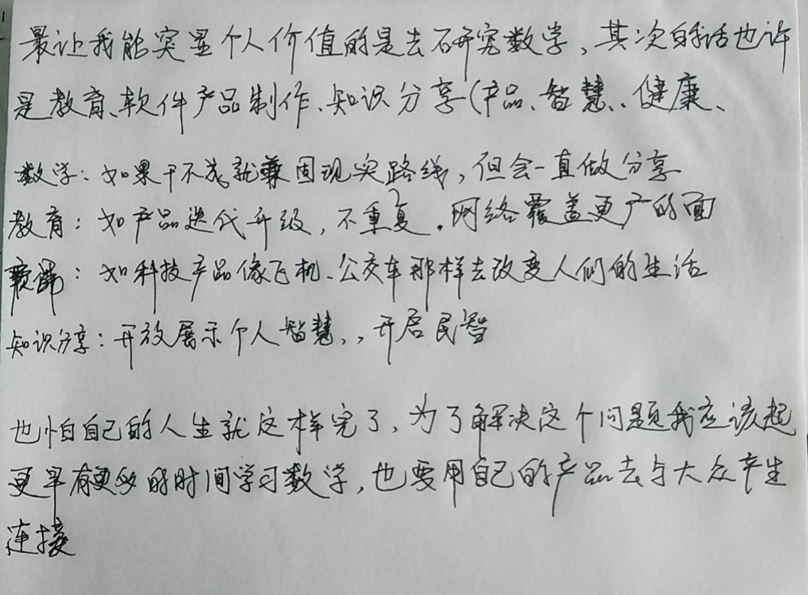

最让我能突显个人价值的是去研究数学,其次的话也许是教育、软件产品制作、知识分享(产品、智慧、健康、

数学:如果干不成就兼固现实路线,但会一直做分享
教育:如产品迭代升级,不重复.网络覆盖更广的面
软件:如科技产品像飞机、公交车那样去改变人们的生活
知识分享:开放展示个人智慧,开启民智

也怕自己的人生就这样完了,为了解决这个问题我应该起更早有更多的时间学习数学,也要用自己的产品去与大众产生连接 

我想成为一名老师（人类灵魂的工程师），企业家，数学家，教育家。
首先我可以借助网络来施展自己的能力，

线下的话也很有影响力，这个后面看情况了。网络上的话覆盖面广。